<p align="center"><picture><source media="(prefers-color-scheme: dark)" srcset="frontend/public/brand/faultline-mark-light.svg"></picture></p>

<h1 align="center">Faultline: no path, no claim</h1>

<p align="center"><b>An on-call agent that won't blame a change until FalkorDB returns the causal path, and won't keep a suspect the graph shows cannot carry the impact.</b><br>The model suggests; a read-only query decides.</p>

<p align="center">
<a href="https://github.com/Prashant-thakur77/Faultline/actions/workflows/ci.yml"></a>
<a href="https://13-203-185-119.sslip.io"></a>
<a href="docs/FALKORDB_COMPAT.md"></a>
<a href="#reproduce-it"></a>
<a href="docs/MCP.md"></a>
<a href="https://www.npmjs.com/package/@prashantthakur77/faultline-mcp"></a>
<a href="LICENSE"></a>
<br>
 <!-- noclaim: version -->


</p>


<p align="center"><b><a href="https://13-203-185-119.sslip.io">Live demo</a> · <a href="https://github.com/Prashant-thakur77/Faultline/releases/latest/download/faultline-demo.mp4">Watch the video (4:25)</a> · <a href="docs/MCP.md#try-the-hosted-server-now-public-demo-key">Hosted MCP</a> · <a href="docs/PROOF.md">Every number, with intervals</a> · <a href="https://prashant-thakur77.github.io/Faultline/">Replay (no backend)</a> · <a href="https://github.com/Prashant-thakur77/Faultline/releases/tag/v1.3.1">Release v1.3.1</a></b></p>

## At a glance

| | |
|---|---|
| **What it is** | An on-call agent whose memory and reasoning live in a per-tenant **FalkorDB** operational context graph: services, deploys, flags, warehouse lineage, telemetry windows, people, decisions, runbooks and every step it takes. |
| **The rule** | **No path, no claim.** A change is blamed only when `algo.SPpaths` returns a causal path from it to the symptom and `algo.maxFlow` shows it can carry the observed impact. Otherwise the agent abstains and hands the incident to a human. |
| **What it does** | Blast radius (`algo.BFS`) → causal proof (`algo.SPpaths`, `algo.maxFlow`) → smallest containment (the max-flow min-cut, each option tried on its own `GRAPH.COPY`) → who should fix it (`algo.HarmonicCentrality`, escalation by `algo.MSF`) → pages the on-call → one human-approved action (a real pull request) → verifies it through a second channel (APPLIED, NOT_APPLIED or UNKNOWN) → writes the decision back. |
| **Same graph, more jobs** | A pre-deploy gate that blocks risky PRs; a company brain ("who owns, knows and decided what", with cited node ids); standing approvals for repeat faults; learning from the people who use it; read-only MCP tools any agent can call. |
| **FalkorDB depth** | The only database. <!-- claim:repo.algorithms -->10<!-- /claim --> `algo.*` procedures, each changing a decision; <!-- claim:repo.templates -->236<!-- /claim --> parameterised Cypher templates; one graph and one read-only ACL user per tenant; `GRAPH.COPY` clean rooms and what-if branches; vectors and full-text; FLEX and our own UDF library ranking inside the engine; <!-- claim:repo.constraints -->18<!-- /claim --> constraints; `WAITAOF` durability; the engine's own telemetry on a `/engine` page. |
| **Proven** | <!-- claim:seedsall.deep.wrong_confident -->0<!-- /claim --> confident wrong blames in <!-- claim:seedsall.deep.cases -->1540<!-- /claim --> adversarial worlds (a telemetry heuristic: <!-- claim:seedsall.deep.T.wrong_any -->620<!-- /claim -->; a strong LLM alone: <!-- claim:llm_deep.deep.all.wrong_confident -->37<!-- /claim --> of <!-- claim:deep.fresh.all.cases -->140<!-- /claim -->); on the real OpenTelemetry Demo, <!-- claim:otel.faultline.wrong.k -->0<!-- /claim --> wrong blames in <!-- claim:otel.faultline.wrong.n -->40<!-- /claim --> windows; without `algo.maxFlow` the right cause drops from <!-- claim:decisive.full.g5_only.right_cause -->20<!-- /claim -->/<!-- claim:decisive.full.g5_only.cases -->20<!-- /claim --> to <!-- claim:decisive.no_maxflow.g5_only.right_cause -->0<!-- /claim -->. The cost is recall, stated next to every number ([Proof at a glance](#proof-at-a-glance)). |
| **Understand it in five minutes** | the [3D explainer](https://13-203-185-119.sslip.io/explainer) (nine scenes, each one FalkorDB call from the hero incident), [how one incident flows](#how-one-incident-flows), [the evidence gate](#the-evidence-gate) with its load-bearing query `Q-GATE-1`, the [architecture](#architecture) and the [query catalogue](#query-catalogue). |
| **Run it** | Live: [13-203-185-119.sslip.io](https://13-203-185-119.sslip.io) (keyless; to reset the demo data, open the menu next to "FalkorDB ready" and choose "Reset demo data"). Your agent: `npx -y @prashantthakur77/faultline-mcp` (any MCP client). Your machine, Docker only: `docker compose -f quickstart.yml up` ([Use it](#use-it)). Every number: `make setup && make judge-check` prints PASS with no API key. |
| **Stack** | FalkorDB 6.0.2 (pinned by digest) · Python 3.11 and FastAPI · Next.js 16, React Three Fiber · MCP over stdio and HTTP · Docker Compose on one AWS EC2 VM with Caddy. <!-- noclaim: versions --> |
| **Built for** | Graph Hacks (WeMakeDevs × FalkorDB). Tracks: T1 Agents That Act on Connected Data ([how one incident flows](#how-one-incident-flows)) · T3 Company Brain ([memory and brain](#memory-company-brain-preflight-coordination)) · T2 Agent Memory & Coordination ([learning from the people who use it](#learns-from-the-people-who-use-it-t2)). |

**[Video](https://github.com/Prashant-thakur77/Faultline/releases/latest/download/faultline-demo.mp4) (4:25, narrated, captioned)** chapters: 0:15 thesis · 0:30 how FalkorDB decides, in 3D · 1:39 the live incident · 2:05 a real PR, APPLIED · 2:36 on call · 3:18 company brain · 3:23 what it learned · 3:32 inside FalkorDB · 3:38 break it · 3:44 the numbers. Every number in it is read from the results file at record time; script: [docs/DEMO_SCRIPT.md](docs/DEMO_SCRIPT.md). <!-- noclaim: chapter times -->

---

## Use it

| You want to | Do this |
|---|---|
| Give your own agent Faultline's graph tools (Claude Code, Claude Desktop, Cursor, any MCP client) | `npx -y @prashantthakur77/faultline-mcp` ([npm](https://www.npmjs.com/package/@prashantthakur77/faultline-mcp)); with Claude Code: `claude mcp add faultline -- npx -y @prashantthakur77/faultline-mcp`. It connects to the live demo's read-only tools; `--url` and `--key` point it at your own server. |
| Run the whole product on your machine, Docker only | `curl -fsSLO https://raw.githubusercontent.com/Prashant-thakur77/Faultline/main/deploy/quickstart.yml && docker compose -f quickstart.yml up`, then open http://localhost:3000 (API on :8400, MCP on :8401). FalkorDB, the demo graphs, the API, the MCP endpoint and the UI; no API key. Point your agent at it with `npx -y @prashantthakur77/faultline-mcp --url http://localhost:8401/mcp --key quickstart-local-key-change-me` (the local key set in `quickstart.yml`). The images are built for x86-64; on Apple Silicon Docker runs them emulated. |
| Reproduce every number in this README | `git clone --depth 1 https://github.com/Prashant-thakur77/Faultline && cd Faultline && make setup && make judge-check` (prints PASS, no API key); see [Reproduce it](#reproduce-it). |
| Just look | the [live demo](https://13-203-185-119.sslip.io) ("Reset demo data" in the menu next to "FalkorDB ready" restores it), the [video](https://github.com/Prashant-thakur77/Faultline/releases/latest), or the [replay](https://prashant-thakur77.github.io/Faultline/) with no backend. |

## In short

Faultline answers four questions during an incident. Each answer comes out of a FalkorDB query, and the agent cannot skip one.

| Question | How it is decided |
|---|---|
| What breaks? | `algo.BFS` blast radius over failure-flow edges |
| Why? | `algo.SPpaths` must return a causal path from the change to the symptom, and `algo.maxFlow` must show the change can carry the observed impact |
| What is the smallest containment? | max-flow → min-cut on the failure graph, each candidate tried on its own `GRAPH.COPY` branch with a predicted outcome before anyone approves |
| Who should fix it? | `algo.HarmonicCentrality` over who touched the code, who resolved it before and who is on call; `algo.MSF` for escalation |

It then takes one human-approved action, verifies it through a second channel (APPLIED, NOT_APPLIED or UNKNOWN), and writes the decision back into the same graph, so the next incident starts warm. The same graph blocks risky PRs before they ship (preflight) and answers "who owns, knows and decided what" with cited node ids (company brain).

**Faultline trades recall for safety.** It will not blame a change until FalkorDB proves a causal path and enough capacity, so where a heuristic guesses, it abstains and hands the incident to a human. Measured on the deep bench: <!-- claim:deep.fresh.all.cases -->140<!-- /claim --> generated worlds built to trap it (causes 1–4 hops upstream, look-alike deploys on the path and on the alerting service, five adversarial kinds), against two telemetry heuristics and a strong LLM given the same evidence. Square brackets hold 95 % intervals; `make claims` checks every number against [`evals/results/latest.json`](evals/results/latest.json):

| Same <!-- claim:deep.fresh.all.cases -->140<!-- /claim --> worlds | Right cause (of <!-- claim:deep.fresh.all.cause_cases -->100<!-- /claim --> worlds that have one) | Confident wrong blames | Abstained (handed to a human) |
|---|---|---|---|
| **Faultline** | **<!-- claim:deep.fresh.all.right_cause -->51<!-- /claim -->** [<!-- claim:deep.fresh.all.right_cause.ci_lo -->41%<!-- /claim -->–<!-- claim:deep.fresh.all.right_cause.ci_hi -->61%<!-- /claim -->] | **<!-- claim:deep.fresh.all.wrong_confident -->0<!-- /claim -->** [0–<!-- claim:deep.fresh.all.wrong_confident.ci_hi -->2.7%<!-- /claim -->] | <!-- claim:deep.fresh.all.abstained -->89<!-- /claim --> |
| Telemetry only, with or without a "none" threshold (T, T+: identical here, because every look-alike is itself anomalous) | <!-- claim:deep.fresh.all.T.right_strict -->85<!-- /claim --> | <!-- claim:deep.fresh.all.T.wrong_any -->55<!-- /claim --> | <!-- claim:deep.fresh.all.T.abstained -->0<!-- /claim -->, it cannot |
| A strong LLM alone (`claude-opus-5-5`, the same telemetry and change list) | <!-- claim:llm_deep.deep.all.right_cause -->66<!-- /claim --> [<!-- claim:llm_deep.deep.all.right_cause.ci_lo -->56%<!-- /claim -->–<!-- claim:llm_deep.deep.all.right_cause.ci_hi -->75%<!-- /claim -->] | **<!-- claim:llm_deep.deep.all.wrong_confident -->37<!-- /claim -->** of <!-- claim:deep.fresh.all.cases -->140<!-- /claim --> [<!-- claim:llm_deep.deep.all.wrong_confident.ci_lo -->20%<!-- /claim -->–<!-- claim:llm_deep.deep.all.wrong_confident.ci_hi -->34%<!-- /claim -->] | <!-- claim:llm_deep.deep.all.abstained -->37<!-- /claim --> |

On <!-- claim:seeds.deep.seeds -->3<!-- /claim --> more deep-bench seeds generated for the first time in this audit (<!-- claim:seeds.deep.cases -->420<!-- /claim --> worlds) the trade holds: right cause <!-- claim:seeds.deep.right_cause -->136<!-- /claim --> of <!-- claim:seeds.deep.cause_cases -->300<!-- /claim -->, confident wrong blames <!-- claim:seeds.deep.wrong_confident -->0<!-- /claim --> [0–<!-- claim:seeds.deep.wrong_confident.ci_hi -->0.9%<!-- /claim -->], against <!-- claim:seeds.deep.T.right_strict -->249<!-- /claim --> and <!-- claim:seeds.deep.T.wrong_any -->171<!-- /claim --> for telemetry only. On <!-- claim:seeds2.deep.seeds -->8<!-- /claim --> further pre-registered seeds (<!-- claim:seeds2.deep.cases -->1120<!-- /claim --> worlds) it held again: right cause <!-- claim:seeds2.deep.right_cause -->382<!-- /claim --> of <!-- claim:seeds2.deep.cause_cases -->800<!-- /claim -->, confident wrong blames <!-- claim:seeds2.deep.wrong_confident -->0<!-- /claim --> [0–<!-- claim:seeds2.deep.wrong_confident.ci_hi -->0.3%<!-- /claim -->], against <!-- claim:seeds2.deep.T.right_strict -->671<!-- /claim --> and <!-- claim:seeds2.deep.T.wrong_any -->449<!-- /claim --> for telemetry only.

The full scorecard (each number with its N, a 95 % interval and whether it is measured or true by design; baselines, adversarial and new-seed benches, mutation testing, crash and contention safety, scale, speed and the live deployment) is in **[docs/PROOF.md](docs/PROOF.md)**.


## Proof at a glance

Every result in one table. Each number is tagged and checked against [`evals/results/latest.json`](evals/results/latest.json) by `make claims`; each row links to its method and pre-registration. Intervals and the full scorecard: [docs/PROOF.md](docs/PROOF.md).

| Claim | Faultline | Compared with | Bench |
|---|---|---|---|
| It does not blame an innocent change | <!-- claim:seedsall.deep.wrong_confident -->0<!-- /claim --> confident wrong blames in <!-- claim:seedsall.deep.cases -->1540<!-- /claim --> adversarial worlds on <!-- claim:seedsall.deep.seeds -->11<!-- /claim --> seeds [0–<!-- claim:seedsall.deep.wrong_confident.ci_hi -->0.25%<!-- /claim -->], and <!-- claim:deep.fresh.all.wrong_confident -->0<!-- /claim --> in the <!-- claim:deep.fresh.all.cases -->140<!-- /claim --> headline worlds | telemetry only: <!-- claim:seedsall.deep.T.wrong_any -->620<!-- /claim --> wrong in the same <!-- claim:seedsall.deep.cases -->1540<!-- /claim -->; a strong LLM alone: <!-- claim:llm_deep.deep.all.wrong_confident -->37<!-- /claim --> in the <!-- claim:deep.fresh.all.cases -->140<!-- /claim --> | [deep bench](docs/EVALS.md#the-numbers-audit-2026-10-16-intervals-new-seeds-and-harder-comparisons) |
| The graph decides, not the model | right cause <!-- claim:decisive.full.g5_only.right_cause -->20<!-- /claim -->/<!-- claim:decisive.full.g5_only.cases -->20<!-- /claim --> with `algo.maxFlow`, <!-- claim:decisive.no_maxflow.g5_only.right_cause -->0<!-- /claim -->/20 without it | a strong LLM alone on the same <!-- claim:llm_deep.decisive.g5_only.cases -->20<!-- /claim --> worlds: <!-- claim:llm_deep.decisive.g5_only.right_cause -->14<!-- /claim --> right, <!-- claim:llm_deep.decisive.g5_only.wrong_confident -->3<!-- /claim --> wrong | [decisive bench](docs/EVALS.md#the-numbers-audit-2026-10-16-intervals-new-seeds-and-harder-comparisons) |
| A model driving it stays honest | with `claude-opus-5-5` driving the investigation (it proposes and calls the graph tools; FalkorDB and the gate decide): right cause <!-- claim:llm_product.decisive.all.right_cause -->40<!-- /claim -->/<!-- claim:llm_product.decisive.all.cases -->40<!-- /claim -->, <!-- claim:llm_product.decisive.all.wrong_confident -->0<!-- /claim --> confident wrong blames | the same model alone on the same worlds: <!-- claim:llm_deep.decisive.all.right_cause -->27<!-- /claim --> right, <!-- claim:llm_deep.decisive.all.wrong_confident -->7<!-- /claim --> confident wrong blames | [pre-registered, paid](docs/EVALS.md#the-product-with-claude-driving-pre-registered-2026-10-18) |
| It holds on a real running system | on the OpenTelemetry Demo's real services and telemetry, broken with its own fault flags (topology, decoys and page rule ours), the right cause in <!-- claim:otel.faultline.right_cause.k -->11<!-- /claim -->/<!-- claim:otel.faultline.right_cause.n -->20<!-- /claim --> fault windows and <!-- claim:otel.faultline.wrong.k -->0<!-- /claim --> wrong blames in <!-- claim:otel.faultline.wrong.n -->40<!-- /claim --> windows [0–<!-- claim:otel.faultline.wrong.ci_hi -->8.8%<!-- /claim -->]; the rest abstained (<!-- claim:otel.accepted_nc.bystander -->3<!-- /claim --> naming an innocent "not confident" suspect); no causal path removed <!-- claim:otel.gate.decoys.G2 -->73<!-- /claim --> of <!-- claim:otel.gate.decoys -->120<!-- /claim --> decoys | thresholded telemetry (T+): <!-- claim:otel.Tplus.right_cause.k -->13<!-- /claim --> right, <!-- claim:otel.Tplus.wrong.k -->8<!-- /claim --> wrong; recency: <!-- claim:otel.N.right_cause.k -->17<!-- /claim --> right, <!-- claim:otel.N.wrong.k -->23<!-- /claim --> wrong | [FaultBench-OTel](docs/EVALS.md#faultbench-otel-a-real-system-real-telemetry-pre-registered-2026-10-16) |
| On call, end to end | <!-- claim:oncall.night.steps_passed -->14<!-- /claim -->/<!-- claim:oncall.night.steps -->14<!-- /claim --> steps: page, escalate, acknowledge, approve, verified APPLIED; the same fault again paged <!-- claim:oncall.night.inc2.people_woken -->0<!-- /claim --> people under a standing contract (only <!-- claim:oncall.night.inc2.notices -->5<!-- /claim --> silent information notices); the contract fired in <!-- claim:oncall.night.negatives_fired -->0<!-- /claim --> of <!-- claim:oncall.night.negatives -->5<!-- /claim --> cases outside its terms | the first time, by design: <!-- claim:oncall.night.inc1.people_woken -->5<!-- /claim --> people paged | [on-call night](#on-call-page-acknowledge-escalate-standing-approval) |
| It learns from the people who use it | the fix the on-call keeps choosing ranked first on both scenarios (<!-- claim:learn.choices.scenarios -->S1,S1b<!-- /claim -->; a deterministic check, three identical runs each); gate verdicts unchanged; memory and coordination checklist (track T2) <!-- claim:t2.green -->5<!-- /claim -->/<!-- claim:t2.items -->5<!-- /claim --> | cold: the rollback first on both | [learning night](#learns-from-the-people-who-use-it-t2) |
| The company brain on questions it never saw | <!-- claim:brain_blind.s2.hybrid.correct -->24<!-- /claim -->/<!-- claim:brain_blind.s2.hybrid.questions -->40<!-- /claim --> on a blind set, with no model call (<!-- claim:graphrag.s2.fl.ms_p50 -->18.1<!-- /claim --> ms median) | FalkorDB's GraphRAG-SDK on the same questions and knowledge: <!-- claim:graphrag.s2.sdk.correct -->32<!-- /claim -->/<!-- claim:graphrag.s2.questions -->40<!-- /claim --> (paired p <!-- claim:graphrag.s2.paired.mcnemar_p -->0.12<!-- /claim -->), with a model call per answer (<!-- claim:graphrag.s2.sdk.s_p50 -->3.09<!-- /claim --> s median); keyword routing alone <!-- claim:brain_blind.s2.keyword_router.correct -->19<!-- /claim -->/<!-- claim:brain_blind.s2.keyword_router.questions -->40<!-- /claim --> | [blind set and SDK](docs/EVALS.md#company-brain-and-falkordbs-graphrag-sdk-on-the-same-blind-questions-pre-registered-2026-10-17) |
| The vector index, tuned on the engine | recall@10 <!-- claim:vector.recall_at_10.tuned -->1.0<!-- /claim --> on <!-- claim:vector.queries -->702<!-- /claim --> queries over <!-- claim:vector.sets -->9<!-- /claim --> sets (M 32, efConstruction 400, efRuntime 100) | the defaults: <!-- claim:vector.recall_at_10.default -->0.9767<!-- /claim --> on the hardest set (<!-- claim:vector.history2k_incident.queries -->60<!-- /claim --> queries over <!-- claim:vector.history2k_incident.vectors -->2040<!-- /claim --> vectors); the settings were chosen on these same queries | [vector recall](docs/GRAPH_MODEL.md#indexes-and-constraints) (`evals/vector_recall.py`) |
| It cannot act twice | <!-- claim:contention.responders -->24<!-- /claim --> approvals of one plan at once: <!-- claim:contention.same.accepted -->1<!-- /claim --> accepted, <!-- claim:contention.same.prs -->1<!-- /claim --> PR; killed between execute and verify: exactly once; <!-- claim:mutation.killed -->43<!-- /claim -->/<!-- claim:mutation.mutants -->43<!-- /claim --> safety mutants caught | a retry without the idempotency key merged <!-- claim:chaos.control_merged_prs -->2<!-- /claim --> PRs | [safety](#safety) |
| It gives back to FalkorDB | a fix as a pull request to GraphRAG-SDK ([#345](https://github.com/FalkorDB/GraphRAG-SDK/pull/345)), so the SDK runs on the engine we pin; issues [#3349](https://github.com/FalkorDB/FalkorDB/issues/3349), [#3376](https://github.com/FalkorDB/FalkorDB/issues/3376) and [#3377](https://github.com/FalkorDB/FalkorDB/issues/3377); new evidence on [#3150](https://github.com/FalkorDB/FalkorDB/issues/3150#issuecomment-6201125566) (a server panic) and [#2502](https://github.com/FalkorDB/FalkorDB/issues/2502#issuecomment-6237945777); one finding reported privately | | [docs/upstream](docs/upstream/) |

<table>
<tr>
<td width="420">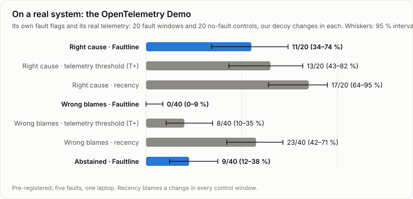</td>
<td width="420"></td>
</tr>
<tr>
<td>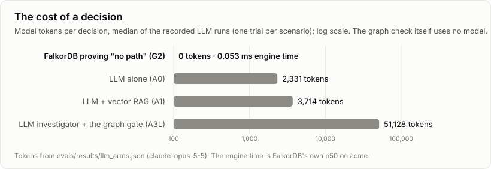</td>
<td>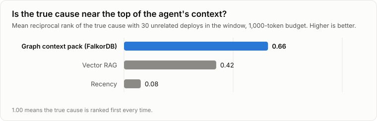</td>
</tr>
<tr>
<td>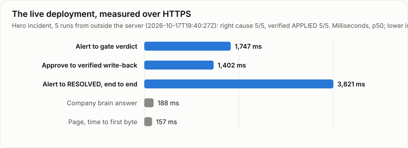</td>
<td></td>
</tr>
</table>

<sub>Every chart is drawn from <code>evals/results/latest.json</code> by <code>scripts/gen_charts.py</code>; the methods are in <a href="docs/EVALS.md">docs/EVALS.md</a>.</sub>

## See it

<table>
<tr>
<td width="420" valign="top"><br><sub><b>Incident room, verdict first.</b> The cause and its proven path in one line; the timeline, the failure-flow graph and every suspect the gate tried, each ruled in or out by a query you can open.</sub></td>
<td width="420" valign="top">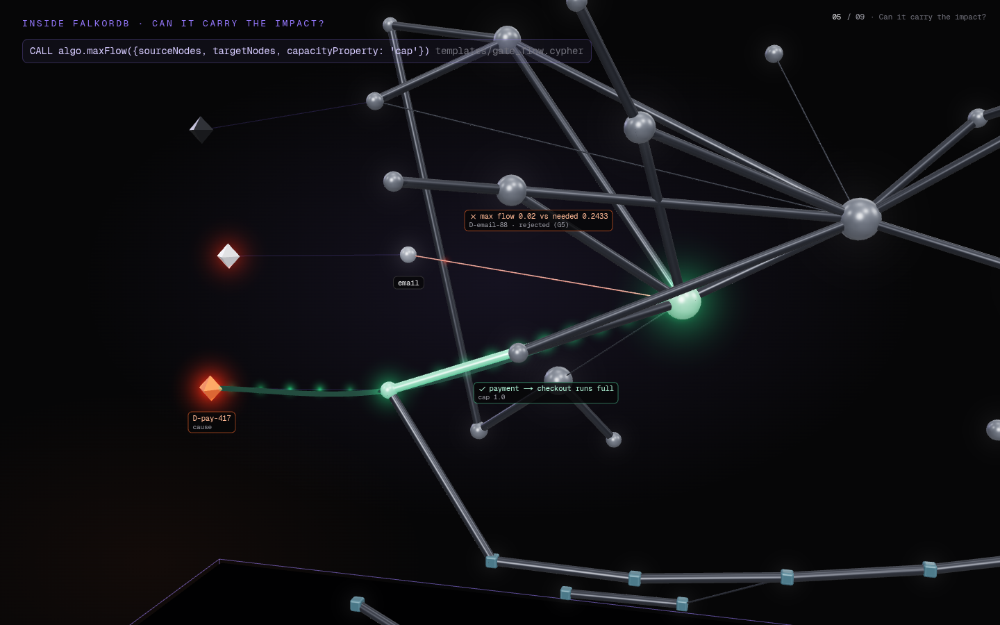<br><sub><b>How FalkorDB decides, in 3D</b> (<a href="https://13-203-185-119.sslip.io/explainer">/explainer</a>). Each scene is one FalkorDB call from the hero incident; here <code>algo.maxFlow</code> shows the look-alike cannot carry the impact.</sub></td>
</tr>
<tr>
<td valign="top">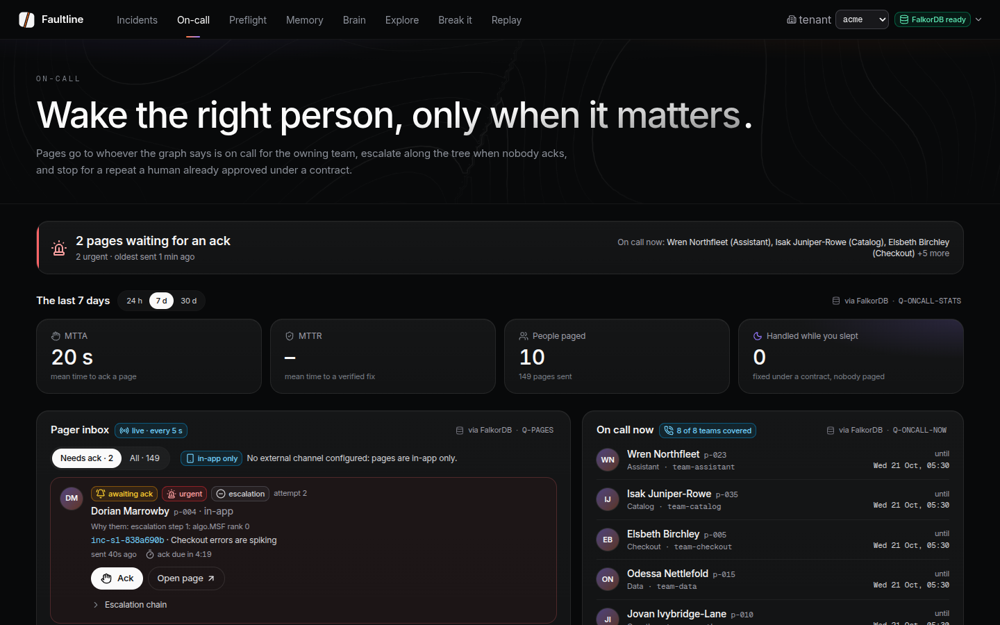<br><sub><b>On call.</b> Pages go to whoever the graph says is on call for the owning team, escalate along the graph's spanning tree, and stop for a repeat a human already approved.</sub></td>
<td valign="top">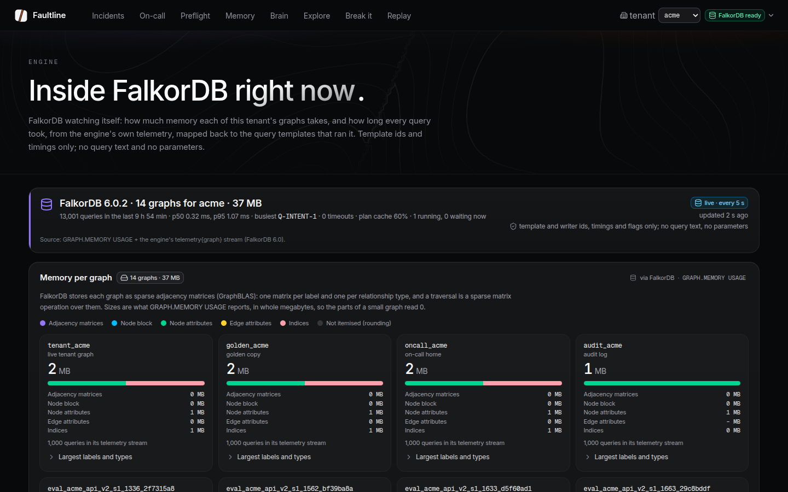<br><sub><b>Inside FalkorDB</b> (<code>/engine</code>). Memory per graph from <code>GRAPH.MEMORY USAGE</code>, every template timed by the engine's own telemetry stream, the live tail.</sub></td>
</tr>
<tr>
<td valign="top">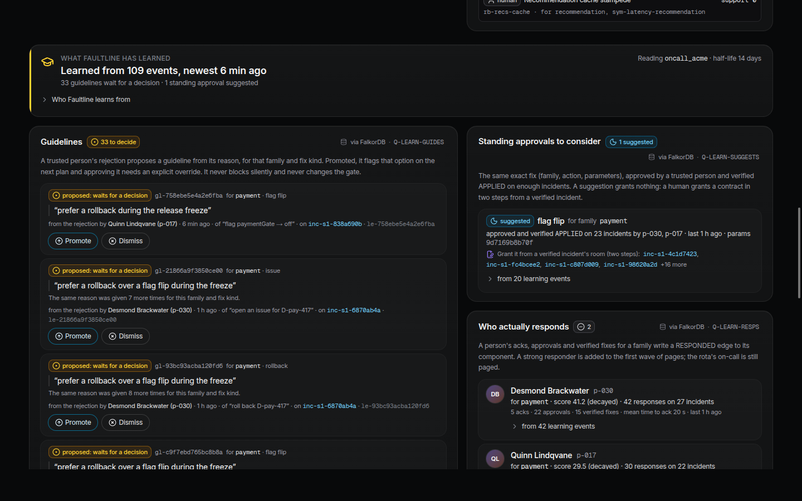<br><sub><b>What it learned</b> (<code>/memory#learned</code>). Guidelines proposed from rejections, standing approvals to consider, who actually answers, and forget with a receipt.</sub></td>
<td valign="top">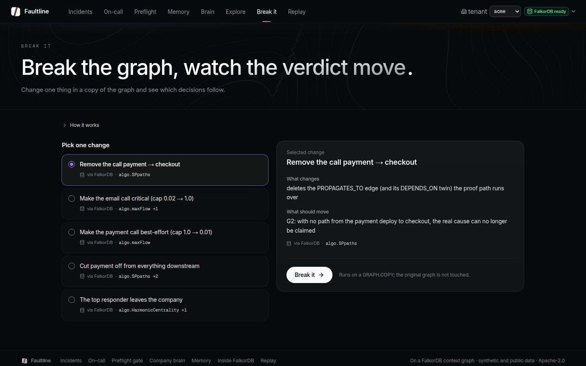<br><sub><b>Break it</b> (<a href="https://13-203-185-119.sslip.io/playground">/playground</a>). Change one thing in a <code>GRAPH.COPY</code> of the graph and watch the verdict move: the graph is load-bearing, live.</sub></td>
</tr>
<tr>
<td valign="top">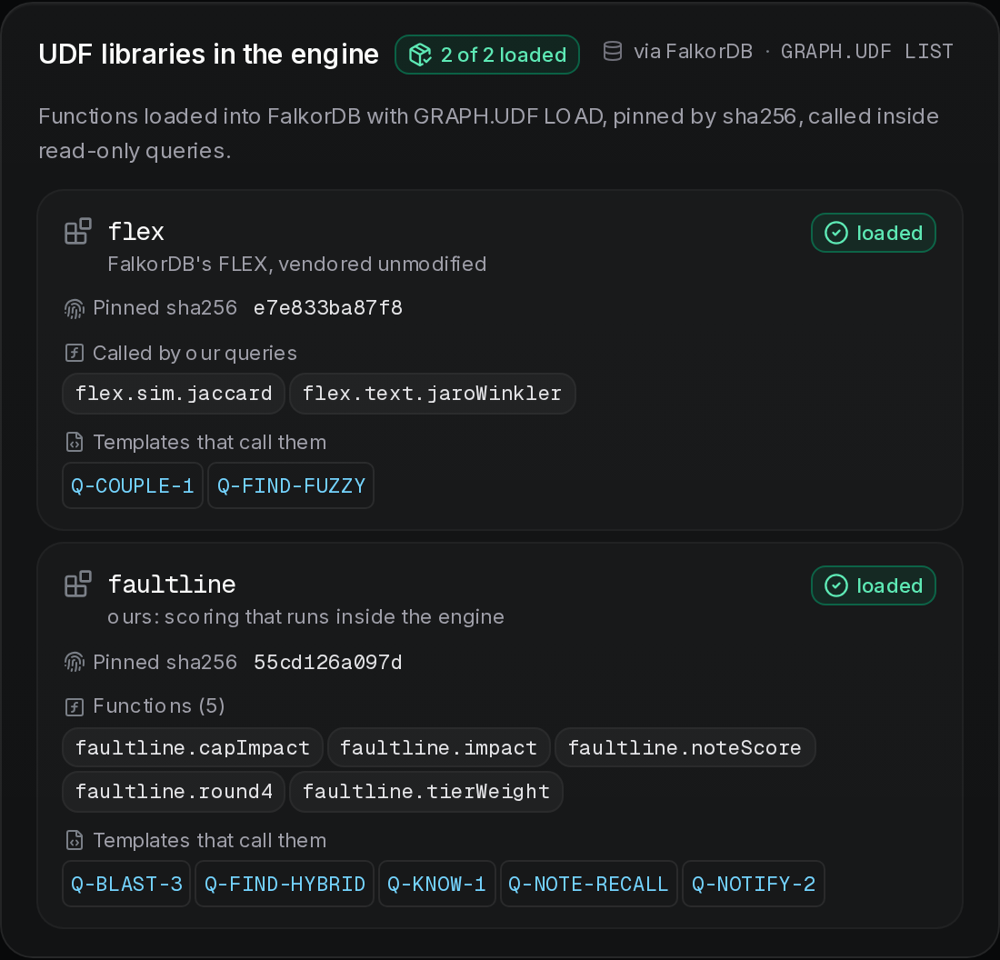<br><sub><b>UDF libraries in the engine.</b> FLEX and our own <code>faultline</code> library, loaded with <code>GRAPH.UDF LOAD</code> and pinned by sha256; the blast radius, the notify list and note recall are ranked inside FalkorDB by them.</sub></td>
<td valign="top">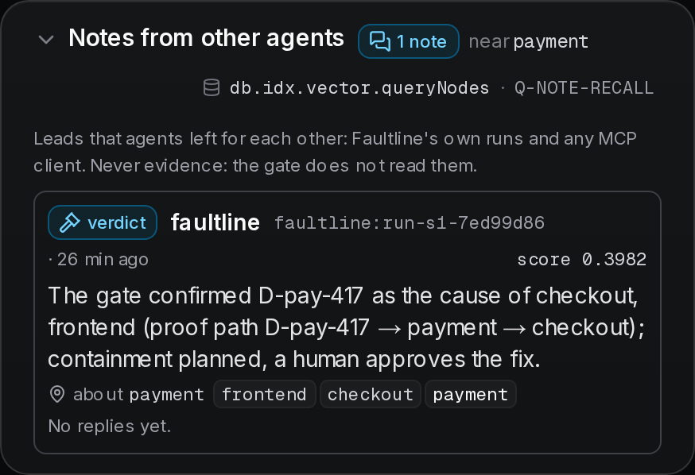<br><sub><b>Notes from other agents.</b> The run's verdict, left for the next agent in <code>agentmem_acme</code> and recalled by graph distance and meaning in one query; a lead, never evidence.</sub></td>
</tr>
<tr>
<td valign="top"><br><sub><b>Why do you believe this?</b> Agent, tool call, evidence, verdict: every arrow is a stored edge, so the answer is itself a query.</sub></td>
<td valign="top"><br><sub><b>Company brain.</b> "Who decided the payment timeout?" answered from the graph, every name a node id a query returned.</sub></td>
</tr>
</table>

<p align="center">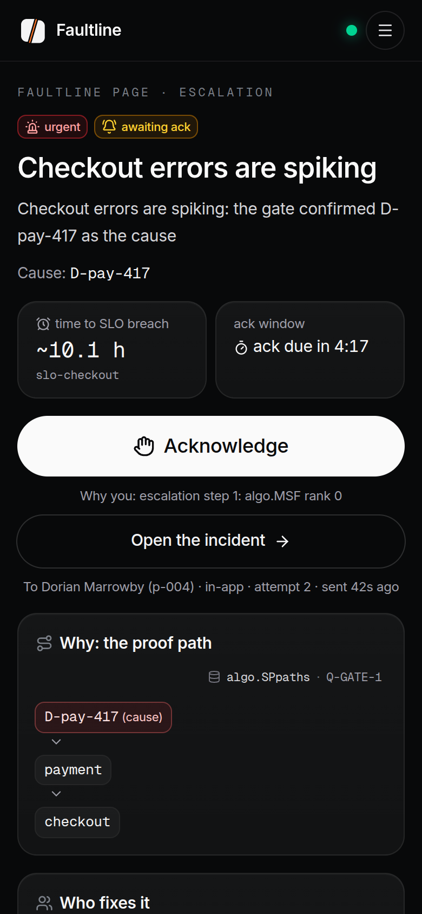<br><sub><b>The page, on a phone.</b> The verdict, the proof path and who fixes it, all read from the graph; one tap acknowledges and stops the escalation.</sub></p>

More screens (preflight, Cypher panel, crew board, tenant isolation, replay, FalkorDB Browser): [Screens](#screens).

## What the judges asked for

The rules and the organiser's day-1 post ("How to Build an Agent That Reasons Over a Graph", section "What Judges Are Looking For") name what is judged. Each line below is quoted, then answered with a measured number:

| Judging line | What Faultline does | Evidence |
|---|---|---|
| "The graph has to shape what the agent does, not sit on the side" (challenge text); "whether the graph is doing work the agent could not do without it" (organiser post) | every verdict is a read-only FalkorDB query, and taking one algorithm away changes decisions | when the look-alike is itself faulty, the right cause in <!-- claim:decisive.full.g5_only.right_cause -->20<!-- /claim -->/<!-- claim:decisive.full.g5_only.cases -->20<!-- /claim --> worlds with `algo.maxFlow`, <!-- claim:decisive.no_maxflow.g5_only.right_cause -->0<!-- /claim --> without it ([decisive bench](docs/EVALS.md)); without both `algo.SPpaths` and `algo.maxFlow`, <!-- claim:ladder.full.b.right_cause -->65<!-- /claim --> → <!-- claim:ladder.neither.b.right_cause -->43<!-- /claim --> of <!-- claim:ladder.neither.b.confirm_cases -->65<!-- /claim --> ([ladder](#the-graph-is-load-bearing)); one perturbation test per algorithm use in [`test_algo_load_bearing.py`](tests/live/test_algo_load_bearing.py) |
| "If the product still works once FalkorDB is taken out, the graph is decoration" (official rules, rule 3) | with FalkorDB off (arm A4) the run cannot start, and the UI says so | confirmed causes <!-- claim:arm.A4.confirmed_causes -->0<!-- /claim -->. That is by design, not a measurement: the product fails closed instead of degrading |
| "Run the same question twice", "with a depth of one", then "with a depth of four" (organiser post) | the proof path is `algo.SPpaths` over up to 8 hops of change → gate → failure-flow edges; the deep bench plants causes 1 to 4 hops upstream of the alert | right cause / worlds with a cause at 1 hop <!-- claim:deep.fresh.hops.1.right_cause -->16<!-- /claim -->/<!-- claim:deep.fresh.hops.1.cause_cases -->28<!-- /claim -->, 2 hops <!-- claim:deep.fresh.hops.2.right_cause -->18<!-- /claim -->/<!-- claim:deep.fresh.hops.2.cause_cases -->37<!-- /claim -->, 3 hops <!-- claim:deep.fresh.hops.3.right_cause -->4<!-- /claim -->/<!-- claim:deep.fresh.hops.3.cause_cases -->13<!-- /claim -->, 4 hops <!-- claim:deep.fresh.hops.4.right_cause -->0<!-- /claim -->/<!-- claim:deep.fresh.hops.4.cause_cases -->2<!-- /claim -->, plus <!-- claim:deep.fresh.nohops.right_cause -->13<!-- /claim -->/<!-- claim:deep.fresh.nohops.cause_cases -->20<!-- /claim --> weak-link worlds with no hop count; confident wrong blames <!-- claim:deep.fresh.hops.1.wrong_confident -->0<!-- /claim -->, <!-- claim:deep.fresh.hops.2.wrong_confident -->0<!-- /claim -->, <!-- claim:deep.fresh.hops.3.wrong_confident -->0<!-- /claim -->, <!-- claim:deep.fresh.hops.4.wrong_confident -->0<!-- /claim -->. Depth costs recall (deep causes are mostly handed to a human), never a wrong blame |
| "Ask the agent something that is not in the graph and let it say so" (organiser post) | the brain says "not in the graph" and cites nothing; the gate ends with NO_INCIDENT or abstains instead of guessing | brain: <!-- claim:brain.unanswerable_honest -->6<!-- /claim -->/<!-- claim:brain.unanswerable -->6<!-- /claim --> unanswerable questions answered honestly with no citations; deep bench: in <!-- claim:deep.fresh.abstain_downstream.correct -->20<!-- /claim -->/<!-- claim:deep.fresh.abstain_downstream.cases -->20<!-- /claim --> worlds where no change explains the alert, no change blamed; correct abstention on the control and no-cause scenarios: <!-- claim:arm.A3.abstention_correct_rate -->1.0<!-- /claim --> |
| "An empty traversal means your graph does not know about a dependency, which during an incident is a different and more worrying statement than safety" (organiser post) | G2 is "no path → no claim", never "no path → safe": when the graph lacks a link the gate abstains and hands over | one failure link hidden on the cause's path: <!-- claim:learning.i1_abstained -->22<!-- /claim -->/<!-- claim:learning.cases -->24<!-- /claim --> abstained, <!-- claim:learning.i1_wrong_confident -->0<!-- /claim --> wrong-confident ([learning eval](docs/EVALS.md)); one random real edge missing from the graph: <!-- claim:mismatch.hidden.wrong_confident -->0<!-- /claim --> wrong-confident in <!-- claim:mismatch.hidden.cases -->100<!-- /claim --> (<!-- claim:mismatch.hidden.abstained -->21<!-- /claim --> abstained), against <!-- claim:mismatch.arm_t.wrong_blame -->27<!-- /claim --> wrong blames for telemetry alone; telemetry missing for a fifth of components: <!-- claim:robustness.missing.0.2.wrong_confident -->0<!-- /claim --> wrong-confident, <!-- claim:robustness.missing.0.2.abstained -->37<!-- /claim --> abstained |
| "One instance can hold thousands of isolated graphs, so each user, agent, or tenant gets its own" (about the sponsor) | one graph per tenant with its own read-only ACL user; a tenant is a `GRAPH.COPY` | <!-- claim:tenants.n -->250<!-- /claim --> tenant graphs on one engine, <!-- claim:tenants.acl.leaks -->0<!-- /claim --> leaks in <!-- claim:tenants.acl.cross.n -->1000<!-- /claim --> cross-tenant reads (95 % upper bound <!-- claim:tenants.acl.leak.ci_hi -->0.0038<!-- /claim -->); p99 <!-- claim:tenants.c64.p99_ms -->6.62<!-- /claim --> ms with 64 investigators in parallel, <!-- claim:tenants.c64.errors -->0<!-- /claim --> errors |
| "Traversals are fast enough to run on every step of an agent loop" (about the sponsor) | the gate runs its path, capacity and blast reads on every incident | at <!-- claim:scale.10k.services -->10000<!-- /claim --> services, engine p99: `algo.SPpaths` <!-- claim:scale.10k.tail.Q-GATE-1.engine_ms_p99 -->8.926<!-- /claim --> ms, `algo.maxFlow` <!-- claim:scale.10k.tail.Q-GATE-3.engine_ms_p99 -->22.261<!-- /claim --> ms, `algo.BFS` <!-- claim:scale.10k.tail.Q-BLAST-1.engine_ms_p99 -->3.279<!-- /claim --> ms |

## Track fit

Each track's own bullets, and where Faultline answers them: the feature, the code and the measured evidence.

| Track bullet | In Faultline | Code | Evidence |
|---|---|---|---|
| **T1** multi-hop reasoning | causes 1 to 4 hops upstream proven by `algo.SPpaths`; blast radius by `algo.BFS` | `agent/gate.py`, `templates/gate_path.cypher` | deep bench: <!-- claim:seedsall.deep.wrong_confident -->0<!-- /claim --> confident wrong blames in <!-- claim:seedsall.deep.cases -->1540<!-- /claim --> worlds |
| **T1** graph queries and algorithms as agent tools | <!-- claim:repo.algorithms -->10<!-- /claim --> `algo.*` procedures and <!-- claim:repo.templates -->236<!-- /claim --> templates behind typed tools; every result carries its Cypher | `mcp_server/tools.py`, `graph/algo/registry.py` | without `algo.maxFlow`: <!-- claim:decisive.full.g5_only.right_cause -->20<!-- /claim -->/<!-- claim:decisive.full.g5_only.cases -->20<!-- /claim --> → <!-- claim:decisive.no_maxflow.g5_only.right_cause -->0<!-- /claim --> right |
| **T1** tool selection through MCP | <!-- claim:repo.mcp_tools -->60<!-- /claim --> MCP tools (stdio), <!-- claim:repo.mcp_tools_hosted -->53<!-- /claim --> hosted over HTTP; an npm bridge for any client | `mcp_server/`, `packages/faultline-mcp` | [docs/MCP.md](docs/MCP.md) |
| **T1** actions based on what the graph shows | the min-cut containment, tried on a `GRAPH.COPY`; one approved action, verified APPLIED / NOT_APPLIED / UNKNOWN | `actions/act.py`, `templates/cut_in_engine.cypher` | live: verified APPLIED <!-- claim:live.hero.applied -->5<!-- /claim -->/<!-- claim:live.hero.n -->5<!-- /claim -->; real pull requests on faultline-demo-infra |
| **T1** explainable results | the proof path, "why do you believe this" provenance, the Cypher behind every element | `agent/report.py`, `templates/run_provenance.cypher` | [See it](#see-it) |
| **T2** episodic / semantic / procedural memory | past incidents recalled by vector + graph (episodic), decisions and runbooks (semantic), runbooks derived from verified fixes (procedural) | `memory/`, `templates/recall.cypher` | warm repeat recalls its precedent: <!-- claim:memory.warm_top_precedent_is_s1 -->True<!-- /claim -->; a learned link fixes the next incident <!-- claim:learning.i2_learned_correct -->24<!-- /claim -->/<!-- claim:learning.cases -->24<!-- /claim --> |
| **T2** persistent conversation history | brain sessions and turns stored as `Session`/`Turn` nodes, read back on a separate read-only connection | `brain/ask.py`, `mcp_server/tools.py::session_history` | <!-- claim:t2.session.sessions -->2<!-- /claim --> sessions, <!-- claim:t2.session.turns -->4<!-- /claim --> turns read back |
| **T2** shared state and hand-offs | the crew's tasks, claims and hand-offs are graph records; on-call hand-offs and shift reports; shared agent notes any agent writes (`remember`) and recalls by meaning and graph distance (`recall_notes`), in their own graph behind their own ACL user | `agent/crew.py`, `actions/oncall.py`, `memory/notes.py`, `templates/note_recall.cypher` | [Crew board](#screens) |
| **T2** high-concurrency reads and writes | atomic conditional claims; one approval wins among many | `graph/writes.py` (`W-CLAIM-1`) | <!-- claim:s13.rounds_one_owner -->100<!-- /claim -->/<!-- claim:s13.rounds -->100<!-- /claim --> rounds with one owner, <!-- claim:s13.lost_updates -->0<!-- /claim --> lost updates; <!-- claim:contention.responders -->24<!-- /claim --> approvals → <!-- claim:contention.same.accepted -->1<!-- /claim --> accepted |
| **T2** separate memory per user and tenant | one graph and one read-only ACL user per tenant; learning only from trusted people, forget with a receipt | `graph/tenant.py`, `memory/learning.py` | <!-- claim:tenants.n -->250<!-- /claim --> tenants, <!-- claim:tenants.acl.leaks -->0<!-- /claim --> leaks in <!-- claim:tenants.acl.cross.n -->1000<!-- /claim --> cross-tenant reads; forget leaves <!-- claim:learn.forget.events_left -->0<!-- /claim --> events |
| **T3** docs, tickets and chats in one graph | ADRs, runbooks, postmortems, chats and issues ingested beside the topology and the people; their text as `(:Chunk)` passages with `vecf32` embeddings, searched by `search_knowledge` in one query (seven index lists fused by reciprocal rank inside FalkorDB, then expanded to what each source concerns) | `ingest/`, `ingest/chunks.py`, `templates/knowledge_search.cypher` | [Graph model](#graph-model) |
| **T3** who owns and who knows what | ownership over time, who worked on a component, bus factor | `templates/owner_at.cypher`, `templates/who_knows.cypher` | on blind questions (written by an agent that never saw the router): brain <!-- claim:graphrag.s2.fl.correct -->24<!-- /claim -->/<!-- claim:graphrag.s2.questions -->40<!-- /claim -->, FalkorDB's GraphRAG-SDK <!-- claim:graphrag.s2.sdk.correct -->32<!-- /claim -->/<!-- claim:graphrag.s2.questions -->40<!-- /claim --> on the same questions and knowledge; neither cited an id that is not in the graph; <!-- claim:brain.correct -->33<!-- /claim -->/<!-- claim:brain.questions -->33<!-- /claim --> on our own development set |
| **T3** tracing decisions to their source | `trace_decision`, `decisions_about`, supersession chains | `templates/decision_*.cypher` | preflight blocks a PR that contradicts recorded decisions |
| **T3** keeping knowledge current | knowledge health, knowledge gaps from unanswered questions, forget with a receipt | `mcp_server/tools.py::knowledge_health`, `memory/forget.py` | [What it learned](#see-it) |
| **T3** answers with clear sources | every name in an answer is a node id a query returned; unanswerable questions say so | `brain/ask.py` | <!-- claim:brain.unanswerable_honest -->6<!-- /claim -->/<!-- claim:brain.unanswerable -->6<!-- /claim --> unanswerable questions answered honestly; blind set <!-- claim:brain_blind.s2.hybrid.correct -->24<!-- /claim -->/40 |

## Why FalkorDB, in numbers

Measured on the pinned engine (FalkorDB 6.0.2), in the terms FalkorDB uses for itself: graphs per instance, p99 under concurrent clients, memory, algorithm speed. These are Faultline's own workloads on one laptop, not a comparison with another database. Methods were pre-registered ([evals/PREREGISTRATION.md](evals/PREREGISTRATION.md), addendum of 2026-10-17); details in [docs/EVALS.md](docs/EVALS.md#engine-numbers-in-falkordbs-own-terms-pre-registered-2026-10-17).

| FalkorDB's yardstick | Faultline, measured | Source |
|---|---|---|
| Many isolated graphs on one instance | **<!-- claim:tenants.n -->250<!-- /claim --> tenant graphs** on one engine (maxmemory <!-- claim:tenants.maxmemory_mb -->3500.0<!-- /claim --> MB, shared with the product's own graphs): <!-- claim:tenants.product.n -->50<!-- /claim --> full product tenants at <!-- claim:tenants.product.mb_per_tenant -->15.0<!-- /claim --> MB each, <!-- claim:tenants.small.n -->200<!-- /claim --> topology-only tenants at <!-- claim:tenants.small.mb_per_tenant -->3.0<!-- /claim --> MB; a new tenant is one `GRAPH.COPY` (p50 <!-- claim:tenants.product.copy_ms_p50 -->61.239<!-- /claim --> ms). **<!-- claim:tenants.acl.leaks -->0<!-- /claim --> leaks** in <!-- claim:tenants.acl.cross.n -->1000<!-- /claim --> cross-tenant reads by per-tenant ACL users (95 % upper bound on the leak rate <!-- claim:tenants.acl.leak.ci_hi -->0.0038<!-- /claim -->) | [`evals/tenants_bench.py`](evals/tenants_bench.py) |
| p99 under concurrent clients | <!-- claim:tenants.c64.qps -->21694.6<!-- /claim --> gate reads/s from 64 parallel investigators on random tenants, p99 **<!-- claim:tenants.c64.p99_ms -->6.62<!-- /claim --> ms**, <!-- claim:tenants.c64.errors -->0<!-- /claim --> errors; one investigator: p99 <!-- claim:tenants.c1.p99_ms -->1.4<!-- /claim --> ms. At 64 the Python clients, not the engine (<!-- claim:tenants.c64.engine_cpu_cores -->7.15<!-- /claim --> cores busy), set the ceiling | [`evals/tenants_bench.py`](evals/tenants_bench.py) |
| Fast enough for every agent step | at <!-- claim:scale.10k.services -->10000<!-- /claim --> services (<!-- claim:scale.10k.nodes -->296261<!-- /claim --> nodes, <!-- claim:scale.10k.edges -->1097675<!-- /claim --> edges), engine p99 over 200 runs: the G2 proof path (`algo.SPpaths`) **<!-- claim:scale.10k.tail.Q-GATE-1.engine_ms_p99 -->8.926<!-- /claim --> ms**, the G5 capacity bound (`algo.maxFlow`) <!-- claim:scale.10k.tail.Q-GATE-3.engine_ms_p99 -->22.261<!-- /claim --> ms, the blast radius (`algo.BFS`) <!-- claim:scale.10k.tail.Q-BLAST-1.engine_ms_p99 -->3.279<!-- /claim --> ms | [`evals/scale.py`](evals/scale.py) |
| Linear scalability | proof-path p99 at 1k / 3k / 5k / 10k services: <!-- claim:scale.1k.tail.Q-GATE-1.engine_ms_p99 -->0.852<!-- /claim --> / <!-- claim:scale.3k.tail.Q-GATE-1.engine_ms_p99 -->3.602<!-- /claim --> / <!-- claim:scale.5k.tail.Q-GATE-1.engine_ms_p99 -->4.031<!-- /claim --> / <!-- claim:scale.10k.tail.Q-GATE-1.engine_ms_p99 -->8.926<!-- /claim --> ms, the planted incident decided correctly at all <!-- claim:scale.sizes_run -->4<!-- /claim --> sizes | [`evals/scale.py`](evals/scale.py) |
| Memory | <!-- claim:scale.10k.bytes_per_elem -->369<!-- /claim --> bytes per node-or-edge at 10k services, properties and indexes included (<!-- claim:scale.10k.used_bytes_per_elem -->447<!-- /claim --> by the engine's `used_memory` growth); the same extracted graph takes <!-- claim:algo10k.mem.falkordb_mb -->86.7<!-- /claim --> MB in FalkorDB and <!-- claim:algo10k.mem.networkx_mb -->107.7<!-- /claim --> MB in NetworkX | [`evals/scale.py`](evals/scale.py), [`evals/algo10k.py`](evals/algo10k.py) |
| Algorithm speed | all 10 `algo.*` at 10k services against NetworkX on the same input: same answers on <!-- claim:algo10k.same -->9<!-- /claim --> of <!-- claim:algo10k.comparable -->11<!-- /claim --> comparable workloads (PageRank's 10th place and the approximate harmonic centrality differ); engine time faster on <!-- claim:algo10k.faster_engine -->11<!-- /claim --> of <!-- claim:algo10k.timed_pairs -->12<!-- /claim -->, e.g. exact betweenness <!-- claim:algo10k.betweenness.falkor_ms_p50 -->255.217<!-- /claim --> ms against <!-- claim:algo10k.betweenness.nx_ms_p50 -->54707.892<!-- /claim --> ms, max flow <!-- claim:algo10k.maxflow.single.falkor_ms_p50 -->8.592<!-- /claim --> ms against <!-- claim:algo10k.maxflow.single.nx_ms_p50 -->163.826<!-- /claim --> ms. Client wall time faster on only <!-- claim:algo10k.faster_wall -->5<!-- /claim -->: parsing a whole-graph result in Python costs more than computing it | [`evals/algo10k.py`](evals/algo10k.py) |
| Real time | a written alert is visible to the next read-only decision query in p50 <!-- claim:perf.fresh.alert.p50_ms -->0.727<!-- /claim --> ms (<!-- claim:perf.fresh.alert.first_read_saw_it -->50<!-- /claim -->/<!-- claim:perf.fresh.alert.writes -->50<!-- /claim --> on the first read) | [`evals/perf_vs_flat.py`](evals/perf_vs_flat.py) |

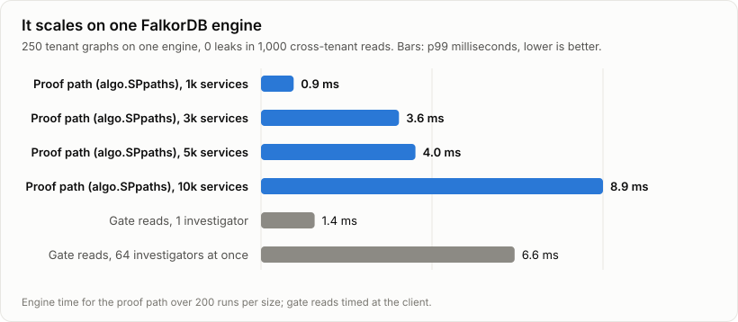

## Contents

- [Use it](#use-it)
- [Proof at a glance](#proof-at-a-glance)
- [See it](#see-it)
- [What the judges asked for](#what-the-judges-asked-for)
- [Track fit](#track-fit)
- [Why FalkorDB, in numbers](#why-falkordb-in-numbers)
- [Glossary](#glossary)
- [Reproduce it](#reproduce-it)
- [Why existing approaches fall short](#why-existing-approaches-fall-short)
- [How one incident flows](#how-one-incident-flows)
- [See it work: two incidents](#see-it-work-two-incidents)
- [The evidence gate](#the-evidence-gate)
- [Architecture](#architecture)
- [Graph model](#graph-model)
- [FalkorDB feature map](#falkordb-feature-map)
- [The graph is load-bearing](#the-graph-is-load-bearing)
- [Results](#results) (scorecard: [docs/PROOF.md](docs/PROOF.md))
- [What makes it different](#what-makes-it-different)
- [Context for any agent](#context-for-any-agent)
- [Memory, company brain, preflight, coordination](#memory-company-brain-preflight-coordination)
- [On-call: page, acknowledge, escalate, standing approval](#on-call-page-acknowledge-escalate-standing-approval)
- [Learns from the people who use it (T2)](#learns-from-the-people-who-use-it-t2)
- [Screens](#screens)
- [Query catalogue](#query-catalogue)
- [Safety](#safety)
- [What's real vs synthetic](#whats-real-vs-synthetic)
- [Scope and assumptions](#scope-and-assumptions)
- [What didn't work](#what-didnt-work)
- [AI disclosure](#ai-disclosure)

## Glossary

The words this README uses that are ours, not FalkorDB's.

| Term | Meaning |
|---|---|
| **Gate (G1 to G8)** | eight checks, all read-only FalkorDB queries, that a suspect must pass before it is blamed: seen, path, timing, origin, capacity, rivals, agreement, no contradicting decision ([the evidence gate](#the-evidence-gate)) |
| **No path, no claim** | a change is blamed only if `algo.SPpaths` returns a causal path from it to the failing component |
| **Capacity check (G5)** | `algo.maxFlow` over the `PROPAGATES_TO.cap` edges must be able to carry the impact that was observed, or the suspect is ruled out |
| **cap / row share** | the capacity on an edge: on service edges, how much of the caller depends on it; on data-lineage edges, the share of rows that flows end to end, measured in the warehouse |
| **Blast radius** | everything a failure can reach (`algo.BFS`), ranked by impact inside the engine |
| **Min-cut / containment** | the smallest set of edges whose removal stops the failure reaching what matters, read from the same max-flow result and tried first on a `GRAPH.COPY` |
| **Abstain / not confident** | the agent names no cause and hands over to a human; "not confident" may still name a suspect, which is never acted on |
| **Decoy** | an innocent change shipped in the same window as the real one, there to tempt a guess |
| **Bystander** | an innocent changed component that a run left as a "not confident" suspect when an unchanged component above it broke |
| **Clean room** | a fresh `GRAPH.COPY` of a golden graph that one eval run uses and deletes; `golden_<tenant>` is the read-only original |
| **What-if branch** | a `GRAPH.COPY` where a containment option is applied, to check it before anyone touches the real system |
| **APPLIED / NOT_APPLIED / UNKNOWN** | the verdict of the second-channel check after an action; UNKNOWN goes to a human and never counts as success |
| **Write-back** | the decision, its evidence and the precedent written back into the graph in one query (`W_WB_1`), then re-read on a separate read-only connection |
| **Warm** | a later incident recalls a past one by meaning and graph neighbourhood and shows its precedent; memory informs, the gate still decides |
| **Arms (N, V, T, A2, A3, A3-noG5, A4)** | the baselines and ablations in the evals: naive recency, vector only, telemetry only, graph without memory, the product, the product without the capacity check, FalkorDB turned off |
| **T+** | thresholded telemetry: blame the change on the most anomalous component; the strongest non-graph baseline |
| **Scenarios S1 to S13** | the scripted incidents; S1 is the hero, S4D and S4S are controls with no incident, S12 must abstain |
| **Ladder** | the same bench run with the graph checks weakened or removed step by step, to show which FalkorDB call each right answer depends on |

## Reproduce it

To *use* Faultline you need only Docker (the [quickstart](#use-it): `docker compose -f quickstart.yml up`) or Node (the MCP tools: `npx -y @prashantthakur77/faultline-mcp`). To *check* it, one command checks everything offline. It needs Docker, `uv` and Node. There is no API key, no GitHub token and nothing remote.

```bash
git clone --depth 1 https://github.com/Prashant-thakur77/Faultline.git && cd Faultline   # --depth 1: the history holds earlier video cuts
make setup && make judge-check     # several minutes; prints PASS
```

Last run on a fresh `--depth 1` clone of `main` (2026-10-18, commit `004a6e8`): **PASS**, 18 of 18 checks; the full summary is in [evals/results/judge_check_clean_clone.txt](evals/results/judge_check_clean_clone.txt). <!-- noclaim: a dated run log, not a results-file number -->

`judge-check` starts the pinned FalkorDB, runs the engine smoke suite, seeds both tenants, runs the unit and live tests (isolation and concurrency included), checks the pipeline invariants, runs the lints and the claims check, and builds the frontend. CI runs the same steps on the pinned engine ([`ci.yml`](.github/workflows/ci.yml)). A `.devcontainer/` is included for a Codespace.

To run the product:

```bash
make up             # pinned FalkorDB (deploy/docker-compose.yml)
make seed           # acme + golden copies (TENANT=globex for the second tenant)
make demo           # API :8400 + UI :3000 → run S1, choose and approve an option, watch VERIFY → RESOLVED
make mcp            # the agent's read-only graph tools over MCP (stdio)
make eval           # keyless eval arms → evals/RESULTS.md
```

**Sixty seconds, no build.** After `make up && make seed`, ask FalkorDB directly. `algo.SPpaths` returns the path a blame needs, and `algo.maxFlow` shows that a look-alike change cannot carry the impact (`email` → `checkout`: 0.02, the seeded edge cap of a best-effort call): <!-- noclaim: the seeded best-effort edge cap -->

```bash
docker exec -it faultline-falkordb redis-cli GRAPH.RO_QUERY tenant_acme "MATCH (c:Node {id:'payment'}), (s:Node {id:'checkout'}) CALL algo.SPpaths({sourceNode: c, targetNode: s, relTypes: ['PROPAGATES_TO'], weightProp: 'w', relDirection: 'outgoing', maxLen: 8, pathCount: 1}) YIELD path RETURN [n IN nodes(path) | n.id]"
docker exec -it faultline-falkordb redis-cli GRAPH.RO_QUERY tenant_acme "MATCH (e:Node {id:'email'}), (t:Node {id:'checkout'}) CALL algo.maxFlow({sourceNodes: [e], targetNodes: [t], relationshipTypes: ['PROPAGATES_TO'], capacityProperty: 'cap'}) YIELD maxFlow RETURN maxFlow"
```

The first returns `[payment, checkout]`. With `targetNode` `kpi.exec_revenue` the same call crosses domains: `[payment, raw.raw_orders, staging.stg_orders, marts.fct_revenue, marts.exec_revenue_metric, kpi.exec_revenue]`. The second returns `0.02`; from `payment` it returns `1.0`. Scenario changes such as `D-pay-417` exist only inside a scenario's clean room. On the seeded tenant the history is there to query, for example `MATCH (d:Deploy)-[:CAUSED]->(i:Incident) RETURN d.id, i.id LIMIT 5`.

**Break it yourself** [on the live site](https://13-203-185-119.sslip.io/playground), or locally with `make demo`, then **Break it** (`/playground`). Pick one change: remove the proof-path call, make a call best-effort, make the decoy's call critical, cut a service off, or have the top responder leave. It is applied to a `GRAPH.COPY` of the hero incident, the product runs on both copies, and every decision is shown before and after with the Cypher that decides it.

**Replay without a backend.** The static replay site plays [`examples/s1-hero/`](examples/s1-hero) end to end: gate, containment, APPLIED, write-back verified <!-- claim:s1.writeback -->7/7<!-- /claim -->. Locally: `cd frontend && npm run build:pages`, then serve `out-pages/` under `/Faultline/`.

**Where each judging question is answered:**

| You are checking… | Look here |
|---|---|
| Is FalkorDB load-bearing, or decoration? | [the evidence gate](#the-evidence-gate) · [every algorithm perturbed, the decision flips](#the-graph-is-load-bearing) · the Break it page · arm A4 (FalkorDB off: confirms nothing) |
| How deep is the FalkorDB use? | [feature map](#falkordb-feature-map): <!-- claim:repo.algorithms -->10<!-- /claim --> `algo.*` procedures, `GRAPH.COPY` branches, vectors, full-text, FLEX and our own UDFs, per-tenant ACL users, versioned topology · [query catalogue](docs/QUERY_CATALOGUE.md) |
| Does the agent act, safely? | two-step approval bound to a plan hash, three-valued verification, kill -9 chaos, write-back re-read: [Safety](#safety) · [`examples/s1-hero/`](examples/s1-hero/) |
| Does it learn? | a verified fix teaches the graph a missing link, and the next incident is proved: [Results](#results) · [docs/EVALS.md](docs/EVALS.md) |
| Are the numbers honest? | pre-registration, new never-generated seeds, 95 % intervals with N, structural zeros labelled, a wrong-graph eval, mutants: [Results](#results) · [What didn't work](#what-didnt-work) · [docs/HONEST_LIMITS.md](docs/HONEST_LIMITS.md) |
| Company brain (T3)? | as-of answers with node-id citations, forget receipts: [Memory, company brain, preflight, coordination](#memory-company-brain-preflight-coordination) |

**Files to read first:**

| File | Why |
|---|---|
| [`graph/templates/gate_path.cypher`](backend/faultline/graph/templates/gate_path.cypher) | the proof path (G2) |
| [`agent/gate.py`](backend/faultline/agent/gate.py) | Gate v2, G1–G8, the competitor sweep |
| [`graph/ro.py`](backend/faultline/graph/ro.py) | the only read path |
| [`actions/act.py`](backend/faultline/actions/act.py) | approval → execute → three-valued verify → write-back |
| [`docs/QUERY_CATALOGUE.md`](docs/QUERY_CATALOGUE.md) | every query the product runs |

Deeper docs: [architecture](docs/ARCHITECTURE.md) (one incident end to end, with files) · [graph model](docs/GRAPH_MODEL.md) · [design decisions](docs/DESIGN_DECISIONS.md) · [evals in detail](docs/EVALS.md) · [explainer](docs/EXPLAINER.md) (the questions a judge asks) · [scope and assumptions](docs/HONEST_LIMITS.md).

## Why existing approaches fall short

> How twelve current products approach root cause (Dynatrace, Datadog, New Relic, PagerDuty, BigPanda, Splunk ITSI, incident.io, Rootly, Causely, HolmesGPT, k8sgpt), from their public documentation, with sources, and where Faultline differs and where they are ahead: **[docs/LANDSCAPE.md](docs/LANDSCAPE.md)**.

Google's SRE book says "roughly 70% of outages are due to changes in a live system" ([SRE book, Introduction](https://sre.google/sre-book/introduction/)). Uptime Institute's 2025 outage analysis puts IT and networking at 23% of impactful outages and ties the rise to change management and misconfiguration ([press release](https://uptimeinstitute.com/about-ui/press-releases/uptime-announces-annual-outage-analysis-report-2025)); 54% of respondents said their latest significant outage cost more than $100,000 (as reported by [Data Center Knowledge](https://www.datacenterknowledge.com/outages/data-center-outages-decline-for-fourth-straight-year-but-issues-persist)). So the on-call question is usually "which change?", and a wrong answer rolls back the wrong thing. <!-- noclaim: external figures, quoted with their sources -->

There are three common ways to answer it today. Each is good at something, and each misses something an on-call engineer needs. We built a baseline for each one and measured it on the same scenarios as the product.

| Approach | What it does well | What it cannot do | Measured here |
|---|---|---|---|
| **Alert correlation and recency** ("what changed last, near the alert?") | fast, needs no model, groups alerts by time and labels | two changes in the same minute tie; it cannot tell a cause from a victim; it never says "no change explains this" | naive recency (arm N): top-1 <!-- claim:arm.N.top1 -->0.1<!-- /claim -->, false blame <!-- claim:arm.N.false_blame_rate -->1.0<!-- /claim -->, correct abstention <!-- claim:arm.N.abstention_correct_rate -->0.0<!-- /claim -->. A sharper telemetry-only heuristic (arm T) reaches top-1 <!-- claim:arm.T.top1 -->0.9<!-- /claim --> but still blames <!-- claim:arm.T.false_blame_rate -->0.2<!-- /claim --> of the time, and by design it cannot say "nothing explains this", so it blames a change in all <!-- claim:deep.fresh.abstain_downstream.cases -->20<!-- /claim --> deep-bench worlds where the right answer is to blame nothing |
| **LLM agent with vector RAG** over logs, tickets and runbooks | reads text well; finds incidents that look similar | similarity is not causation: two descriptive deploy titles score alike; nothing checks that a candidate can carry the impact; it answers instead of abstaining, and a look-alike change on the path reads like the cause; its memory is a pile of chunks, with no "who owns this now" | vector ranking (arm V, cosine in FalkorDB): top-1 <!-- claim:arm.V.top1 -->0.4<!-- /claim -->, false blame <!-- claim:arm.V.false_blame_rate -->0.6<!-- /claim -->, correct abstention <!-- claim:arm.V.abstention_correct_rate -->0.0<!-- /claim -->. As agent context with 30 unrelated deploys: MRR <!-- claim:ctx.busy30.b1000.V.mrr -->0.4226<!-- /claim -->. A strong LLM (`claude-opus-5-5`) given the same telemetry: <!-- claim:arm.A0.outcome_correct.k -->23<!-- /claim -->/<!-- claim:arm.A0.outcome_correct.n -->24<!-- /claim --> right on our 8 scenarios, but on <!-- claim:llm_deep.deep.all.cases -->140<!-- /claim --> adversarial worlds it confidently blames an innocent change in <!-- claim:llm_deep.deep.all.wrong_confident -->37<!-- /claim --> (Faultline: 0) ([Results](#results)) |
| **Static dependency maps and service catalogs** | list edges and owners | an edge says two things connect, not how much failure can cross it; maps drift out of date; no validity windows, decisions or past fixes attached; usually read by people, not checked at decision time | the capability ladder: with the path check reduced to plain connectivity and `algo.maxFlow` removed, the right cause is blamed in <!-- claim:ladder.neither.b.right_cause -->43<!-- /claim -->/<!-- claim:ladder.neither.b.confirm_cases -->65<!-- /claim --> generated worlds, against <!-- claim:ladder.full.b.right_cause -->65<!-- /claim -->/<!-- claim:ladder.full.b.confirm_cases -->65<!-- /claim --> for the product |
| **Faultline**: graph proof, capacity bound, abstention | a causal path (`algo.SPpaths`), a max-flow bound on what a suspect can carry (`algo.maxFlow`), and eight read-only checks before any claim; it abstains when nothing passes; acts once, verifies, and writes back to the same graph | it needs a modelled failure-flow layer and telemetry on the components (see [Scope and assumptions](#scope-and-assumptions)) | arm A3: top-1 <!-- claim:arm.A3.top1 -->1.0<!-- /claim -->, false blame <!-- claim:arm.A3.false_blame_rate -->0.0<!-- /claim -->, correct abstention <!-- claim:arm.A3.abstention_correct_rate -->1.0<!-- /claim -->; deep bench <!-- claim:deep.fresh.all.wrong_confident -->0<!-- /claim --> confident wrong blames in <!-- claim:deep.fresh.all.cases -->140<!-- /claim --> worlds; context MRR <!-- claim:ctx.busy30.b1000.GA.mrr -->0.6598<!-- /claim --> |

Five gaps run through current practice, and each one maps to a part of Faultline you can check:

| Gap | What Faultline does | Where to check |
|---|---|---|
| Similarity stands in for causation | G2 requires a directed causal path from the change to every symptom | [`gate_path.cypher`](backend/faultline/graph/templates/gate_path.cypher); `D-rec-12` rejected by <!-- claim:s1.D-rec-12.rejected_by -->G2<!-- /claim --> |
| Nothing proves the cause can carry the impact | G5 bounds the share of the symptom a suspect can explain with joint `algo.maxFlow` | [`gate_flow.cypher`](backend/faultline/graph/templates/gate_flow.cypher); gate bench G5 cases <!-- claim:gate_bench.G5.correct -->20<!-- /claim -->/<!-- claim:gate_bench.G5.cases -->20<!-- /claim --> (those look-alikes are healthy, so the origin check would reject them too; G5 decides alone on S2 and on the decisive bench) |
| Tools always name something | a three-valued outcome (confirmed, not confident, no incident) with a negative proof (`algo.SSpaths`) | gate bench abstention cases <!-- claim:gate_bench.abstain.correct -->20<!-- /claim -->/<!-- claim:gate_bench.abstain.cases -->20<!-- /claim --> by outcome (in <!-- claim:gate_bench.bystander_not_confident -->4<!-- /claim --> of them the gate accepted a bystander change as "not confident"), controls <!-- claim:gate_bench.control.correct -->15<!-- /claim -->/<!-- claim:gate_bench.control.cases -->15<!-- /claim --> |
| Actions are reported, not verified | a second channel decides APPLIED, NOT_APPLIED or UNKNOWN; UNKNOWN never writes success | S5 → <!-- claim:s5.verdict -->NOT_APPLIED<!-- /claim -->, S9 → <!-- claim:s9.verdict -->UNKNOWN<!-- /claim -->, success written: <!-- claim:s9.success_written -->False<!-- /claim --> |
| Memory is a vector store beside the system | incidents, fixes, decisions and runbooks are nodes in the same graph the gate reads; a verified fix can teach a missing link | next incidents correct after learning: <!-- claim:learning.i2_learned_correct -->24<!-- /claim -->/<!-- claim:learning.cases -->24<!-- /claim --> vs <!-- claim:learning.i2_control_correct -->2<!-- /claim --> without |

## How one incident flows

The hero scenario S1: checkout and frontend error rates jump. Three changes landed in the window, two of them in the same minute. Every step below is recorded in the graph as `StageEvent`, `ToolCall`, `Evidence` and `GateRun` nodes. Paths are relative to `backend/faultline/`.

| # | Step | What happens | FalkorDB query or procedure | File |
|---|---|---|---|---|
| 1 | Alert | The alerts that fired around onset become the symptoms; the incident is opened and its text embedded | `Q-ALERT-1`; `vecf32` on `Incident.embedding` | `graph/templates/window_alerts.cypher`, `scenario.py` |
| 2 | Recall | Similar past incidents, kept only if they share a `Symptom` node | `db.idx.vector.queryNodes` + structural confirm (`Q-MEM-1`) | `graph/templates/recall.cypher` |
| 3 | Scope | What is upstream of the symptoms, and what breaks downstream | `algo.SSpaths`, `algo.BFS`, `algo.betweenness` | `upstream_scope.cypher`, `blast_radius.cypher`, `chokepoints.cypher` |
| 4 | Suspects | The changes in the window, ranked for investigation order | `algo.SSpaths` (`Q-SUS-1`), `algo.pageRank` on a scratch projection | `upstream_suspects.cypher`, `rank_causes.cypher`, `agent/score.py` |
| 5 | Path | `D-rec-12` has no path to checkout: rejected | `algo.SPpaths` (`Q-GATE-1`) | `gate_path.cypher` |
| 6 | Flow | `D-email-88` has a path, but its max flow <!-- claim:s1.D-email-88.max_flow -->0.02<!-- /claim --> is below the <!-- claim:s1.D-email-88.needed -->0.2433<!-- /claim --> needed: rejected | joint `algo.maxFlow` × path multiplicity (`Q-GATE-3`, `Q-GATE-MULT`) | `gate_flow.cypher`, `gate_multiplicity.cypher` |
| 7 | Proof | `D-pay-417` passes G1–G7; G8 attaches the ADR-012 and ADR-013 it contradicts; one `GateRun` per verdict | eight read-only checks | `agent/gate.py`, `decision_contradiction.cypher` |
| 8 | Cut | Is a cut needed, what is the smallest one, and what happens under each option | `algo.WCC`; `algo.maxFlow` with `edgeFlows` → min-cut in the same query; one `GRAPH.COPY` branch per candidate (`Q-FUTURE-1`) | `connectivity.cypher`, `cut_in_engine.cypher`, `futures.cypher` |
| 9 | Route | Who fixes it, who is looped in, who to notify | `algo.HarmonicCentrality`, `algo.MSF` on scratch projections | `harmonic.cypher`, `msf.cypher`, `mcp_server/tools.py` |
| 10 | Approve | Choosing an option renders the exact action and its plan hash; approval must quote the hash and moves the incident to EXECUTE in the same query | single-query writes `W_CHOOSE`, `W_APPROVE` | `actions/act.py`, `graph/writes.py` |
| 11 | Act and verify | A PR flips the `paymentGate` flag; GitHub main is re-read and telemetry is checked for every symptom → APPLIED | intent → execute → reconcile, idempotency key under a unique constraint | `actions/act.py`, `actions/github.py`, `actions/reconcile.py` |
| 12 | Write-back | `CAUSED`, `RESOLVED_BY`, a postmortem, a decision and `PRECEDENT_FOR` in one query, re-read through a separate read-only connection | `W_WB_1` + `writeback_check.cypher` | `graph/writes.py`; verified <!-- claim:s1.writeback -->7/7<!-- /claim --> |
| 13 | Warm recall | The incident joins a family; a derived runbook is consolidated; the repeat incident S1b starts warm | `algo.labelPropagation` | `families.cypher`, `memory/learn.py` |

On S1b (a repeat payment regression after S1 was resolved), the warm run's top precedent is S1 (<!-- claim:memory.warm_top_precedent_is_s1 -->True<!-- /claim -->), the derived runbook comes first (<!-- claim:memory.derived_runbook_first -->True<!-- /claim -->), the family prior rises from <!-- claim:memory.cold_prior -->0.7681<!-- /claim --> to <!-- claim:memory.warm_prior -->0.8423<!-- /claim -->, and the gate verdicts stay identical check by check (<!-- claim:memory.gate_verdicts_identical -->True<!-- /claim -->). Memory reorders; it never decides.

The full walk-through, with every function name, is in [docs/ARCHITECTURE.md](docs/ARCHITECTURE.md).

## See it work: two incidents

Recorded through the real API (`scripts/record_demo.py`) with the deterministic investigator and simulated GitHub, both labelled as such everywhere.

| | **S1 service incident** (hero) | **S2 data incident** (cross-domain) |
|---|---|---|
| Symptom | checkout + frontend error rate | the executive revenue KPI jumps |
| Changes in the window | `D-pay-417` (payment), `D-email-88` (email, **same minute**), `D-rec-12` (recommendation) | `D-cutover-1` (payment provider cutover), `D-fx-pause-7` (FX feed paused) |
| Proof path (G2, `algo.SPpaths`) | <!-- claim:s1.chain -->D-pay-417 → payment → checkout<!-- /claim --> | <!-- claim:s2.chain -->D-cutover-1 → payment → raw.raw_orders → staging.stg_orders → marts.fct_revenue → marts.exec_revenue_metric → kpi.exec_revenue<!-- /claim --> |
| Look-alike rejected by **max flow** (G5) | `D-email-88`: max flow <!-- claim:s1.D-email-88.max_flow -->0.02<!-- /claim --> < needed <!-- claim:s1.D-email-88.needed -->0.2433<!-- /claim --> (the email call is best-effort: one modelled edge cap, [cited from the OTel demo source](data/topology/otel-demo.yaml)) | `D-fx-pause-7`: max flow <!-- claim:s2.D-fx-pause-7.max_flow -->0.0692<!-- /claim --> < needed <!-- claim:s2.D-fx-pause-7.needed -->0.8<!-- /claim --> (FX touches a small share of revenue) |
| Rejected by **no path** (G2) | `D-rec-12` (<!-- claim:s1.D-rec-12.rejected_by -->G2<!-- /claim -->) | n/a |
| Decision contradiction (G8) | ADR-012 (timeout ≤ 2000 ms), ADR-013 (≥ 2 retries) | n/a |
| Containment | min-cut `payment → checkout` → flag `paymentGate` off (checkout defers the charge), or roll the deploy back (listed first: it worked more often on past incidents with this symptom) | min-cut found, but its only flag cuts a service edge no failure path to the KPI crosses, so it is shown disabled with that reason (`Q-LEVER-PATH`); the data repair needs a proposed transform patch (live LLM mode) |
| Who fixes it | ranked people with reasons (recent commits, past resolutions, on-call) | same |
| Action → verdict | PR to the infra repo (**simulated GitHub** here; the same path against real GitHub: [PR #1](https://github.com/Prashant-thakur77/faultline-demo-infra/pull/1)) → **APPLIED**: main re-read + telemetry back in band, no collateral | awaiting a human choice |
| Write-back | verified <!-- claim:s1.writeback -->7/7<!-- /claim --> through a separate read-only connection, then LEARN | n/a |

Where naive recency and vector similarity put the real cause on every scenario, and why the look-alikes lost, is generated per run in [docs/NAIVE_VS_FAULTLINE.md](docs/NAIVE_VS_FAULTLINE.md).

## The evidence gate

Gate G2 is the load-bearing query. If it returns no rows, Faultline cannot claim the cause, whatever the model thinks:


```cypher
// Q-GATE-1, as rendered (gate_path.cypher writes {algo:sppaths}; graph/algo/registry.py resolves it on the pinned engine)
MATCH (c:Node {id:$cause}), (s:Node {id:$symptom})
CALL algo.SPpaths({sourceNode: c, targetNode: s, relTypes: ['CHANGED','GATES','PROPAGATES_TO'],
                   weightProp: 'w', relDirection: 'outgoing', maxLen: 8, pathCount: 3}) YIELD path, pathWeight
RETURN [n IN nodes(path) | n.id] AS chain, [r IN relationships(path) | type(r)] AS rels, pathWeight AS weight, length(path) AS hops
ORDER BY weight, hops LIMIT 3
```

What it returned on the eval run:


| Call | Rows |
|---|---|
| `D-pay-417` → checkout (S1, the real cause) | chain <!-- claim:s1.chain -->D-pay-417 → payment → checkout<!-- /claim --> |
| `D-rec-12` → checkout (S1, decoy) | **0 rows**: rejected by <!-- claim:s1.D-rec-12.rejected_by -->G2<!-- /claim --> ("no path, no claim") |
| `D-cutover-1` → kpi.exec_revenue (S2, data incident) | chain <!-- claim:s2.chain -->D-cutover-1 → payment → raw.raw_orders → staging.stg_orders → marts.fct_revenue → marts.exec_revenue_metric → kpi.exec_revenue<!-- /claim --> |

<details><summary>Show the other checks, their Cypher and how a verdict is reached</summary>


A path is necessary but not sufficient. G5 asks whether the change can carry the observed impact, as `algo.maxFlow` over `PROPAGATES_TO.cap`. On service edges `cap` is criticality; on lineage edges it is the end-to-end row share computed from the warehouse. The strongest case is S2: `D-fx-pause-7` has a multi-hop path to the revenue KPI, but it can carry at most <!-- claim:s2.D-fx-pause-7.max_flow -->0.0692<!-- /claim --> of the anomaly, and <!-- claim:s2.D-fx-pause-7.needed -->0.8<!-- /claim --> is needed. Why the bound is valid, including the path-multiplicity factor and joint sufficiency for two causes, is in [docs/EXPLAINER.md](docs/EXPLAINER.md).

The model may propose; Gate v2 decides with eight checks, two of them split into a strict and a confidence part. Each is a read-only query ([`agent/gate.py`](backend/faultline/agent/gate.py)):

| Check | Query | Fails → |
|---|---|---|
| G1 grounded: the cause came back from a graph query this run, and every cited evidence item came from this run | Q-GATE-G1 | rejected |
| G2 path: `algo.SPpaths` from the change to every primary symptom | Q-GATE-1 | rejected ("no path, no claim") |
| G3 time: the change is inside the window before onset | Q-GATE-2 | rejected (an earlier upstream change → not confident) |
| G4 quantitative: an anomalous measurement on a node of the chain | Q-GATE-4 | rejected |
| G4 origin: the anomaly shows at the changed component itself or in its own data output (unless the change is on the alerting component) | Q-GATE-4 | not confident |
| G4 upstream (sweep): a suspect whose component is anomalous only by what an anomalous component upstream (changed or not) can carry there (measured excess × path transfer) is not the origin | Q-GATE-UPSTREAM | eliminated (an unchanged upstream origin → abstain) |
| G5 sufficiency: joint `algo.maxFlow` × the number of failure paths can carry the observed impact | Q-GATE-3, Q-GATE-MULT, Q-GATE-OBS | rejected (only jointly sufficient → not confident) |
| G6 competitors: every rival eliminated with evidence | Q-HYP-1 | unresolved rivals → not confident |
| G7 agreement: independent evidence channels agree on the chain | Q-GATE-7 | not confident |
| G7 correlation: the change specialist and the code or data specialist name the same deploy, which CHANGED a node of the chain | Q-GATE-CORR | not confident (not evaluable when no code/data channel could inspect a change) |
| G8 contradiction: active decisions the cause violates | Q-DEC-1 | attached, never blocks |

How a verdict is reached:

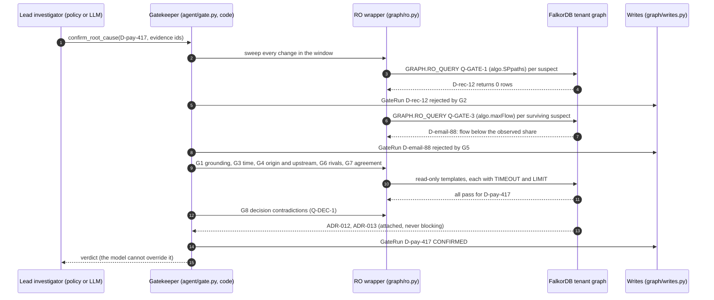

If nothing passes, the run abstains: it reports an inferred origin as unconfirmed, or proves "no incident" with an `algo.SSpaths` negative proof when every alerting symptom is measured and normal.

</details>

## Architecture

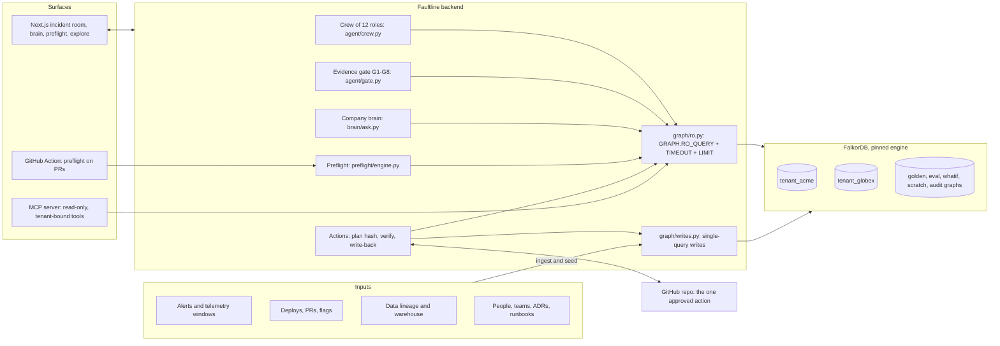

Two rules hold everywhere. Reads go through one path, `graph/ro.py`: `GRAPH.RO_QUERY` with a per-query `TIMEOUT` and a literal `LIMIT` sent as n+1 so truncation is detected, as the per-tenant ACL user `ro_<tenant>` when ACL passwords are configured. Writes go through `graph/writes.py`, each a single query that is atomic on its own; the model never holds a write connection. FalkorDB is the only store: `events.jsonl`, `report.md` and the replay files are exports of the graph, and `scripts/lint_single_store.py` enforces this in CI.

The agent's stages:

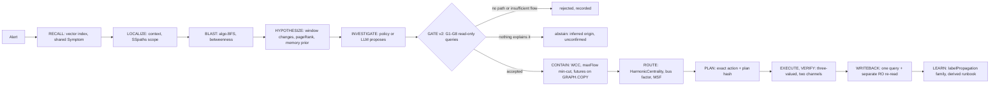

**The crew.** Each stage is worked by a named, least-privilege role: Triage, Historian, Cartographer, Profiler, the Lead investigator with its five investigators (topology, telemetry, data, change, code), the Gatekeeper, Containment, Dispatcher, Planner, Operator, Auditor and Librarian ([docs/AGENTS.md](docs/AGENTS.md), generated from `agent/crew.py`). Each role is deterministic code with its own tool whitelist, enforced in code; only the lead may use a model, and the Gatekeeper never does. The Operator is the only holder of `execute_action`. Every step is a record in FalkorDB: `(:Run)-[:HAS_TASK]->(:Task)-[:CLAIMED_BY]->(:Agent)`, the graph calls it made (`MADE`) and the hand-off order (`NEXT`). The incident room's Crew board reads it back (`Q-CREW-1`), and "Why do you believe this?" draws the verdict's provenance (`Q-PROV-1`): which agent's call produced which evidence that supports the confirmed cause. Crew records are records, not locks: execution is serialised by the Intent lease, and a crew record never counts as a G7 vote. Per-stage tool whitelists: [docs/STAGE_TOOLS.md](docs/STAGE_TOOLS.md).

## Graph model

One graph per tenant. Every node carries the base label `Node` plus one domain label, so ids resolve across labels. The core of the model:

<details><summary>Show the graph model: labels, relationships and validity windows</summary>


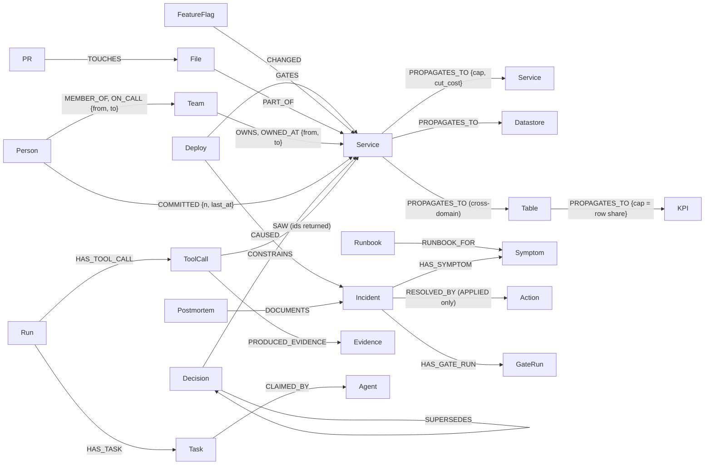

- The agent never decides over raw `CALLS` or lineage edges. At ingest each producer writes a derived `PROPAGATES_TO` edge that points the way failure flows, with `cap` (criticality, or row share on lineage) and `cut_cost`.
- Ownership, on-call and decisions carry validity windows (`OWNED_AT {from, to}`, `ON_CALL {from, to}`, `SUPERSEDES`), and calls a past PR introduced carry `valid_from`, so the graph answers as of a date or an incident.
- Incidents, postmortems and runbooks carry `vecf32` embeddings under a vector index; services, tables, runbooks, decisions, postmortems and docs have full-text indexes.
- Run state lives in the same graph: `Run`, `StageEvent`, `ToolCall`, `Evidence`, `Hypothesis`, `GateRun`, `Approval`, `Intent`, `Action`, `Task`/`Agent`, `Session`/`Turn`.

Full ER diagrams, property semantics and validity windows: [docs/GRAPH_MODEL.md](docs/GRAPH_MODEL.md). The live schema, generated from the seeded graphs and checked for drift against the declared model (`graph/schema_model.py`): [docs/GRAPH_SCHEMA.md](docs/GRAPH_SCHEMA.md). Seeded sizes: acme has <!-- claim:repo.acme.services -->21<!-- /claim --> services, <!-- claim:repo.acme.persons -->40<!-- /claim --> people and <!-- claim:repo.acme.incidents -->40<!-- /claim --> past incidents; globex has <!-- claim:repo.globex.services -->200<!-- /claim --> services, <!-- claim:repo.globex.persons -->180<!-- /claim --> people and <!-- claim:repo.globex.incidents -->150<!-- /claim --> past incidents.

</details>

## FalkorDB feature map

Every feature below is called from the listed file. Template paths are under `backend/faultline/graph/templates/`.

| Feature | Used for | File |
|---|---|---|
| `algo.SPpaths` / `algo.SSpaths` | G2 proof path, path multiplicity / upstream scope, suspects, no-incident negative proof | `gate_path.cypher`, `gate_multiplicity.cypher`, `upstream_scope.cypher`, `upstream_suspects.cypher`, `neg_proof.cypher` |
| `algo.maxFlow` (+ `edgeFlows`) | G5 sufficiency; containment min-cut, computed in the same query from the flows (residual reachability as a list fixpoint in Cypher); preflight | `gate_flow.cypher`, `cut_in_engine.cypher`, `preflight_flow.cypher` |
| `algo.BFS`, `algo.WCC` | blast radius, protected set, preflight impact, alert-storm grouping, what-if on a branch | `blast_radius.cypher`, `protect_set.cypher`, `preflight_impact.cypher`, `storm_wcc.cypher`, `connectivity.cypher`, `whatif_*.cypher` |
| `algo.betweenness`, `algo.pageRank` | chokepoints, preflight risk, node size; investigation order | `chokepoints.cypher`, `betweenness_all.cypher`, `rank_causes.cypher` |
| `algo.HarmonicCentrality`, `algo.MSF` | who fixes it, escalation tree (scratch projections; the projection's pairs, reasons and tie weights are Cypher too) | `harmonic.cypher`, `msf.cypher`, `who_knows.cypher`, `who_reasons.cypher`, `collab_weights.cypher` |
| `algo.labelPropagation` | incident families → derived runbooks | `families.cypher`, `memory/learn.py` |
| Vector index (`vecf32`, `db.idx.vector.queryNodes`) | recall, brain entity seeds, forget proof. HNSW options measured against an exact `vec.cosineDistance` scan (`M 32`, `efConstruction 400`, `efRuntime 100`): recall@10 <!-- claim:vector.recall_at_10.tuned -->1.0<!-- /claim --> on every set, against <!-- claim:vector.recall_at_10.default -->0.9767<!-- /claim --> for the default index | `recall.cypher`, `find_incident_vector.cypher`, `forget_vector_probe.cypher`, `graph/schema.cypher`, [`evals/vector_recall.py`](evals/vector_recall.py) |
| Full-text index (DDL form) | brain tier-1 seeds; knowledge search over document passages, postmortems, runbooks and decisions, fused with the vector lists by reciprocal rank in the same query | `find_*.cypher`, `knowledge_search.cypher`, `graph/schema.cypher` |
| `GRAPH.COPY` | golden → tenant and eval clean rooms, what-if branches, one futures branch per containment candidate, the Break it twin, as-of branches for the backtest, Re-arm | `graph/copy.py`, `futures.cypher`, `playground.py` |
| `GRAPH.RO_QUERY` + `TIMEOUT` + ACL users | every read | `graph/ro.py`, `deploy/users.acl.template` |
| `GRAPH.EXPLAIN` / `GRAPH.PROFILE` | text2cypher plan check / the UI Cypher panel | `graph/guard.py`, `graph/ro.py` |
| `GRAPH.CONSTRAINT` MANDATORY / UNIQUE on nodes and edges | <!-- claim:repo.constraints -->18<!-- /claim --> engine-enforced invariants on every golden, tenant, on-call and clean-room graph (`GRAPH.COPY` carries them): evidence provenance, a page's deadline, an approval's plan hash, `PROPAGATES_TO.cap`, every node's id, unique run and intent ids. FalkorDB refuses the violating write | [`graph/constraints.py`](backend/faultline/graph/constraints.py), `graph/writes.py`, `tests/live/test_constraints.py` |
| UDFs (`GRAPH.UDF LOAD`, FalkorDB FLEX, pinned by sha) | fuzzy entity resolution (`flex.text.jaroWinkler`), co-failure coupling strength (`flex.sim.jaccard`) | `find_fuzzy.cypher`, `hidden_coupling.cypher`, `graph/udf.py` |
| Our own UDF library (`faultline.*`, `GRAPH.UDF LOAD`, pinned by sha) | ranking inside the engine: the blast radius is scored by `faultline.impact` (tier weight × 1/(1+hops) × traffic), the notify list sums `faultline.capImpact` per owning team, shared agent notes are ranked by `faultline.noteScore`, and entity search merges its full-text and vector branches in one `CALL { … UNION ALL … }` query. Each tool is one read-only query whose rows come back already ordered. Against the previous Python code on every node of both tenants (`evals/udf_equivalence.py`), identical everywhere: blast radius <!-- claim:udf.eq.blast.nonempty_k -->198<!-- /claim -->/<!-- claim:udf.eq.blast.nonempty -->198<!-- /claim --> on every node with a non-empty blast radius (<!-- claim:udf.eq.blast.k -->7926<!-- /claim -->/<!-- claim:udf.eq.blast.n -->7926<!-- /claim --> calls in all), notify list <!-- claim:udf.eq.notify.nonempty_k -->195<!-- /claim -->/<!-- claim:udf.eq.notify.nonempty -->195<!-- /claim --> (on-call filled in <!-- claim:udf.eq.notify.with_oncall -->195<!-- /claim -->), search <!-- claim:udf.eq.find.nonempty_k -->170<!-- /claim -->/<!-- claim:udf.eq.find.nonempty -->170<!-- /claim --> non-empty answers (<!-- claim:udf.eq.find.k -->698<!-- /claim -->/<!-- claim:udf.eq.find.n -->698<!-- /claim --> calls), min-cut <!-- claim:udf.eq.cut.nonempty_k -->197<!-- /claim -->/<!-- claim:udf.eq.cut.nonempty -->197<!-- /claim --> non-empty cuts plus <!-- claim:udf.eq.cut.refused -->1<!-- /claim --> region both refused; `faultline.round4` is Python's `round(x, 4)`, exact halves included | `deploy/udf/faultline-1.0.0.js`, `blast_radius_ranked.cypher`, `notify_set_ranked.cypher`, `find_hybrid.cypher`, `note_recall.cypher`, `evals/udf_equivalence.py` |
| Many graphs on one instance | `tenant_*`, `golden_*`, `golden_*_nomem` (memory-off arm), `audit_*` (append-only receipts), `oncall_*`, `agentmem_*` (shared agent notes), `eval_*`, `scratch_*`, `whatif_*` | `graph/tenant.py` |
| Redis ACL users per tenant | `ro_<tenant>` may only `GRAPH.RO_QUERY`/`EXPLAIN` its own keys (S7 checks NOPERM); `mem_<tenant>` may write one key, `agentmem_<tenant>`, and nothing else (shared agent notes) | `deploy/users.acl.template`, `tests/isolation/` |
| `GRAPH.CONFIG` runtime limits | `TIMEOUT_MAX`, `TIMEOUT_DEFAULT`, `RESULTSET_SIZE`, `MAX_QUEUED_QUERIES` and the per-query memory cap `QUERY_MEM_CAPACITY` (256 MB: a runaway query, from any client including the official MCP server, is stopped by the engine and the engine stays up) applied and verified at seed | `scripts/configure_falkordb.py`, `deploy/docker-compose.yml`, `tests/live/test_mem_cap.py` |
| `avg` / `stDevP` / `percentileCont` aggregates | the gate's anomaly band, computed in the engine (same verdicts as before: the gate bench reproduces its recorded run) | `baseline_band.cypher`, `metric_window_band.cypher`, `agent/datatools.py`, `tests/live/test_band_in_engine.py` |
| Temporal values (`localdatetime`, `duration`, `.dayOfWeek`, `.hour`) | change-freeze windows in the pre-deploy gate: FalkorDB turns the merge time into the policy's local wall clock and holds a PR inside "no payment changes Friday 16:00 to Monday 09:00" | `preflight_freeze.cypher`, `data/gen/policies/acme.yaml`, `preflight/score.py` |
| `dbms.functions()` | text2cypher function allow-list, built from the engine's own catalogue (built-ins plus two vetted UDFs) | `engine_functions.cypher`, `graph/guard.py` |
| `telemetry{graph}` stream + `GRAPH.MEMORY USAGE` | `GET /api/engine/insight`: every query's wait, execution and report time and plan-cache use, per template id, as FalkorDB recorded it (ids and numbers only) | `graph/engine_info.py`, `api.py` |
| `WAITAOF` | the write-back is on disk before VERIFY counts it; a timeout is UNKNOWN, never RESOLVED | `graph/client.py`, `actions/act.py` |
| `intern()` | the telemetry windows' repeated strings (component, metric, kind, source) are stored once by the engine | `graph/writes.py::upsert_nodes`, `tests/live/test_intern.py` |
| Engine without internet egress | prod puts FalkorDB on an internal-only Docker network with no route to the internet (defence in depth), so no query can reach out | `deploy/docker-compose.prod.yml`, `scripts/egress_check.py` |
| Edge validity windows + `SUPERSEDES` | as-of answers: owner, on-call, decisions and runbooks at a date or an incident's onset; the topology at a PR's merge | `owner_at.cypher`, `beliefs_at.cypher`, `timeline.cypher`, `preflight_impact_asof.cypher`, `topology_at.cypher` |
| Pattern comprehensions + bounded variable-length paths | G1 grounding, alert grouping, family fixes, preflight components (the template lint rejects unbounded paths) | `gate_grounding.cypher`, `primary_symptoms.cypher`, `preflight_components.cypher` |
| Single-query atomic writes | every state change (approval + intent, write-back, claims, forget) is one query | `graph/writes.py` |
| `db.meta.stats()`, `db.indexes()` | the `graph_schema` tool, MCP resources, schema drift check | `schema_*.cypher`, `graph/schema_introspect.py`, `scripts/check_schema_drift.py` |
| Official FalkorDB MCP server | raw read-only access for judges | `.mcp.json` (`@falkordb/mcpserver@1.3.0`, strict read-only) |
| `@falkordb/canvas` | the UI's Explore view of the failure-flow graph (node size = betweenness) | `frontend/src/components/explore/FalkorCanvas.tsx` |
| FalkorDB Browser | the same graph, inspected directly: [proof path](docs/media/falkordb-browser-path.png), [decisions constraining payment](docs/media/falkordb-browser-decisions.png) | `docs/media/` |

All <!-- claim:repo.algorithms -->10<!-- /claim --> procedures are resolved on the pinned engine by `make smoke` and recorded in `graph/algo/resolved.json`; procedure names and call forms live only in [`graph/algo/registry.py`](backend/faultline/graph/algo/registry.py) ([docs/FALKORDB_COMPAT.md](docs/FALKORDB_COMPAT.md)). The engine is `falkordb/falkordb:6.0.2`, pinned by digest. The engine bugs we hit are written up as upstream drafts in [docs/upstream/](docs/upstream).

## The graph is load-bearing


Method and numbers for both charts: [docs/PROOF.md, Why FalkorDB](docs/PROOF.md#why-falkordb-what-the-graph-engine-itself-contributes).

`tests/live/test_algo_load_bearing.py` perturbs, on a clean-room `GRAPH.COPY`, exactly what each algorithm reads, and asserts that the decision changes:

| Algorithm (MCP tool) | Decision it makes | Perturbation → flip |
|---|---|---|
| `algo.BFS` (`blast_radius`) | impact set, verification collateral | cut payment→checkout → checkout leaves the impact set |
| `algo.SPpaths` (`causal_paths`) | G2 pass/fail | remove the edge → "no path, no claim" |
| `algo.SSpaths` (`reachable_from_changes`) | NO_INCIDENT vs refuse | cut the path → negative proof accepted |
| `algo.maxFlow` (`impact_bound`) | G5 keep/eliminate | lower one capacity → sufficient becomes insufficient |
| `algo.maxFlow` (`containment_cut`) | which edge to cut | change one `cut_cost` → a different min-cut |
| `algo.WCC` (`connectivity_check`) | whether a cut is needed at all | disconnect → no containment step |
| `algo.betweenness` (`chokepoints`) | preflight risk, chokepoints | remove the top hub's calls → a new top chokepoint |
| `algo.pageRank` (`rank_causes`) | investigation order | add dependencies → a new first suspect |
| `algo.HarmonicCentrality` (`who_fixes`) | who is paged first | remove the top person's work → a new first responder |
| `algo.MSF` (`escalation_tree`) | who is looped in, in what order | drop one collaboration → a different tree |
| `algo.labelPropagation` (`incident_families`) | derived runbook (procedural memory) | split the family → no runbook |

At the outcome level:

| Taken out | What happens | Number |
|---|---|---|
| FalkorDB (arm A4, `FAULTLINE_DISABLE_GRAPH=true`) | the run cannot start and the UI says so; nothing is guessed | confirms <!-- claim:arm.A4.confirmed_causes -->0<!-- /claim --> causes |
| The max-flow check G5 (arm A3-noG5) | S2 can no longer be decided: the stale FX feed survives, so the run escalates rather than guessing; S1 is still decided because the origin test rejects the email deploy too | top-1 <!-- claim:arm.A3.top1 -->1.0<!-- /claim --> → <!-- claim:arm.A3-noG5.top1 -->0.8<!-- /claim --> |
| `algo.SPpaths` and `algo.maxFlow` together (capability ladder, second gate-bench seed) | each covers for the other alone; without both, true causes are lost to abstention | right cause <!-- claim:ladder.full.b.right_cause -->65<!-- /claim --> → <!-- claim:ladder.neither.b.right_cause -->43<!-- /claim --> of <!-- claim:ladder.neither.b.confirm_cases -->65<!-- /claim --> |
| Any one safety check (mutation testing) | each mutant weakens one gate or action rule; the test suite must catch it | <!-- claim:mutation.killed -->43<!-- /claim -->/<!-- claim:mutation.mutants -->43<!-- /claim --> mutants caught |

A4 shows the graph is load-bearing; it is not a measurement of a graph-free agent, because the product fails closed instead of degrading.

## Results

Keyless arms run on fresh `GRAPH.COPY` clean rooms over scenarios S1, S2, S3, S1b, S3b, S12 (abstention) and the controls S4D and S4S. The investigator is deterministic, so N = 3 shows reproducibility, not variance; arm N runs once. Method and expectations were written down first: [evals/PREREGISTRATION.md](evals/PREREGISTRATION.md). Every table is generated into [evals/RESULTS.md](evals/RESULTS.md) from `evals/results/` and never edited by hand.

| Arm | What it gets | Top-1 | False blame (on scenarios with a true cause) | Abstention (S4D, S4S, S12) |
|---|---|---|---|---|
| N: naive recency (also A4's "ungated guess") | the list of changes as files | <!-- claim:arm.N.top1 -->0.1<!-- /claim --> (ties scored 1/k) | <!-- claim:arm.N.false_blame_rate -->1.0<!-- /claim --> | <!-- claim:arm.N.abstention_correct_rate -->0.0<!-- /claim --> |
| V: vector only (cosine in FalkorDB over change-title embeddings) | the incident's vector + the changes' titles | <!-- claim:arm.V.top1 -->0.4<!-- /claim --> | <!-- claim:arm.V.false_blame_rate -->0.6<!-- /claim --> | <!-- claim:arm.V.abstention_correct_rate -->0.0<!-- /claim --> |
| T: telemetry only (the change on the most anomalous component; no topology) | the window's changes + their components' error rates | <!-- claim:arm.T.top1 -->0.9<!-- /claim --> (ties scored 1/k) | <!-- claim:arm.T.false_blame_rate -->0.2<!-- /claim --> | <!-- claim:arm.T.abstention_correct_rate -->0.0<!-- /claim --> |
| A2: graph, memory off | graph tools | <!-- claim:arm.A2.top1 -->1.0<!-- /claim --> | <!-- claim:arm.A2.false_blame_rate -->0.0<!-- /claim --> | <!-- claim:arm.A2.abstention_correct_rate -->1.0<!-- /claim --> |
| A3: graph + memory (the product) | everything | <!-- claim:arm.A3.top1 -->1.0<!-- /claim --> | <!-- claim:arm.A3.false_blame_rate -->0.0<!-- /claim --> | <!-- claim:arm.A3.abstention_correct_rate -->1.0<!-- /claim --> |
| A3-noG5: the product without the max-flow check | everything except G5 | <!-- claim:arm.A3-noG5.top1 -->0.8<!-- /claim --> | <!-- claim:arm.A3-noG5.false_blame_rate -->0.0<!-- /claim --> | <!-- claim:arm.A3-noG5.abstention_correct_rate -->1.0<!-- /claim --> |
| A4: FalkorDB off | the same agent; the run cannot start (fails closed) | confirms <!-- claim:arm.A4.confirmed_causes -->0<!-- /claim --> | <!-- claim:arm.A4.false_blame_rate -->0.0<!-- /claim --> | <!-- claim:arm.A4.abstention_correct_rate -->0.0<!-- /claim --> (cannot prove a no-incident) |

The graph decides where a plain anomaly heuristic cannot: the data incident (S2, where the distractor ties), the controls and the abstention (T can never say "no change explains this"), and the max-flow rejection of a look-alike that has a path. Grounding (G1) is <!-- claim:arm.A3.grounded_rate -->1.0<!-- /claim -->.

Headline results (method for each line: [docs/EVALS.md](docs/EVALS.md)):

| Question | Result |
|---|---|
| Does the gate decide right on generated incidents? | gate bench <!-- claim:gate_bench.correct -->100<!-- /claim -->/<!-- claim:gate_bench.cases -->100<!-- /claim --> (development seed), <!-- claim:gate_bench_heldout.correct -->100<!-- /claim -->/<!-- claim:gate_bench_heldout.cases -->100<!-- /claim --> (second seed) and <!-- claim:seeds.gate.correct -->300<!-- /claim -->/<!-- claim:seeds.gate.cases -->300<!-- /claim --> on <!-- claim:seeds.gate.seeds -->3<!-- /claim --> seeds generated for this audit, 0 wrong blames; strict, with a bystander named "not confident" counted wrong: <!-- claim:gate_bench.correct_strict -->96<!-- /claim -->, <!-- claim:gate_bench_heldout.correct_strict -->98<!-- /claim --> and <!-- claim:seeds.gate.correct_strict -->296<!-- /claim -->. This bench is a conformance test (healthy look-alikes; its verdicts follow the gate's rules) |
| Multi-hop causes and innocent deploys downstream? | deep bench, fresh seed: right cause <!-- claim:deep.fresh.all.right_cause -->51<!-- /claim -->/<!-- claim:deep.fresh.all.cause_cases -->100<!-- /claim -->, <!-- claim:deep.fresh.all.wrong_confident -->0<!-- /claim --> confident wrong blames in <!-- claim:deep.fresh.all.cases -->140<!-- /claim --> worlds, <!-- claim:deep.fresh.all.abstained -->89<!-- /claim --> abstained; on <!-- claim:seeds.deep.seeds -->3<!-- /claim --> new seeds <!-- claim:seeds.deep.right_cause -->136<!-- /claim -->/<!-- claim:seeds.deep.cause_cases -->300<!-- /claim --> and <!-- claim:seeds.deep.wrong_confident -->0<!-- /claim --> in <!-- claim:seeds.deep.cases -->420<!-- /claim -->, with <!-- claim:seeds.deep.accepted_nc.bystander -->24<!-- /claim --> innocent changes named "not confident". Telemetry only is more often right (<!-- claim:deep.fresh.all.T.right_strict -->85<!-- /claim -->/<!-- claim:deep.fresh.all.cause_cases -->100<!-- /claim --> and <!-- claim:seeds.deep.T.right_strict -->249<!-- /claim -->/<!-- claim:seeds.deep.cause_cases -->300<!-- /claim -->) and wrong in <!-- claim:deep.fresh.all.T.wrong_any -->55<!-- /claim --> and <!-- claim:seeds.deep.T.wrong_any -->171<!-- /claim --> worlds |
| Does it hold on the second tenant (globex, 200 services)? | independent-parameter worlds: right cause <!-- claim:world_globex.right_cause -->106<!-- /claim -->/<!-- claim:world_globex.cause_cases -->117<!-- /claim -->, <!-- claim:world_globex.wrong_confident -->0<!-- /claim --> confident wrong blames in <!-- claim:world_globex.cases -->200<!-- /claim --> worlds. Telemetry only: right <!-- claim:world_globex.T.right_strict -->107<!-- /claim -->, wrong <!-- claim:world_globex.T.wrong_any -->93<!-- /claim -->; thresholded (T+): right <!-- claim:world_globex.Tplus.right_strict -->107<!-- /claim -->, wrong <!-- claim:world_globex.Tplus.wrong_any -->1<!-- /claim --> |
| What if the graph is wrong about the world? | wrong-confident blames: <!-- claim:mismatch.caps.wrong_confident -->0<!-- /claim --> (caps ±50%), <!-- claim:mismatch.hidden.wrong_confident -->0<!-- /claim --> (hidden edge), <!-- claim:mismatch.stale.wrong_confident -->0<!-- /claim --> (stale edge), <!-- claim:mismatch.all.wrong_confident -->0<!-- /claim --> (all three) | <!-- noclaim: ±50% is the pre-registered perturbation size, not a result -->
| What does each FalkorDB algorithm buy? | with healthy look-alikes (second-seed gate bench), each algorithm covers for the other: right cause <!-- claim:ladder.full.b.right_cause -->65<!-- /claim -->/<!-- claim:ladder.full.b.confirm_cases -->65<!-- /claim --> full, <!-- claim:ladder.no_maxflow.b.right_cause -->65<!-- /claim --> without `algo.maxFlow`, <!-- claim:ladder.no_sppaths.b.right_cause -->65<!-- /claim --> with `algo.SPpaths` swapped for connectivity, <!-- claim:ladder.neither.b.right_cause -->43<!-- /claim --> without both. When the look-alike is itself faulty (decisive bench), `algo.maxFlow` decides alone: right cause <!-- claim:decisive.full.g5_only.right_cause -->20<!-- /claim -->/<!-- claim:decisive.full.g5_only.cases -->20<!-- /claim --> with it, <!-- claim:decisive.no_maxflow.g5_only.right_cause -->0<!-- /claim --> without; telemetry only <!-- claim:decisive.T.g5_only.right_strict -->13<!-- /claim -->. Wrong-confident 0 on every rung (we predicted it would rise) |
| Where does it break? | <!-- claim:curve.wrong_confident_max -->0<!-- /claim --> confident wrong blames at any of <!-- claim:curve.points -->21<!-- /claim --> stress points. Not on noise up to ×16 (<!-- claim:curve.noise.16.correct -->100<!-- /claim -->/100 correct) or ×10 duplicate alerts (<!-- claim:robustness.duplicates.10.correct -->100<!-- /claim -->); it bends with missing telemetry (<!-- claim:curve.missing.0.2.correct -->83<!-- /claim --> correct with a fifth of components dark, <!-- claim:curve.missing.0.5.correct -->53<!-- /claim --> with half, every loss an abstention) and with heavy noise (×64: <!-- claim:curve.noise.64.correct -->82<!-- /claim -->) |
| Is the graph better context for an agent than vector RAG? | `context_pack` on <!-- claim:ctx.busy0.worlds -->110<!-- /claim --> worlds, true cause's rank at 1,000 tokens with 30 unrelated deploys (MRR): <!-- claim:ctx.busy30.b1000.GA.mrr -->0.6598<!-- /claim --> vs <!-- claim:ctx.busy30.b1000.TR.mrr -->0.5606<!-- /claim --> ranking by telemetry without the graph, <!-- claim:ctx.busy30.b1000.V.mrr -->0.4226<!-- /claim --> vector RAG and <!-- claim:ctx.busy30.b1000.R.mrr -->0.0768<!-- /claim --> recency; paired difference over telemetry alone <!-- claim:ctx.busy30.b1000.GA_minus_TR.mrr_diff -->0.0991<!-- /claim --> [<!-- claim:ctx.busy30.b1000.GA_minus_TR.ci_lo -->0.06<!-- /claim -->–<!-- claim:ctx.busy30.b1000.GA_minus_TR.ci_hi -->0.1424<!-- /claim -->], and only <!-- claim:ctx.busy0.b1000.GA_minus_TR.mrr_diff -->0.0136<!-- /claim --> in a quiet window |
| Does memory ever change the answer? | after a verified fix teaches a missing link: <!-- claim:learning.i2_learned_correct -->24<!-- /claim -->/<!-- claim:learning.cases -->24<!-- /claim --> next incidents correct (<!-- claim:learning.i2_fresh_correct -->24<!-- /claim --> with a fresh world seed) vs <!-- claim:learning.i2_control_correct -->2<!-- /claim --> without; wrong guesses taught <!-- claim:learning.wrong_guess_proposals -->0<!-- /claim --> links. The eval's human is an oracle that names the true cause: this tests the mechanism, not a human's judgement |
| Do the predicted futures come true? | <!-- claim:futures.bench.cut.agree -->148<!-- /claim -->/<!-- claim:futures.bench.cut.definite -->148<!-- /claim --> measured cut predictions match the world, <!-- claim:futures.bench.cut.false_assurance -->0<!-- /claim --> false assurances |
| Are the safety checks really tested? | <!-- claim:mutation.killed -->43<!-- /claim -->/<!-- claim:mutation.mutants -->43<!-- /claim --> mutants caught |
| Kill -9 in the middle of an action? | settled exactly once: <!-- claim:chaos.exactly_once -->True<!-- /claim -->, write-back <!-- claim:chaos.writeback -->7/7<!-- /claim --> |
| Many responders approve at once? | <!-- claim:contention.responders -->24<!-- /claim --> concurrent approvals: <!-- claim:contention.same.accepted -->1<!-- /claim --> accepted, <!-- claim:contention.same.refused -->23<!-- /claim --> refused, <!-- claim:contention.same.prs -->1<!-- /claim --> PR |
| Company brain | <!-- claim:brain.correct -->33<!-- /claim -->/<!-- claim:brain.questions -->33<!-- /claim --> on our own questions, including <!-- claim:brain.unanswerable_honest -->6<!-- /claim --> of <!-- claim:brain.unanswerable -->6<!-- /claim --> unanswerable ones declined honestly; on a paraphrase of each question <!-- claim:brain_para.correct -->30<!-- /claim -->/<!-- claim:brain_para.questions -->33<!-- /claim -->, and <!-- claim:brain_para.cites_ok -->30<!-- /claim --> with every expected citation. Routing is two-stage: keyword patterns first, and only when none matches, FalkorDB (vector + full-text over seeded question examples, refusing weak matches); the paraphrase set is the one this was built on, so it is not blind. **On a blind set** written by an agent that never saw the router: <!-- claim:brain_blind.s2.hybrid.correct -->24<!-- /claim -->/<!-- claim:brain_blind.s2.hybrid.questions -->40<!-- /claim -->, against <!-- claim:brain_blind.s2.keyword_router.correct -->19<!-- /claim -->/<!-- claim:brain_blind.s2.keyword_router.questions -->40<!-- /claim --> for keyword routing alone |
| Same answers as SQL? | the gate's lookups vs DuckDB recursive SQL on the same edges at 1k services: <!-- claim:perf.1k.reach_set.equal -->10<!-- /claim -->/<!-- claim:perf.1k.reach_set.instances -->10<!-- /claim --> reach sets and <!-- claim:perf.1k.shortest_causal_path.equal -->10<!-- /claim -->/<!-- claim:perf.1k.shortest_causal_path.instances -->10<!-- /claim --> shortest causal paths agree (<!-- claim:perf.1k.shortest_causal_path.non_empty -->5<!-- /claim --> have a path; the rest agree there is none); both are milliseconds at this size, so no speed claim (times in [docs/PROOF.md](docs/PROOF.md#why-falkordb-what-the-graph-engine-itself-contributes)) |
| How fast? | a full scenario run (deterministic investigator, clean room) p50 <!-- claim:arm.A3.seconds_p50 -->0.84<!-- /claim --> s; the G2 query p50 <!-- claim:profile.Q-GATE-1.engine_ms_p50 -->0.025<!-- /claim --> ms engine time; a brain answer p50 <!-- claim:brain.ms_p50 -->11.8<!-- /claim --> ms; an alert is visible to decisions <!-- claim:perf.fresh.alert.p50_ms -->0.727<!-- /claim --> ms after the write |
| Scale | <!-- claim:scale.10k.services -->10000<!-- /claim --> services, <!-- claim:scale.10k.nodes -->296261<!-- /claim --> nodes, <!-- claim:scale.10k.edges -->1097675<!-- /claim --> edges: decided correctly (<!-- claim:scale.10k.correct -->True<!-- /claim -->) in <!-- claim:scale.10k.run_s -->34.88<!-- /claim --> s end to end, most of it the futures stage (one `GRAPH.COPY` branch per containment option); the gate sweep that decides takes <!-- claim:scale.10k.sweep_ms_p50 -->463.421<!-- /claim --> ms (p50) |
| On a real system? | FaultBench-OTel (the OpenTelemetry Demo, its own fault flags, its real telemetry; topology and decoys ours): right cause <!-- claim:otel.faultline.right_cause.k -->11<!-- /claim -->/<!-- claim:otel.faultline.right_cause.n -->20<!-- /claim -->, wrong blames <!-- claim:otel.faultline.wrong.k -->0<!-- /claim -->/<!-- claim:otel.faultline.wrong.n -->40<!-- /claim -->, controls blame-free <!-- claim:otel.faultline.control_blame_free.k -->20<!-- /claim -->/<!-- claim:otel.faultline.control_blame_free.n -->20<!-- /claim -->; a telemetry threshold <!-- claim:otel.Tplus.right_cause.k -->13<!-- /claim --> right and <!-- claim:otel.Tplus.wrong.k -->8<!-- /claim --> wrong, recency <!-- claim:otel.N.right_cause.k -->17<!-- /claim --> right and <!-- claim:otel.N.wrong.k -->23<!-- /claim --> wrong |
| Against a strong LLM on the adversarial worlds? | `claude-opus-5-5` alone, the same telemetry and change list: right cause <!-- claim:llm_deep.deep.all.right_cause -->66<!-- /claim -->/<!-- claim:llm_deep.deep.all.cause_cases -->100<!-- /claim -->, confident wrong <!-- claim:llm_deep.deep.all.wrong_confident -->37<!-- /claim -->/<!-- claim:deep.fresh.all.cases -->140<!-- /claim -->; on the decisive worlds where only max flow separates cause from look-alike, <!-- claim:llm_deep.decisive.g5_only.right_cause -->14<!-- /claim -->/<!-- claim:llm_deep.decisive.g5_only.cases -->20<!-- /claim --> right and <!-- claim:llm_deep.decisive.g5_only.wrong_confident -->3<!-- /claim --> wrong (Faultline <!-- claim:decisive.full.g5_only.right_cause -->20<!-- /claim -->/<!-- claim:decisive.full.g5_only.cases -->20<!-- /claim -->, 0 wrong) |
| Does on call work end to end? | a scripted night: <!-- claim:oncall.night.steps_passed -->14<!-- /claim -->/<!-- claim:oncall.night.steps -->14<!-- /claim --> steps (page, escalate, acknowledge, approve, APPLIED, standing approval, the same fault again with <!-- claim:oncall.night.inc2.people_woken -->0<!-- /claim --> people paged); the contract fired in <!-- claim:oncall.night.negatives_fired -->0<!-- /claim --> of <!-- claim:oncall.night.negatives -->5<!-- /claim --> cases outside its terms |
| Does it learn from the people who use it? | the fix the on-call keeps choosing moves first on both scenarios checked (deterministic), gate verdicts unchanged; forget removes <!-- claim:learn.forget.events -->14<!-- /claim --> events with <!-- claim:learn.forget.events_left -->0<!-- /claim --> left; the memory and coordination checklist (track T2) <!-- claim:t2.green -->5<!-- /claim -->/<!-- claim:t2.items -->5<!-- /claim --> |
| Many tenants on one engine? | <!-- claim:tenants.n -->250<!-- /claim --> tenant graphs, <!-- claim:tenants.acl.leaks -->0<!-- /claim --> leaks in <!-- claim:tenants.acl.cross.n -->1000<!-- /claim --> cross-tenant reads by per-tenant ACL users; gate reads p99 <!-- claim:tenants.c64.p99_ms -->6.62<!-- /claim --> ms with 64 parallel investigators, <!-- claim:tenants.c64.errors -->0<!-- /claim --> errors |
| FalkorDB's algorithms against NetworkX? | all 10 `algo.*` at 10k services on the same input: same answers on <!-- claim:algo10k.same -->9<!-- /claim -->/<!-- claim:algo10k.comparable -->11<!-- /claim --> comparable workloads; engine time faster on <!-- claim:algo10k.faster_engine -->11<!-- /claim -->/<!-- claim:algo10k.timed_pairs -->12<!-- /claim --> (exact betweenness <!-- claim:algo10k.betweenness.falkor_ms_p50 -->255.217<!-- /claim --> ms against <!-- claim:algo10k.betweenness.nx_ms_p50 -->54707.892<!-- /claim --> ms); client wall time faster on only <!-- claim:algo10k.faster_wall -->5<!-- /claim --> |
| Is the vector index tuned? | recall@10 <!-- claim:vector.recall_at_10.tuned -->1.0<!-- /claim --> on <!-- claim:vector.queries -->702<!-- /claim --> queries over <!-- claim:vector.sets -->9<!-- /claim --> sets with M 32, efConstruction 400, efRuntime 100 (the defaults: <!-- claim:vector.recall_at_10.default -->0.9767<!-- /claim --> on the hardest set) |
| Is the method portable? | the four-query skill names the gate's cause in <!-- claim:skill.named_same -->4<!-- /claim -->/<!-- claim:skill.cause_scenarios -->5<!-- /claim --> scenarios that have one (its miss abstains), abstains with the gate in <!-- claim:skill.abstain_same -->3<!-- /claim -->/<!-- claim:skill.abstain_scenarios -->3<!-- /claim -->, and eliminated the gate's cause <!-- claim:skill.cause_eliminated -->0<!-- /claim --> times |

**LLM arms** ([evals/llm_arms.py](evals/llm_arms.py), `claude-opus-5-5`, side file `evals/results/llm_arms.json`): given the alert, per-minute telemetry for every service, the change list with its diff facts and, for data incidents, the warehouse comparison and invariant results, the model alone (A0) got the right verdict in <!-- claim:arm.A0.outcome_correct.k -->23<!-- /claim --> of <!-- claim:arm.A0.outcome_correct.n -->24<!-- /claim --> trials [<!-- claim:arm.A0.outcome_correct.ci_lo -->80%<!-- /claim -->–<!-- claim:arm.A0.outcome_correct.ci_hi -->99%<!-- /claim -->] across the 8 scenarios (3 trials each), with <!-- claim:arm.A0.scen.wrong_blame.k -->0<!-- /claim --> wrong blames; with vector-RAG context (A1) <!-- claim:arm.A1.outcome_correct.k -->23<!-- /claim --> of <!-- claim:arm.A1.outcome_correct.n -->24<!-- /claim -->. Faultline driven by the same model (A3L) got <!-- claim:arm.A3L.outcome_correct.k -->8<!-- /claim --> of <!-- claim:arm.A3L.outcome_correct.n -->8<!-- /claim --> [<!-- claim:arm.A3L.outcome_correct.ci_lo -->68%<!-- /claim -->–100 %]. **On our hand-written scenarios, a strong model with good evidence is as accurate as the gate; on the adversarial worlds it is not safe.** On the same <!-- claim:llm_deep.deep.all.cases -->140<!-- /claim --> deep-bench worlds it names the right cause more often than Faultline (<!-- claim:llm_deep.deep.all.right_cause -->66<!-- /claim --> of 100) but confidently blames an innocent change in <!-- claim:llm_deep.deep.all.wrong_confident -->37<!-- /claim -->; on the <!-- claim:llm_deep.decisive.all.cases -->40<!-- /claim --> decisive worlds, where only `algo.maxFlow` or `algo.SPpaths` can reject the look-alike, it blames an innocent change in <!-- claim:llm_deep.decisive.all.wrong_confident -->7<!-- /claim --> (Faultline: 0). What the graph adds there is not accuracy: it is a proof anyone can re-run (the path and the flow bound, as Cypher), no tokens and well under a millisecond per check against a median <!-- claim:arm.A0.tokens_median -->2522<!-- /claim --> tokens per LLM decision, the same answer every time (the model missed S3b in one trial of three), and the approved, verified action. <!-- noclaim: 55 is deep.fresh.all.T.wrong_any, tagged above -->

## What makes it different

| Property | How it works | Evidence |
|---|---|---|
| Graph proof before any claim | G2 needs an `algo.SPpaths` row from the change to every symptom | [`gate_path.cypher`](backend/faultline/graph/templates/gate_path.cypher); `tests/live/test_algo_load_bearing.py::test_sppaths_decides_g2` |
| A capacity bound on every suspect | G5: joint `algo.maxFlow` × path multiplicity must cover the observed share | `D-fx-pause-7` max flow <!-- claim:s2.D-fx-pause-7.max_flow -->0.0692<!-- /claim --> < <!-- claim:s2.D-fx-pause-7.needed -->0.8<!-- /claim -->; property test `tests/graph/test_g5_bound_property.py` |
| Abstention instead of guessing | not confident, inferred origin, or a proven no-incident; missing telemetry is never read as "normal" (N0) | gate bench, second seed <!-- claim:gate_bench_heldout.correct -->100<!-- /claim -->/<!-- claim:gate_bench_heldout.cases -->100<!-- /claim -->; deep bench <!-- claim:deep.fresh.all.wrong_confident -->0<!-- /claim --> wrong-confident |
| Three-valued verification | GitHub main re-read plus telemetry for every symptom and collateral; UNKNOWN goes to a human | S9 → <!-- claim:s9.verdict -->UNKNOWN<!-- /claim -->, success written <!-- claim:s9.success_written -->False<!-- /claim --> |
| Two-step approval bound to a plan hash | choosing ≠ approving; approval quotes the hash of the exact diff and is exclusive in one query | [`actions/act.py`](backend/faultline/actions/act.py), `tests/live/test_actions.py`; <!-- claim:contention.same.accepted -->1<!-- /claim --> of <!-- claim:contention.responders -->24<!-- /claim --> racing approvals lands |
| Write-back and warm recall in the same graph | the verdict, cause, postmortem and decision are written in one query and re-read on a separate RO connection; the next incident recalls them | write-back <!-- claim:s1.writeback -->7/7<!-- /claim -->; S1b warm prior <!-- claim:memory.warm_prior -->0.8423<!-- /claim --> |
| Provenance from verdict to tool call | every evidence item records its template, Cypher, params and digest; `Q-PROV-1` walks verdict → evidence → tool call → agent | [`run_provenance.cypher`](backend/faultline/graph/templates/run_provenance.cypher); grounding <!-- claim:arm.A3.grounded_rate -->1.0<!-- /claim --> |
| Pre-deploy gate on the same graph | a PR is scored from BFS impact, betweenness, past incidents, contradicted decisions, bus factor and missing guardrails | S6 → <!-- claim:s6.verdict -->block<!-- /claim --> (risk <!-- claim:s6.risk -->0.8<!-- /claim -->); [`deploy/github-action/`](deploy/github-action/faultline-preflight.yml) |
| Company brain on the same graph | as-of answers about owners, decisions and on-call; every cited id must have been returned by that question's own queries | <!-- claim:brain.correct -->33<!-- /claim -->/<!-- claim:brain.questions -->33<!-- /claim --> on our wording, <!-- claim:brain_para.correct -->30<!-- /claim -->/<!-- claim:brain_para.questions -->33<!-- /claim --> reworded (the development set, not blind); <!-- claim:brain_blind.s2.hybrid.correct -->24<!-- /claim -->/<!-- claim:brain_blind.s2.hybrid.questions -->40<!-- /claim --> on a blind set; `Q-CITE-1` |
| Per-tenant isolation | one graph and one ACL user per tenant; the hosted MCP binds a key to one tenant | S7 isolation checks: <!-- claim:s7.passed -->34<!-- /claim --> passed, <!-- claim:s7.failed -->0<!-- /claim --> failed |
| MCP for any agent | the agent's own read-only tools, each returning the Cypher, params, timing and a row digest | <!-- claim:repo.mcp_tools -->60<!-- /claim --> tools, <!-- claim:repo.mcp_tools_hosted -->53<!-- /claim --> of them exposed over Streamable HTTP; [docs/MCP.md](docs/MCP.md) |

## Context for any agent

Vector search finds the entry points; FalkorDB walks from them to the changes upstream of the alert (ranked by the anomaly the graph's telemetry measured on each), their causal paths, the owners and who can fix it, the decisions that constrain them, and what fixed it last time. One MCP call packs that to a token budget, with the query behind every line.

`context_pack(text="checkout errors are elevated", targets=["checkout"], budget_tokens=500)` on the hero incident's clean room, first lines verbatim:

> - `[change] change D-pay-417 (deploy) on payment (error-rate excess +0.403), 1 hop(s) upstream of checkout, 3 min before` ‹Q-CTX-RANK› <!-- noclaim: verbatim output of one pack on the S1 clean room -->
> - `[change] change D-email-88 (deploy) on email (error-rate excess +0.001), 1 hop(s) upstream of checkout, 3 min before` ‹Q-CTX-RANK› <!-- noclaim: verbatim output of one pack on the S1 clean room -->
> - `[path] causal path: D-pay-417 → payment → checkout` ‹Q-GATE-1›
> - `[people] who can fix payment: p-030, p-004, p-017, p-036, p-038 (team team-payments)` ‹Q-ORG-1›
> - `[decision] decision ADR-012 constrains payment: Payment client timeout must stay ≤ 2000 ms` ‹Q-DEC-ABOUT› <!-- noclaim: verbatim output of one pack on the S1 clean room -->

**MCP.** `make mcp` serves every product read as a typed, tenant-bound tool over stdio, plus the schema, query and weights resources and the investigate, preflight and ask-brain prompts. `make mcp-http` serves the same tools over Streamable HTTP with a bearer key bound to one tenant; it is deployed at `https://13-203-185-119.sslip.io/mcp` (read-only, rate-limited). From any stdio MCP client, `npx -y @prashantthakur77/faultline-mcp` connects to it with the public demo key ([npm package](https://www.npmjs.com/package/@prashantthakur77/faultline-mcp); `--url` and `--key` for your own server). Tools that build scratch or branch graphs stay internal, and the MCP service gets no engine credential. The official FalkorDB MCP server is also configured, strict read-only, in [`.mcp.json`](.mcp.json). Details: [docs/MCP.md](docs/MCP.md).

## Memory, company brain, preflight, coordination

- **Memory** recalls precedents by vector, then confirms them structurally; it reorders and never decides (gate verdicts identical cold vs warm: <!-- claim:memory.gate_verdicts_identical -->True<!-- /claim -->).
- **Company brain** answers who owns, knows and decided, and what was true *as of* a date or incident, citing only node ids its own queries returned (<!-- claim:brain.correct -->33<!-- /claim -->/<!-- claim:brain.questions -->33<!-- /claim --> on our question set; <!-- claim:brain_para.correct -->30<!-- /claim -->/<!-- claim:brain_para.questions -->33<!-- /claim --> when each question is reworded, on the development set its router was built on). On a blind set written by an agent that never saw the router it answers <!-- claim:graphrag.s2.fl.correct -->24<!-- /claim -->/<!-- claim:graphrag.s2.questions -->40<!-- /claim --> ([evals](docs/EVALS.md#the-numbers-audit-2026-10-16-intervals-new-seeds-and-harder-comparisons)).
- **Preflight** blocks a risky PR from the same graph (S6 → <!-- claim:s6.verdict -->block<!-- /claim -->).
- **Coordination** uses atomic claims in one query (<!-- claim:s13.lost_updates -->0<!-- /claim --> lost updates under contention).
- **Knowledge search** reads what the documents say: document text is stored as `(:Chunk)` passages with `vecf32` embeddings, and `search_knowledge` fuses seven full-text and vector lists by reciprocal rank in one query, crediting a document's text to the decision or runbook it produced.
- **Shared agent notes** let agents leave leads for each other in FalkorDB: `remember` writes one note in one atomic query (components exist, reply target exists, daily quota on the engine clock) to `agentmem_<tenant>`, a `GRAPH.COPY` of the topology that only the `mem_<tenant>` ACL user may write; `recall_notes` finds notes by meaning (`vecf32` index) and by hops from a component in one read-only query, ranked inside the engine. A note is a lead, never evidence.

<details><summary>Show memory, the company brain, preflight and coordination in detail</summary>


**The company brain (T3), answered by the live deployment.** Every `[id]` is a node a read-only query of that question returned; the brain cannot cite anything else.

> **Who decided the payment timeout, and are they still here?**
> [ADR-012] Payment client timeout must stay ≤ 2000 ms: active, and still current (nothing supersedes it). Decided by [p-004] Dorian Marrowby (still on the owning team), [p-022] Vesna Hollowell (still here, another team). [ADR-013] Payment client keeps ≥ 2 retries: active, and still current. Decided by the same two people.

> **Which revenue-path services lack a runbook or owner?**
> 6 revenue-path services lack a guardrail: [cart], [currency], [frontend], [frontend-proxy] and [shipping] (tier 1) and [quote] (tier 2) have no current runbook.

The same answer drawn as a graph (who decided, the decisions, what they constrain):


<details><summary><b>How memory, the brain, preflight and coordination work</b></summary>

**Memory (T1/T2).**
- **Recall.** The incident's own vector is looked up in the FalkorDB vector index (`db.idx.vector.queryNodes`), then confirmed structurally through a shared `(:Symptom)` node. It never relies on similarity alone.
- **Families.** Incident families come from `algo.labelPropagation`. When a family has ≥ 2 incidents fixed the same APPLIED way, it is consolidated into a derived runbook with `DERIVED_FROM` provenance. Salience decays, except for incidents with an applied fix. A NOT_APPLIED attempt is remembered too.
- **Measured on S1b**, a repeat payment regression in the same graph after S1 was resolved: the warm run's top precedent is S1 (<!-- claim:memory.warm_top_precedent_is_s1 -->True<!-- /claim -->), the derived runbook comes first (<!-- claim:memory.derived_runbook_first -->True<!-- /claim -->), the family prior rises from <!-- claim:memory.cold_prior -->0.7681<!-- /claim --> to <!-- claim:memory.warm_prior -->0.8423<!-- /claim -->, and gate verdicts stay identical (<!-- claim:memory.gate_verdicts_identical -->True<!-- /claim -->).
- **Forget with a receipt (S10).** A dry run lists exactly what one document alone produced. Execution then requires a token bound to that exact set, and a `ForgetReceipt` is written to `audit_<tenant>`. Proof follows: the forgotten vectors no longer come back from the index, and re-asking the question no longer cites the forgotten decision.

**Shared agent notes (T2: memory and coordination across agents).** Faultline's own runs and any MCP client share one
memory in FalkorDB, with the engine, not our code, keeping it apart from the graph the gate reads.
- **Where.** `agentmem_<tenant>` is made once as a `GRAPH.COPY` of the tenant's golden topology, so a note can point at
  real components: `(:Author)-[:WROTE]->(:Note)-[:ABOUT]->(component)`, and `(:Note)-[:REPLY_TO {stance}]->(:Note)` when an
  agent confirms, refutes or adds to another's note. The note text carries a `vecf32` embedding (HNSW index) and a full-text
  index; `Note.id` is UNIQUE and author, kind, text, time and expiry are MANDATORY (engine constraints).
- **Who may write.** Only the `mem_<tenant>` ACL user, whose one key is `agentmem_<tenant>`: FalkorDB answers NOPERM to
  that user on the tenant graph, the golden graph, another tenant's notes, `GRAPH.DELETE`, `GRAPH.COPY`, `GRAPH.CONFIG` and
  `GRAPH.LIST` (`tests/isolation/test_mem_acl.py`, run with real ACL users in `make judge-check`). The read-only user
  may read the notes and cannot write them.
- **Write (`remember`, W-NOTE-1).** One query checks that every `about` id is a component, that the reply target exists
  and that the author is under its daily quota on the engine clock, then writes the note, its edges and its embedding.
  Sixteen concurrent writers against a quota of five leave exactly five notes (`tests/live/test_notes_live.py`). A
  refused write says why, read back from the graph (Q-NOTE-REFUSED).
- **Recall (`recall_notes`, Q-NOTE-RECALL).** One read-only query unions two routes inside `CALL { … UNION ALL … }`:
  notes whose text is near the question (`db.idx.vector.queryNodes`) and notes about the component asked about or a
  component within two `PROPAGATES_TO` hops of it. The engine ranks them with our UDF `faultline.noteScore`
  (similarity, nearness, freshness; weights in `weights.yaml`), drops expired notes and returns each note's components
  and replies. A vector store alone cannot rank "about a neighbour of checkout"; here it is one query.
- **The investigating agent uses them.** An investigation reads the notes near the failing component at RECALL (shown
  as leads, recorded as a tool call) and leaves its outcome as a note: a `verdict` when the gate confirmed a cause, a
  `handoff` otherwise. The note for a verified fix replies to that verdict with stance `confirms`, so the next run, or
  the next agent, starts from one thread: what was concluded, and that the fix held.
- **Private memory beside the shared one.** `remember(private=true)` writes a note only its author recalls; the same
  recall query returns shared notes plus the caller's own private ones, and nobody can reply to a note they cannot see.
- **Never evidence.** The template has no `seen` column, so nothing in a note can satisfy G1, and the gate never reads
  `agentmem_<tenant>`: a live test runs the hero incident with notes on and off and asserts the same outcome, cause and
  proof chain. The public demo's MCP server stays read-only (`recall_notes` only); a self-hosted server opts in to
  `remember` with `FAULTLINE_MCP_NOTES=true`, and the stdio server always has it.

**Company brain (T3).** Tier-1 seeds (id, full-text) → tier-2 templates → tier-3 guarded text2cypher (last resort, LLM mode). Every `[id]` in an answer must have been *seen* by a tool call of that question's own run, and a read-only query decides (`Q-CITE-1`). On-camera questions:
- "Who has worked on payment?"
- "What did we decide about payment timeouts, and is it still current?" (SUPERSEDES head)
- "Which revenue-path services lack a runbook or owner?" (a set difference)
- "What breaks if productcatalog goes down?"

Session turns persist in `(:Session)-[:HAS_TURN]->(:Turn)`, so a follow-up in a new session resolves from history.

**Company brain over time.** Ownership, on-call and decisions carry validity windows in the graph (`OWNED_AT {from, to}`, `ON_CALL {from, to}`, `SUPERSEDES`), so the brain can answer as of a date or an incident:
- "Who owned fraud-detection during inc-h002?" gives the team then, the team now, and the people from the old team who worked on it, who still hold the context (`owner_at`, Q-OWN-AT + Q-OWN-PEOPLE).
- "What did we know about product-catalog as of 2025-11-01?" gives the decision in force *then* (ADR-009, later superseded), with the owner, on-call and runbooks in effect (`beliefs_at`, Q-ASOF-1).
- "What is the history of fraud-detection?" merges deploys, incidents, alerts, ownership changes, decisions and runbook reviews in one timeline (`component_timeline`).
- "Who decided the payment timeout, and are they still here?" names the people who DECIDED each decision and whether each is still active and still on the owning team (`decisions_about`, Q-DEC-PEOPLE).
- "Where is our knowledge stale?" (`knowledge_health`) finds:
  - runbooks not reviewed for `knowledge.stale_days` (90 in `weights.yaml`), or written before the current owner took over;
  - components that changed hands with no runbook since, and who from the previous team to ask, or that nobody who worked on it is left;
  - active decisions whose components changed owner, or that incident causes violated, or whose deciders have all left (Q-DEC-ORPHAN);
  - **edges the graph is probably missing.** Component pairs co-fail repeatedly in the incident history with no failure path between them (`hidden_coupling`, Q-COUPLE-1). On acme, incidents caused at `recommendation` repeatedly hit `product-catalog`, yet failure is only modelled flowing the other way. This is a finding to confirm, never a cause: the gate still needs a path.

**Inside the incident.** After the gate decides, the run also reports four things, each a template:
- **Why the alerts missed it.** For every hop of the proven chain: did an alert fire, and when (Q-CHAIN-MON)?
- **Who to notify** (Q-NOTIFY-2). These are the teams owning anything in the blast radius, plus who is on call for them now, which is different from who fixes it. One query ranks them inside the engine by summed impact (`faultline.capImpact`).
- **Who owned the changed component when the change shipped** (Q-OWN-AT).
- **What the confirmed cause does not explain.** Anomalies measured this run that are not downstream of it (Q-RESIDUE-1, advisory). On the hero S1, the small recommendation error spike from the same-minute decoy deploy is reported as "another fault may be active", not hidden.

Containment options are reordered by what worked before: a Beta-smoothed success rate per action kind over past incidents sharing a symptom, computed in Cypher (Q-REM-1). Each option gets a reason line ("rollback worked k/n times on incidents sharing this symptom"). It reorders only; the human still chooses and approves.

**Preflight (Mode B).** A PR is ingested as `(:PR)-[:TOUCHES]->(:File)` plus ChangeFacts extracted, without a model, from config diffs (JSON/YAML) and from code: a top-level constant given a literal value in Python, JS/TS, Go, Java/Kotlin or a properties/env/ini/toml file. A code constant is named by the graph's own vocabulary: when its normalised name matches a rule key a decision sets on that component (`Q-DEC-KEYS`), the fact takes that key, so `CLIENT_TIMEOUT_MS = 5000` in payment's `client.js` is blocked by ADR-012 exactly like the same edit in its config. The preflight then weighs BFS impact, betweenness, past incidents its components caused, active decisions it contradicts (Q-DEC-1), bus factor and missing guardrails. From these it computes a risk score (weights in `weights.yaml`, each justified in one sentence) and answers **allow / require_review / block**, with "would change if …". A **reversal guard** (Q-DEC-REV) speaks up when a PR puts back what the organisation decided once and later reversed: it names the superseded decision, the decision in force, and the evidence for the reversal (for the catalog's off-peak migrations: "off-peak migrations still lock the catalog"). It is advisory: it never changes the verdict or the risk, and it is the one thing that breaks the silence on `allow`. S6 (payment timeout 5000 ms, retries 0) → <!-- claim:s6.verdict -->block<!-- /claim --> (risk <!-- claim:s6.risk -->0.8<!-- /claim -->) with the ADR-012/013 links, the path to checkout and the owner team's reviewers. A GitHub Action for the demo app is in [`deploy/github-action/`](deploy/github-action/faultline-preflight.yml).

**Coordination (T2).** W-CLAIM-1 is an atomic conditional claim in one query. <!-- claim:s13.workers -->16<!-- /claim --> workers × <!-- claim:s13.rounds -->100<!-- /claim --> rounds gave <!-- claim:s13.rounds_one_owner -->100<!-- /claim --> rounds with exactly one owner and <!-- claim:s13.lost_updates -->0<!-- /claim --> lost updates. Read-only p95 was <!-- claim:s13.ro_p95_ms_during_writes -->9.462<!-- /claim --> ms during the write storm (measured on the pinned 6.0.2, not an engine guarantee).

**Contention on the real action path.** <!-- claim:contention.responders -->24<!-- /claim --> responders, each its own client, approve the same plan at the same moment: <!-- claim:contention.same.accepted -->1<!-- /claim --> approval is accepted and <!-- claim:contention.same.refused -->23<!-- /claim --> are refused at approval (the approval and the move to EXECUTE are one write), leaving <!-- claim:contention.same.intents -->1<!-- /claim --> intent, <!-- claim:contention.same.prs -->1<!-- /claim --> PR and <!-- claim:contention.same.operator_steps -->1<!-- /claim --> Operator step. When they race on <!-- claim:contention.diff.options -->3<!-- /claim --> different options at once, still <!-- claim:contention.diff.accepted -->1<!-- /claim --> approval lands (`evals/contention.py`).

</details>

</details>

## On-call: page, acknowledge, escalate, standing approval

Faultline runs the on-call loop itself, and every step is a FalkorDB node or a catalogue query ([API](docs/API.md#on-call-pages-acknowledgements-escalation-standing-contracts-hand-offs), [graph model](docs/GRAPH_MODEL.md#on-call-pages-acks-escalation-standing-contracts-hand-offs)):

- **Page.** When an incident becomes approvable, the on-call person of the team that owns the failing component (`who_fixes`, read from the `ON_CALL` rota) and the on-call of every team that owns something in its blast radius (`Q-NOTIFY-2`) each get a `(:Page)`. Urgency comes from the obligation clock, and "unknown" counts as urgent. An incident the gate cannot route (escalated, or accepted without confidence) still pages the symptom owners' on-call.
- **Acknowledge.** With the page's signed link (HMAC over tenant and page id), the incident's run token or the approver key: `(:Person)-[:ACKED {at, via}]->(:Page)`. Telegram's Ack button does the same.
- **An approved fix that ends unresolved pages a human.** Verification UNKNOWN, a write-back not fully re-read, NOT_APPLIED or a fix not executed pages the people already paged and the approver at once, urgently; once per outcome, even when the reconciler settles the intent later.
- **Escalate.** A background tick reads `Q-PAGE-OVERDUE` and pages the next person of the incident's escalation order (`Q-PAGE-NEXT`, ranked in Cypher from the `algo.MSF` escalation tree). One write marks the late pages escalated and links them `ESCALATED_TO` the new page. Ack windows come from `weights.yaml` (urgent 5 min, normal 15).
- **Who may approve (a bug fixed).** `Q-APPROVER-1` described the approver as "on call" but only checked that the person was active. It now reads `ON_CALL`: the approver must be on call for, or in a team that owns, a component the incident impacts, and the approval states that reason; anyone else gets 403.
- **Standing approval ("handle it next time").** After a verified APPLIED fix, an eligible approver can grant a contract in two steps bound to a hash (family = the component the confirmed cause changed, the action, its parameters, a use limit and an expiry). On a later incident it applies only after the gate CONFIRMS a cause (G1–G8 unchanged) and the plan offers exactly that action. One guarded write (`uses < max_uses AND expires_at > now`, same family, action and parameters, grantor still active) consumes a use; the action then runs without waking anyone, verification still runs, and anything but APPLIED pages a human at once. A human can revoke it at any time.
- **Shift report, hand-offs and stats** (`Q-SHIFT-REPORT`, `(:Handoff)`, `Q-ONCALL-STATS`: MTTA, MTTR, people paged, handled under contract), also as read-only MCP tools (`oncall_now`, `pages`, `oncall_stats`). `POST /api/alerts` takes Alertmanager v4 or generic JSON and opens incidents through the same intake and run loop.
- **Who may be paged outside the app.** On the public demo, an anonymous run pages in-app only and never uses a standing contract; external channels are for keyed alerts and keyed runs, within an hourly budget per channel and a per-recipient cooldown. On-call state lives in its own graph (`oncall_<tenant>`), which re-arming the demo never touches.
- **Channels.** The in-app pager always; a Slack-compatible webhook, Telegram, PagerDuty Events v2 and email through AWS SES when configured. Standard library only, never blocking a run, the result recorded on the page.
- **One message per destination per incident wave.** Everyone one wave pages into the same Telegram chat gets ONE card listing them all (acknowledging stays per person: one button each in a shared chat, or the chat's own person's Ack); the webhook, PagerDuty and the email inbox get one message per wave with each person's own ack link. Each page still records its own delivery (`coalesced_into`), and the hourly budget counts messages, not pages.

**The Telegram on-call bot.** A page arrives as one phone-sized card, and the same message is edited in place as the incident moves (acknowledged by whom, escalated to whom, approved, APPLIED with the PR link, resolved, "fixed while you slept" under a contract). This is the hero incident's card from an S1 run, as the bot renders it:

```text
🔴 URGENT · inc-s1-m19tgcard
Checkout errors are spiking
D-pay-417 caused this: D-pay-417 → payment → checkout
❌ Ruled out: D-email-88 (G5: cannot carry the impact); D-rec-12 (G2: no causal path)
⏳ slo-checkout breaches in ~605 min · 5 customer(s), 28,600 MRR at risk
👤 Why you: on call for team-payments, which owns payment (the failing component)
⏰ Ack by 13:34 UTC or it escalates
[Phone page] · [Incident room]
[✅ Acknowledge] [⏭ Escalate now] [🔎 Why] [🛠 Options] [👥 Who fixes] [📖 Runbook] [🔗 Open]
```

- **The bot is just another client.** Only Telegram users the operator maps to a person can act. Acknowledging is open to any mapped person. Choosing and approving run the web UI's own code: `Q-APPROVER-1`, the plan hash and the intent lease.
- **A tap never approves.** "Choose 1" shows the exact action and its plan hash; only the typed reply `approve <first 6 of the hash>` approves it, from the same person in the same chat, once, before the proposal expires. "yes" and "ok" are refused with the reason. Approval and acknowledgement record `via: telegram` and the Telegram user. Granting a contract after APPLIED (`grant …`) and revoking one (`revoke …`) are typed phrases too.
- **Commands:** `/start` (link the chat), `/oncall`, `/pages`, `/incident <id>`, `/ack <page>`, `/brain <question>` (the company brain, citations through its guard), `/report`, `/handoff <person> <note>`, `/contracts`, `/stats`, `/mute <minutes>` (holds back information notices; pages always ring), `/help`. An optional morning digest posts the shift report at a set hour.
- **Hardening:** the webhook secret is checked in constant time; every update is handled once (its `update_id` is claimed in the graph); per-chat rate limit; HTML escaped; every message within Telegram's 4096-character limit; a failed delivery is recorded on the page. The bot token is read in one function, never logged or returned (a test checks).
- **Setup:** `scripts/telegram_setup.py` registers the commands and description, sets the webhook with its secret, and verifies it with `getWebhookInfo` (idempotent).

| Server variable (`.env`, never committed) | What it does |
|---|---|
| `TELEGRAM_BOT_TOKEN` | the bot's token (from @BotFather) |
| `TELEGRAM_WEBHOOK_SECRET` | the secret Telegram echoes on every update; without it the webhook refuses everything |
| `TELEGRAM_PEOPLE` | `tg_user_id:p-030,…`: the only users the bot acts for, each mapped to a person |
| `TELEGRAM_CHAT_ID` | optional shared on-call chat for pages to people who have not linked a chat with /start |
| `FAULTLINE_PUBLIC_URL` | https base for the webhook and the links in a card |
| `FAULTLINE_PAGE_SECRET` | key for the signed ack link in each card |
| `TELEGRAM_APPROVE_REAL` | `true` to allow approving against real GitHub from Telegram (default: web UI with the approver key) |
| `TELEGRAM_DIGEST_HOUR` | optional, 0–23 UTC: the morning digest |

**A scripted on-call night** (pre-registered, `make oncall-night`: the real API on clean rooms, the keyless investigator): <!-- claim:oncall.night.steps_passed -->14<!-- /claim --> of <!-- claim:oncall.night.steps -->14<!-- /claim --> steps passed. The first incident paged <!-- claim:oncall.night.inc1.people_woken -->5<!-- /claim --> people, escalated <!-- claim:oncall.night.escalations -->1<!-- /claim --> time when nobody acknowledged, stopped at the acknowledgement and was fixed on the on-call's approval. The same fault again paged <!-- claim:oncall.night.inc2.people_woken -->0<!-- /claim --> people (it sent <!-- claim:oncall.night.inc2.notices -->5<!-- /claim --> silent information notices) and was verified <!-- claim:oncall.night.inc2.verdict -->APPLIED<!-- /claim --> under the contract. The contract fired in <!-- claim:oncall.night.negatives_fired -->0<!-- /claim --> of <!-- claim:oncall.night.negatives -->5<!-- /claim --> negative cases (exhausted, revoked, expired, other parameters, the gate abstaining). MTTA read back from the graph (`Q-ONCALL-STATS`) equals the mean computed from the night's own pages (<!-- claim:oncall.night.mtta_matches_pages -->True<!-- /claim -->). The eval's clock is scripted, so these are correctness checks, not response-time claims; external channels were not configured (in-app only). This is run <!-- claim:oncall.night.runs -->5<!-- /claim -->: the earlier ones failed a harness check, predated "approval counts as the acknowledgement", read the numbers from every graph of the tenant, or predated the security review's fixes; all are kept on record, and no contract fired in a negative case in any of them (<!-- claim:oncall.night.runs_all_negatives_held -->True<!-- /claim -->).

## Learns from the people who use it (T2)

Faultline learns from recent work and from what its operators do, and all of it lives in FalkorDB: every trusted action is a `(:LearnEvent)` in the tenant's on-call graph, and what is learned is recomputed from those events by one Cypher query each, with recency decay written as an expression (`0.5 ^ (age / half-life)`, half-life in `weights.yaml learn`). Learning reorders, suggests and annotates. It never touches the gate, an approval rule or a contract's conditions, and every learned item names the events it came from ([API](docs/API.md#learning-what-faultline-learned), [graph model](docs/GRAPH_MODEL.md#learning-from-the-people-who-use-it)).

| Loop | What it learns from | Where it shows | What it may change |
|---|---|---|---|
| Choices | approvals and rejections per incident family and action kind → `(:Preference)` | PLAN (`learned_preferences`, `Q-LEARN-PREF`), with a why line | the order of options **within one predicted-future class**, blended with verified outcomes (`Q-REM-1`) |
| Guidelines | a rejection's reason → `(:Guideline {status: proposed})` | the next plan for that family and action, with who, when and which incident | nothing until a human promotes it; then the option is flagged and approving it needs an explicit override (stricter, never weaker); dismiss removes it |
| Responders | acknowledgements, approvals and verified fixes → `(:Person)-[:RESPONDED]->(component)` | ROUTE (`learned_responders`, `Q-LEARN-RESP`) | the person who answers is paged first, in addition to the rota (never instead of it) |
| Standing approvals | the same exact fix approved and verified on K incidents | the plan option | a suggestion to grant one; the grant is still the two-step standing-approval grant |
| Recent work | recall ranks look-alike incidents by similarity and recency (`Q-MEM-1`) | RECALL, the context pack ("last seen 3 days ago; fixed by …, verified") | which precedent comes first |
| Knowledge gaps | brain questions the graph could not answer → `(:KnowledgeGap)` | `GET /api/learned`, `knowledge_gaps` | a list of what to document, with the teams that own what each question was about |

**Public demo: visitors cannot poison it.** An action is learned only from a trusted actor: a run off the public demo or started with the approver key, a keyed alert, the approver key itself, or the operator-mapped Telegram bot (the trust rule above). An anonymous visitor's approvals, rejections, acknowledgements and brain questions are never recorded, and changing or forgetting learned state needs the approver key there (`tests/live/test_learning_live.py`).

**Forget with a receipt.** `POST /api/learned/forget {person}` lists every event the person contributed and returns a receipt token; with the token and an approver it deletes exactly that set in one write, recomputes every preference, responder edge and gap it fed, writes a `ForgetReceipt` to the audit graph, and re-reads that nothing of theirs is left.

**Measured** (pre-registered, `evals/learning_night.py`: the real API on clean rooms, the keyless investigator; <!-- claim:learn.night.steps_passed -->13<!-- /claim --> of <!-- claim:learn.night.steps -->13<!-- /claim --> steps passed):

- **Choices, cold vs warm** (<!-- claim:learn.choices.scenarios -->S1,S1b<!-- /claim -->, three runs each): with nothing learned the top option was the rollback on both scenarios (the runs are deterministic, so the three per scenario are identical and count once); after the on-call approved the flag flip on <!-- claim:learn.choices.learning_plans -->5<!-- /claim --> incidents, the flag flip was first on both, with the line "<!-- claim:learn.choices.why_line -->learned: your team approved the flag flip 5 of the last 5 time(s) for payment; last just now<!-- /claim -->". The order changed on plan <!-- claim:learn.choices.flip_at_plan -->4<!-- /claim --> (after <!-- claim:learn.choices.pref_min_n -->3<!-- /claim --> choices), and the gate's verdicts were identical cold and warm.
- **Contract suggestion:** first shown on plan <!-- claim:learn.suggest.first_at_plan -->3<!-- /claim --> (after K = <!-- claim:learn.suggest.k -->2<!-- /claim --> verified approvals); shown before K <!-- claim:learn.suggest.before_k -->0<!-- /claim --> times.
- **Guidelines:** a rejection proposed one; promoted, it put the flag after the rollback and an approval without an override was refused (409); with the override it ran and was recorded; dismissed, it was gone.
- **Who responds:** a team member who answered every page while the on-call never did was paged in the first wave from incident <!-- claim:learn.routing.first_wave_from -->3<!-- /claim --> on; time to acknowledge went from <!-- claim:learn.routing.mtta_before_min -->16.0<!-- /claim --> to <!-- claim:learn.routing.mtta_after_min -->1.0<!-- /claim --> minutes, and the rota on-call was still paged every time (<!-- claim:learn.routing.oncall_paged_every_incident -->True<!-- /claim -->). The clock is scripted, so this checks the mechanism, not a real team's response time.
- **Forget:** forgetting the on-call's influence deleted <!-- claim:learn.forget.events -->14<!-- /claim --> events, left <!-- claim:learn.forget.events_left -->0<!-- /claim -->, and the next plan's top option went back to <!-- claim:learn.forget.top_after -->rollback_deploy<!-- /claim -->.
- **Recall:** the warm run's top precedent was the incident just resolved in <!-- claim:learn.recall.warm_top_first -->6<!-- /claim --> of <!-- claim:learn.recall.trials -->6<!-- /claim --> trials (<!-- claim:learn.recall.pairs -->S1->S1b,S3->S3b<!-- /claim -->), with gate verdicts identical in <!-- claim:learn.recall.gate_identical -->6<!-- /claim -->. On cold rooms, recency changed the top precedent in <!-- claim:learn.recall.top_changed -->3<!-- /claim --> of <!-- claim:learn.recall.scenarios_with_precedents -->3<!-- /claim --> scenarios that have precedents (on S1, from one <!-- claim:learn.recall.s1.w00.top_age_days -->92.5<!-- /claim --> days old to one <!-- claim:learn.recall.s1.w02.top_age_days -->2.5<!-- /claim --> days old).
- **Knowledge gaps:** <!-- claim:learn.gaps.count -->2<!-- /claim --> unanswered questions became gaps (one asked <!-- claim:learn.gaps.asked_max -->2<!-- /claim --> times); the answered and the off-topic question did not.

**The memory and coordination checklist (track T2)** (set before building it, `evals/t2_gonogo.py`): <!-- claim:t2.green -->5<!-- /claim --> of <!-- claim:t2.items -->5<!-- /claim --> green. Cold vs warm on two scenarios with three runs each (above); S13 concurrency <!-- claim:t2.s13.rounds_one_owner -->100<!-- /claim --> of <!-- claim:t2.s13.rounds -->100<!-- /claim --> rounds with exactly one owner and <!-- claim:t2.s13.lost_updates -->0<!-- /claim --> lost updates; S7 isolation <!-- claim:t2.s7.passed -->34<!-- /claim --> passed, <!-- claim:t2.s7.failed -->0<!-- /claim --> failed, also through the shipped read-only ACL users; S10 the forget receipt locally, and the live URL's read-only forget dry run answered <!-- claim:t2.s10.live_dry_run_status -->200<!-- /claim --> with a receipt token (an executed forget there would write the live audit graph, so it ran locally; the live URL serves learning: `GET /api/learned` <!-- claim:t2.s10.live_learned_status -->200<!-- /claim -->); session history: <!-- claim:t2.session.sessions -->2<!-- /claim --> sessions of one user, <!-- claim:t2.session.turns -->4<!-- /claim --> turns read back on a separate read-only connection.

## Screens

All captured from the running product against the real backend (`frontend/scripts/screenshots.py`, `screenshots_oncall.py`, `screenshots_tour.py`). The main ones are in [See it](#see-it).

<table>
<tr>
<td valign="top"><br><sub><b>Naive vs the gate.</b> Recency ties the two same-minute changes; the gate rules out one by max flow and one by no path.</sub></td>
<td valign="top"><br><sub><b>How it decides.</b> A pinned proof graph follows the scroll; each step shows the Cypher template that decides it.</sub></td>
</tr>
<tr>
<td valign="top"><br><sub><b>Cypher panel.</b> Every element on screen opens the query that produced it, with PROFILE and a read-only re-run.</sub></td>
<td valign="top"><br><sub><b>Crew board.</b> Every step of the run is a FalkorDB record: who claimed it, the queries it ran, who it handed to.</sub></td>
</tr>
<tr>
<td valign="top"><br><sub><b>Preflight reversal guard.</b> The PR puts back a decision the organisation reversed; the evidence for the reversal is shown.</sub></td>
<td valign="top"><br><sub><b>Preflight.</b> A pull request scored against the graph before it ships: what it reaches, the decisions it contradicts, who must review.</sub></td>
</tr>
<tr>
<td valign="top"><br><sub><b>Company brain.</b> Answers cite the node ids their queries returned; a question the graph cannot answer is said so.</sub></td>
<td valign="top">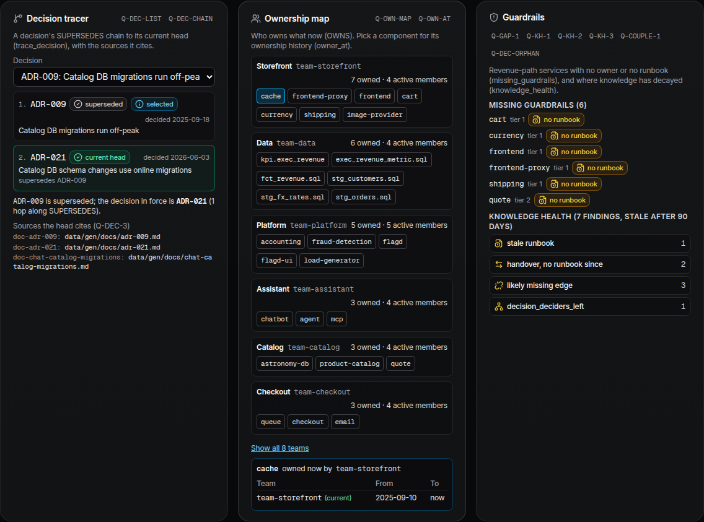<br><sub><b>Brain widgets.</b> The decision tracer, the ownership map over time and the missing guardrails.</sub></td>
</tr>
<tr>
<td valign="top"><br><sub><b>Tenant isolation.</b> The same page on another tenant's graph, read through that tenant's own read-only user.</sub></td>
<td valign="top"><br><sub><b>Explore.</b> The failure-flow graph in FalkorDB's own canvas component.</sub></td>
</tr>
<tr>
<td valign="top">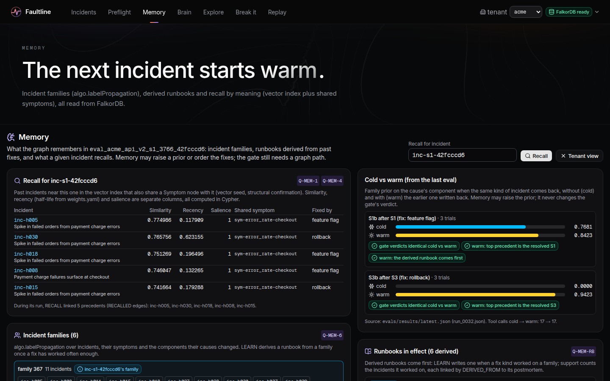<br><sub><b>Memory.</b> Recall of past incidents, incident families, runbooks derived from verified fixes, cold vs warm.</sub></td>
<td valign="top"><br><sub><b>Obligations at risk.</b> SLO burn, the customers reached and the revenue at risk, from the graph.</sub></td>
</tr>
<tr>
<td valign="top">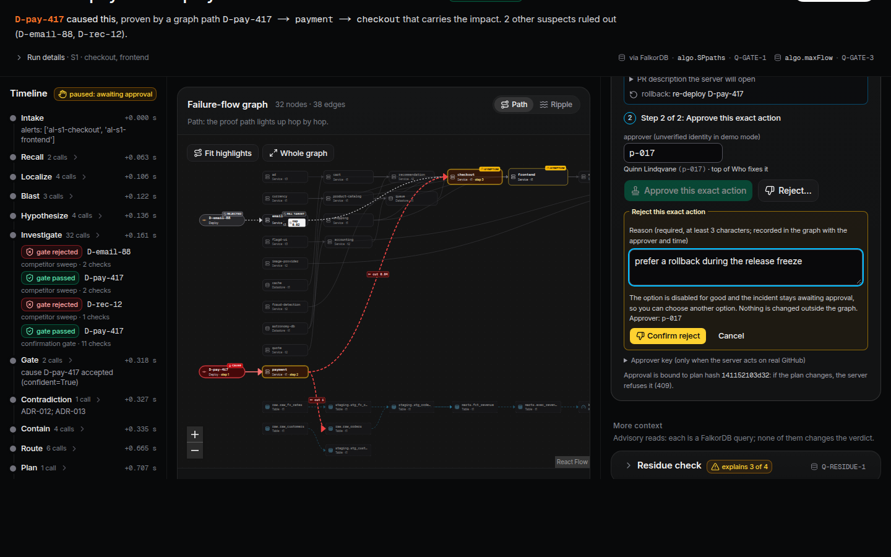<br><sub><b>Two-step approval.</b> Choosing an option renders the exact action; rejecting needs a reason, which can become a guideline.</sub></td>
<td valign="top">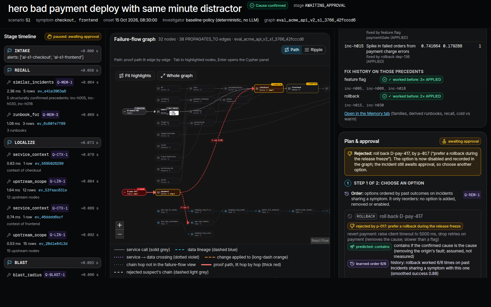<br><sub><b>Rejected, recorded.</b> The option is disabled and who rejected it, and why, is written to the graph; nothing is approved.</sub></td>
</tr>
<tr>
<td valign="top">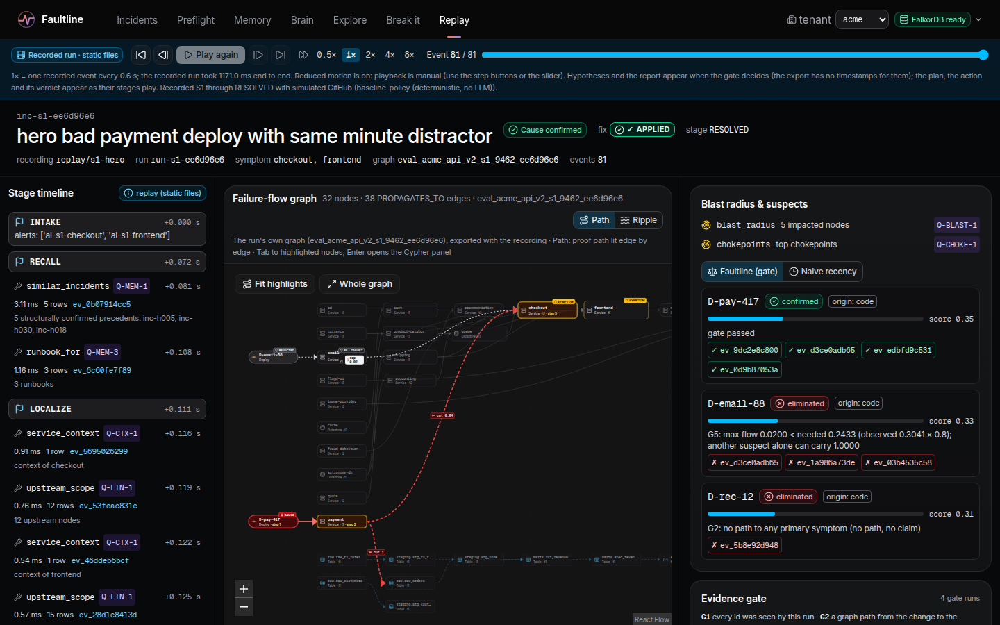<br><sub><b>Replay.</b> A recorded run played back with no backend (the static replay site).</sub></td>
<td valign="top"><br><sub><b>Home.</b> The promise, the cube that opens into the hero incident's graph, the numbers.</sub></td>
</tr>
<tr>
<td valign="top"><br><sub><b>Where it sits.</b> Inputs, the per-tenant FalkorDB graph, the crew that proposes and the gate that decides.</sub></td>
<td valign="top"><br><sub><b>Product tour.</b> Each tab is a real screenshot of a run, with one callout on what matters.</sub></td>
</tr>
</table>

<table>
<tr>
<td valign="top"><br><sub><b>FalkorDB Browser.</b> The same proof path, queried in FalkorDB's own browser.</sub></td>
<td valign="top"><br><sub><b>FalkorDB Browser.</b> The decisions that constrain the payment service.</sub></td>
</tr>
</table>


## Query catalogue

<!-- claim:repo.templates -->236<!-- /claim --> parameterised templates, one `.cypher` file per query id, linted for `LIMIT`, `ORDER BY`, bounded paths, a `CALL` allowlist and no writes. Cypher is never built from inputs. The full list with purposes and PROFILE timings: [docs/QUERY_CATALOGUE.md](docs/QUERY_CATALOGUE.md). Three of them, as stored:

<details><summary>Show the query catalogue</summary>


G5, the sufficiency bound ([`gate_flow.cypher`](backend/faultline/graph/templates/gate_flow.cypher)):

```cypher
// id: Q-GATE-3
MATCH (s:Node) WHERE s.id IN $sources
WITH collect(s) AS srcs
WHERE size(srcs) > 0
MATCH (t:Node {id:$symptom})
CALL {algo:maxflow}({sourceNodes: srcs, targetNodes: [t], relationshipTypes: ['PROPAGATES_TO'], capacityProperty: 'cap'}) YIELD maxFlow
RETURN maxFlow AS max_flow, size(srcs) AS sources
LIMIT 1
```

Containment in one read-only query: `algo.maxFlow` over `cut_cost`, then the min-cut inside FalkorDB. The residual graph's reachability from the failing component is a fixpoint over a list of residual arcs (a `reduce` inside a `reduce`), and the cut is the edges that leave it. The code only checks that the cut's capacity equals the max-flow and that no protected node is left on the source side; [`graph/algo/maxflow.py`](backend/faultline/graph/algo/maxflow.py) is the test oracle (identical on <!-- claim:udf.eq.cut.nonempty_k -->197<!-- /claim -->/<!-- claim:udf.eq.cut.nonempty -->197<!-- /claim --> non-empty cuts, `evals/udf_equivalence.py`) ([`cut_in_engine.cypher`](backend/faultline/graph/templates/cut_in_engine.cypher)):

```cypher
// id: Q-CUT-3
MATCH (f:Node {id:$failing})
MATCH (p:Node) WHERE p.id IN $protect
WITH f, collect(p.id) AS prot
WHERE size(prot) > 0
CALL {
  WITH f
  CALL {algo:sspaths}({sourceNode: f, relTypes: ['PROPAGATES_TO'], weightProp: 'w', relDirection: 'outgoing', maxLen: 8, pathCount: 1000}) YIELD path
  WITH f, collect(DISTINCT last(nodes(path))) + [f] AS region
  UNWIND region AS a
  MATCH (a)-[r:PROPAGATES_TO]->(b)
  WHERE b IN region
  WITH a, r, b ORDER BY a.id, b.id
  RETURN collect({rid: id(r), u: a.id, v: b.id, cost: coalesce(r.cut_cost, 0), domain: r.domain}) AS cand
}
MATCH (t:Node) WHERE t.id IN prot
WITH f, prot, cand, collect(t) AS targets
CALL {algo:maxflow}({sourceNodes: [f], targetNodes: targets, relationshipTypes: ['PROPAGATES_TO'], capacityProperty: 'cut_cost'}) YIELD edges, edgeFlows, maxFlow
WITH f, prot, cand, maxFlow,
     [i IN range(0, size(edges) - 1) | {rid: id(edges[i]), u: startNode(edges[i]).id, v: endNode(edges[i]).id, flow: edgeFlows[i]}] AS fe
WITH f, prot, cand, maxFlow, fe,
     [c IN cand | {u: c.u, v: c.v, cost: c.cost, domain: c.domain,
                   flow: coalesce(head([x IN fe WHERE x.rid = c.rid | x.flow]), 0)}] AS arcs
WITH f, prot, cand, maxFlow, fe, arcs,
     [a IN arcs WHERE a.cost - a.flow > 1e-9 | [a.u, a.v]] + [a IN arcs WHERE a.flow > 1e-9 | [a.v, a.u]] AS residual
WITH f, prot, cand, maxFlow, fe, arcs,
     reduce(s = [f.id], i IN range(0, size(arcs)) | s + reduce(add = [], x IN residual |
            CASE WHEN x[0] IN s AND NOT x[1] IN s AND NOT x[1] IN add THEN add + [x[1]] ELSE add END)) AS reach
WITH f, prot, cand, maxFlow, fe, arcs, CASE WHEN maxFlow <= 1e-9 THEN [f.id] ELSE reach END AS side
WITH prot, cand, maxFlow, fe, side,
     [a IN arcs WHERE maxFlow > 1e-9 AND a.u IN side AND NOT a.v IN side AND a.cost > 1e-9 |
      {u: a.u, v: a.v, cut_cost: a.cost, domain: a.domain}] AS cut
RETURN cut, reduce(total = 0, c IN cut | total + c.cut_cost) AS cut_total, maxFlow AS max_flow, side AS source_side,
       [x IN prot WHERE x IN side] AS protected_on_source_side, size(cand) AS candidates,
       [e IN fe | [e.u, e.v]] AS flow_edges
LIMIT 1
```

The citation guard: the brain may cite only ids a tool call of this run actually saw ([`cite_check.cypher`](backend/faultline/graph/templates/cite_check.cypher)):

```cypher
// id: Q-CITE-1
MATCH (run:Run {id:$run})-[:HAS_TOOL_CALL]->(:ToolCall)-[:SAW]->(n:Node)
WHERE n.id IN $ids
RETURN collect(DISTINCT n.id) AS seen
LIMIT 1
```

</details>

## Safety

The full table (agent cannot … | enforced by | file::function | test) is in [docs/SAFETY.md](docs/SAFETY.md); the public-demo threat model is in [SECURITY.md](SECURITY.md).

<details><summary>Show the safety envelope in detail</summary>


- **Reads.** `GRAPH.RO_QUERY` only, with a per-query `TIMEOUT` (clamped to `TIMEOUT_MAX`) and a literal `LIMIT` sent as n+1 so truncation is detected. They run as a per-tenant ACL user (`ro_<tenant>`) when ACL passwords are configured, as the production compose does; local keyless runs use the default user. The model never holds a write connection.
- **Templates first.** Text2cypher is the last resort and passes three layers: a guard on the masked text, a `GRAPH.EXPLAIN` plan check, and `RO_QUERY` as the read-only user with a short timeout.
- **Two-step approval.** Choosing an option ≠ approving it. Approval must quote the plan hash of the exact rendered action (file diff, commit message, PR body with reviewers, rollback), and it moves the incident to EXECUTE in the same query. Execute re-checks the intent owner, the plan hash and drift at GitHub main, and refuses no-op changes.
- **Three-valued verification.** Channel 1 re-reads GitHub main (simulated GitHub in keyless mode). Channel 2 reads the world's telemetry after the change for every symptom, plus collateral on what was protected. In this demo, telemetry comes from the simulator, which reads the same graph: the two channels are separate checks, not independent physical sensors. `UNKNOWN` goes to a human and never writes success. A failed fix goes back to approval with that option disabled.
- **Cross-system honesty.** intent → execute → reconcile with an idempotency key; no claim of cross-system transactions. A reconciler settles PENDING intents after crashes or timeouts, at API start and every minute, taking over the intent lease of a process whose heartbeat stopped. With real GitHub, approval requires an approver key.
- **Tenancy.** One graph per tenant; clean rooms via `GRAPH.COPY`. The hosted MCP binds a bearer key to one tenant and hosts no tool that writes.

| Failure mode | Defence | Proof |
|---|---|---|
| The model names a plausible but wrong change | G2: no causal path, no claim | `D-rec-12` rejected (S1); `test_algo_load_bearing.py::test_sppaths_decides_g2` |
| A look-alike has a path too | G5 max flow; origin test (a suspect whose own component was measured healthy is not the origin); G4 upstream | `D-email-88`, `D-fx-pause-7`; arm A3-noG5 |
| The model cites something it never read | G1 (agent) and Q-CITE-1 (brain): every cited id ⊆ ids the run's own tool calls returned | `tests/brain/test_citation_guard.py`, `tests/llm/` |
| An incident is invented | three-valued no-incident: measurements normal plus an `algo.SSpaths` negative proof | S4D, S4S |
| An innocent deploy sits downstream of what really broke | G4 upstream eliminates it; with no change upstream, the run abstains | deep bench `abstain_downstream`; `tests/live/test_gate_upstream.py`; mutant `M-G4-UPSTREAM` |
| Missing telemetry looks like "nothing wrong" | N0: every alerting symptom must itself be measured before "no incident" is accepted | robustness eval; `tests/live/test_negative_proof_missing.py`; mutant `M-N0-UNMEASURED` |
| Wrong action, or the wrong action approved | plan hash binds the exact diff; exclusive approval; drift guard | `tests/live/test_actions.py` |
| A fix that didn't take is reported as success | three-valued verify; NOT_APPLIED goes back to approval; UNKNOWN never writes success | S5, S9 |
| A crash between GitHub and the graph | intent → execute → reconcile by idempotency key | `test_reconciler_*`; chaos eval |
| One tenant sees another's data | graph per tenant, RO wrapper ownership check, ACL user, guard | S7 |

</details>

## What's real vs synthetic

- **Real:** FalkorDB and every query and algorithm; the agent loop; the gate; the data pipeline (DuckDB warehouse plus invariant suite), whose rebuild verifies data repairs.
- **Real GitHub on every real video take:** with `FAULTLINE_GITHUB=real`, Faultline opened, merged and verified each of the [pull requests on faultline-demo-infra](https://github.com/Prashant-thakur77/faultline-demo-infra/pulls?q=is%3Apr) after the two-step approval (the first is [PR #1](https://github.com/Prashant-thakur77/faultline-demo-infra/pull/1); `paymentGate` off, verdict APPLIED, the plan hash's idempotency key in the PR body; in the latest takes a second PR fixes the repeat under a standing approval). They are demonstrations, not a measurement. The live demo and every eval run use the simulated GitHub, so visitors never touch a real repo.
- **Synthetic, seeded and deterministic:** the org, history, ADRs and runbooks; service telemetry, from a share-weighted simulator that writes `MetricWindow` nodes the agent reads only through templates; the OpenTelemetry-Demo-shaped topology.
- **Real, once, as a benchmark:** FaultBench-OTel ran the real OpenTelemetry Demo with its own fault flags and fed Faultline the demo's measured error rates ([details](docs/EVALS.md#faultbench-otel-a-real-system-real-telemetry-pre-registered-2026-10-16)); the decoy changes and the page rule are ours.
- **Keyless mode** uses a simulated GitHub, labelled "simulated" on every result.

Pointing this at a real stack: [docs/REAL_STACK.md](docs/REAL_STACK.md).

## Scope and assumptions

Details and engine caveats: [docs/HONEST_LIMITS.md](docs/HONEST_LIMITS.md).

- The capacities are modelled from criticality and row share, and the gate assumes a single cause by default (joint sufficiency is reported as "not confident").
- The concurrency numbers are measured on one machine. FalkorDB 6.0 serialises writes per graph. <!-- noclaim: engine version -->
- The keyless numbers come from the deterministic investigator. The LLM investigator was measured in a separate, smaller comparison.

## What didn't work

Each item comes from a named bench; the per-run list is in [evals/RESULTS.md](evals/RESULTS.md).

- **A model found a way to move the gate, and we closed it the same hour.** In the pre-registered run with `claude-opus-5-5` driving, on the deep bench's two-causes-in-a-chain worlds, the model marked the rival change "eliminated" with an unrelated evidence id, and the gate then confirmed one of two jointly sufficient changes in <!-- claim:llm_product.deep.two_causes_chain.wrong_confident -->8<!-- /claim --> of <!-- claim:llm_product.deep.two_causes_chain.cases -->20<!-- /claim --> worlds. Elimination is now the graph's alone (no path, G2, or not enough flow, G5); a regression test replays what the model did. Re-run of those worlds with the same model: <!-- claim:llm_product.deep_fix.all.abstained -->8<!-- /claim --> of <!-- claim:llm_product.deep_fix.all.cases -->8<!-- /claim --> abstain, <!-- claim:llm_product.deep_fix.all.wrong_confident -->0<!-- /claim --> confident wrong blames.
- **Our adversarial bench caught a safety hole, and an independent review caught our first fix.** The deep bench put deploys *downstream* of what broke, and the shipped gate confidently blamed an innocent one; a reviewer then built worlds where our first fix blamed the wrong change. The redesign eliminates a suspect only under a strict lower bound and holds at <!-- claim:deep.fresh.all.wrong_confident -->0<!-- /claim --> confident wrong blames in <!-- claim:deep.fresh.all.cases -->140<!-- /claim --> fresh worlds.
- **Real telemetry found a bug the simulator hid.** On the first real-system window (FaultBench-OTel, the OpenTelemetry Demo) Faultline said "no incident" while a service was failing: healthy real services report exactly zero errors, which the simulator never produces, so a rise from zero did not read as anomalous. The fix: a rise of at least `gate.err_abs_min` from zero now falls outside every band, with no gate condition, weight or threshold changed.
- **Our prediction about the ladder was wrong.** We pre-registered that removing `algo.SPpaths` or `algo.maxFlow` would produce wrong confident blames. It produced none: with one algorithm removed the other still eliminates the decoys, and wrong confident blames stayed at <!-- claim:ladder.no_maxflow.wrong_confident -->0<!-- /claim --> without `algo.maxFlow` and <!-- claim:ladder.no_sppaths.wrong_confident -->0<!-- /claim --> without `algo.SPpaths`.

## AI disclosure

- **How it was built.** Claude Code (Anthropic) was the coding agent, working under the author's direction. The author set the product and the rules it is built on (FalkorDB as the only store, a deterministic gate with the final say, no number in the docs without a check), chose the scope and priorities, approved every spend and every outward action, and reviewed the results.
- **How the output was checked.** Every number in the README and docs is checked against the results file by `make claims`, in CI. The evals were pre-registered. Each safety invariant is broken on purpose by a mutant, and a test catches every one. Independent review agents audited the gate and the docs. `make judge-check` reproduces everything on a clean clone.
- **Models in the product.** The LLM investigator uses Anthropic models (`claude-opus-5-5`, `claude-sonnet-5-5`) when a key is configured; every keyless path is deterministic. Decisions, numbers and gate verdicts come from code and FalkorDB, never from a model.
- **Media.** The charts and the 3D explainer are code drawn from the results file; the video's narration voice and its music are generated.

## Repo map

`backend/faultline/` holds the graph layer (`graph/`: RO wrapper, writes, templates, `algo/`, guard, tenancy), the agent (`agent/`: loop, gate, score, phases, crew), `mcp_server/`, `actions/`, `memory/`, `brain/`, `preflight/`, `sim/`, `ingest/` and `api.py`. `frontend/` is the Next.js UI, `evals/` the harness and benches, `tests/` the unit and live suites. Full map: [docs/REPO_MAP.md](docs/REPO_MAP.md).

Install and release: `packages/faultline-mcp/` is the npm package (a stdio MCP server forwarding to Faultline's hosted read-only tools; [npm](https://www.npmjs.com/package/@prashantthakur77/faultline-mcp)); `deploy/quickstart.yml` runs the whole product from the images that `.github/workflows/images.yml` publishes to ghcr.io on every release (`ghcr.io/prashant-thakur77/faultline-api`, `faultline-ui`); `deploy/docker-compose.prod.yml` is the live deployment.

## Team

Prashant ([@Prashant-thakur77](https://github.com/Prashant-thakur77)), solo build, with Claude Code as the coding agent (see AI disclosure).

## License

Apache-2.0 ([LICENSE](LICENSE)). The OpenTelemetry Demo topology it models is Apache-2.0; all organisational data is synthetic.
