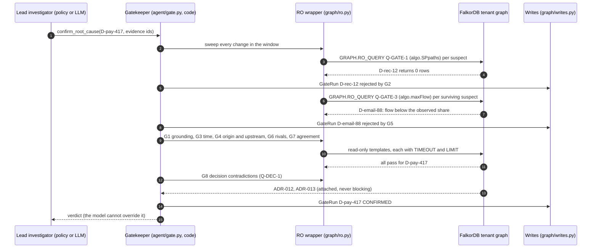
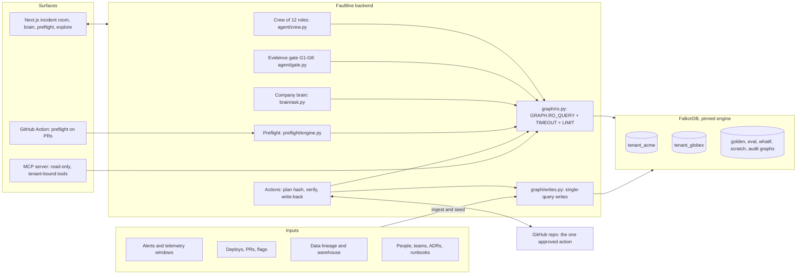
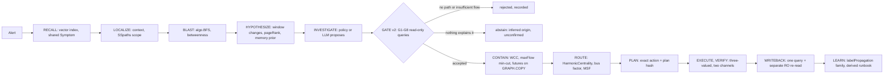
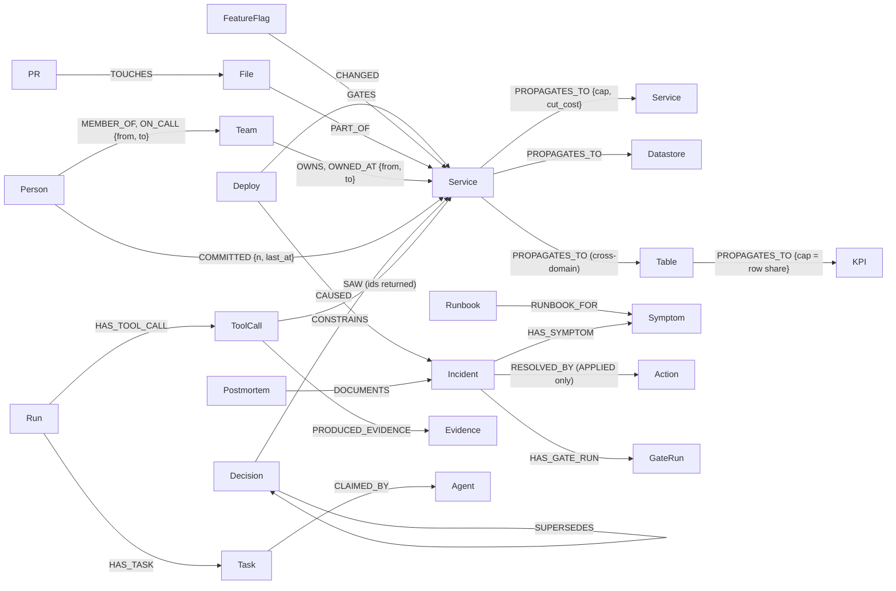

# Faultline: no path, no claim

**An on-call agent that won't blame a change until FalkorDB returns the causal path, and won't keep a suspect the graph shows cannot carry the impact.** The model suggests; a read-only query decides.

[](https://github.com/Prashant-thakur77/Faultline/releases) [](https://github.com/Prashant-thakur77/Faultline/actions/workflows/ci.yml) [](https://prashant-thakur77.github.io/Faultline/) [](https://13-203-185-119.sslip.io)
[](docs/FALKORDB_COMPAT.md) [](pyproject.toml) [](frontend/package.json) [](docs/MCP.md) [](LICENSE) [](#reproduce-it) <!-- noclaim: versions in badges -->
[](#how-one-incident-flows) [](#memory-company-brain-preflight-coordination)


**Live demo: [13-203-185-119.sslip.io](https://13-203-185-119.sslip.io)** (keyless: deterministic investigator, simulated GitHub; press Re-arm to reset it) · **Hosted MCP:** `https://13-203-185-119.sslip.io/mcp` (bearer key per tenant, read-only; see [docs/MCP.md](docs/MCP.md)) · **Recorded replay (no backend):** [prashant-thakur77.github.io/Faultline](https://prashant-thakur77.github.io/Faultline/) · **Release:** [v1.0.0](https://github.com/Prashant-thakur77/Faultline/releases/tag/v1.0.0) ([changelog](CHANGELOG.md))

Demo video (3 minutes): [`docs/media/demo.mp4`](docs/media/demo.mp4), captions in [`docs/video_captions.srt`](docs/video_captions.srt). It was recorded from real runs with simulated GitHub and the deterministic investigator, before the G4-upstream rule and the context pack were added; a re-record is planned.

Built for Graph Hacks (WeMakeDevs × FalkorDB). Primary track T1, Agents That Act on Connected Data; secondary track T3, Company Brain.

---

## In short

Faultline answers four questions during an incident. Each answer comes out of a FalkorDB query, and the agent cannot skip one.

| Question | How it is decided |
|---|---|
| What breaks? | `algo.BFS` blast radius over failure-flow edges |
| Why? | `algo.SPpaths` must return a causal path from the change to the symptom, and `algo.maxFlow` must show the change can carry the observed impact |
| What is the smallest containment? | max-flow → min-cut on the failure graph, each candidate tried on its own `GRAPH.COPY` branch with a predicted outcome before anyone approves |
| Who should fix it? | `algo.HarmonicCentrality` over who touched the code, who resolved it before and who is on call; `algo.MSF` for escalation |

It then takes one human-approved action, verifies it through a second channel (APPLIED, NOT_APPLIED or UNKNOWN), and writes the decision back into the same graph, so the next incident starts warm. The same graph blocks risky PRs before they ship (preflight) and answers "who owns, knows and decided what" with cited node ids (company brain).

Three measured results, each pre-registered and checked against [`evals/results/latest.json`](evals/results/latest.json) by `make claims`:

| Result | Number |
|---|---|
| Confident wrong blames on the deep bench (fresh seed, five adversarial world kinds) | <!-- claim:deep.fresh.all.wrong_confident -->0<!-- /claim --> in <!-- claim:deep.fresh.all.cases -->140<!-- /claim --> worlds |
| Causes confirmed with FalkorDB switched off (arm A4: fails closed) | <!-- claim:arm.A4.confirmed_causes -->0<!-- /claim --> |
| Rank of the true cause in an agent's context, 30 unrelated deploys in the window (MRR, 1 = first): graph `context_pack` vs vector RAG vs recency | <!-- claim:ctx.busy30.b1000.GA.mrr -->0.6598<!-- /claim --> vs <!-- claim:ctx.busy30.b1000.V.mrr -->0.4226<!-- /claim --> vs <!-- claim:ctx.busy30.b1000.R.mrr -->0.0768<!-- /claim --> |

## Contents

- [Reproduce it](#reproduce-it)
- [Why existing approaches fall short](#why-existing-approaches-fall-short)
- [How one incident flows](#how-one-incident-flows)
- [See it work: two incidents](#see-it-work-two-incidents)
- [The evidence gate](#the-evidence-gate)
- [Architecture](#architecture)
- [Graph model](#graph-model)
- [FalkorDB feature map](#falkordb-feature-map)
- [The graph is load-bearing](#the-graph-is-load-bearing)
- [Results](#results)
- [What makes it different](#what-makes-it-different)
- [Context for any agent](#context-for-any-agent)
- [Memory, company brain, preflight, coordination](#memory-company-brain-preflight-coordination)
- [Screens](#screens)
- [Query catalogue](#query-catalogue)
- [Safety](#safety)
- [What's real vs synthetic](#whats-real-vs-synthetic)
- [Honest limits](#honest-limits)
- [What didn't work](#what-didnt-work)
- [Existing system and what was built here](#existing-system-and-what-was-built-here)
- [AI disclosure](#ai-disclosure)

## Reproduce it

One command checks everything offline. It needs Docker, `uv` and Node. There is no API key, no GitHub token and nothing remote.

```bash
git clone https://github.com/Prashant-thakur77/Faultline.git && cd Faultline
make setup && make judge-check     # several minutes; prints PASS
```

`judge-check` starts the pinned FalkorDB, runs the engine smoke suite, seeds both tenants, runs the unit and live tests (isolation and concurrency included), checks the pipeline invariants, runs the lints and the claims check, and builds the frontend. CI runs the same steps on the pinned engine ([`ci.yml`](.github/workflows/ci.yml)). A `.devcontainer/` is included for a Codespace.

To run the product:

```bash
make up             # pinned FalkorDB (deploy/docker-compose.yml)
make seed           # acme + golden copies (TENANT=globex for the second tenant)
make demo           # API :8400 + UI :3000 → run S1, choose and approve an option, watch VERIFY → RESOLVED
make mcp            # the agent's read-only graph tools over MCP (stdio)
make eval           # keyless eval arms → evals/RESULTS.md
```

**Sixty seconds, no build.** After `make up && make seed`, ask FalkorDB directly. `algo.SPpaths` returns the path a blame needs, and `algo.maxFlow` shows that a look-alike change cannot carry the impact (`email` → `checkout`: 0.02, the seeded edge cap of a best-effort call): <!-- noclaim: the seeded best-effort edge cap -->

```bash
docker exec -it faultline-falkordb redis-cli GRAPH.RO_QUERY tenant_acme "MATCH (c:Node {id:'payment'}), (s:Node {id:'checkout'}) CALL algo.SPpaths({sourceNode: c, targetNode: s, relTypes: ['PROPAGATES_TO'], weightProp: 'w', relDirection: 'outgoing', maxLen: 8, pathCount: 1}) YIELD path RETURN [n IN nodes(path) | n.id]"
docker exec -it faultline-falkordb redis-cli GRAPH.RO_QUERY tenant_acme "MATCH (e:Node {id:'email'}), (t:Node {id:'checkout'}) CALL algo.maxFlow({sourceNodes: [e], targetNodes: [t], relationshipTypes: ['PROPAGATES_TO'], capacityProperty: 'cap'}) YIELD maxFlow RETURN maxFlow"
```

The first returns `[payment, checkout]`. With `targetNode` `kpi.exec_revenue` the same call crosses domains: `[payment, raw.raw_orders, staging.stg_orders, marts.fct_revenue, marts.exec_revenue_metric, kpi.exec_revenue]`. The second returns `0.02`; from `payment` it returns `1.0`. Scenario changes such as `D-pay-417` exist only inside a scenario's clean room. On the seeded tenant the history is there to query, for example `MATCH (d:Deploy)-[:CAUSED]->(i:Incident) RETURN d.id, i.id LIMIT 5`.

**Break it yourself.** `make demo`, then open **Break it** (`/playground`). Pick one change: remove the proof-path call, make a call best-effort, make the decoy's call critical, cut a service off, or have the top responder leave. It is applied to a `GRAPH.COPY` of the hero incident, the product runs on both copies, and every decision is shown before and after with the Cypher that decides it.

**Replay without a backend.** The static replay site plays [`examples/s1-hero/`](examples/s1-hero) end to end: gate, containment, APPLIED, write-back verified <!-- claim:s1.writeback -->7/7<!-- /claim -->. Locally: `cd frontend && npm run build:pages`, then serve `out-pages/` under `/Faultline/`.

**Where each judging question is answered:**

| You are checking… | Look here |
|---|---|
| Is FalkorDB load-bearing, or decoration? | [the evidence gate](#the-evidence-gate) · [every algorithm perturbed, the decision flips](#the-graph-is-load-bearing) · the Break it page · arm A4 (FalkorDB off: confirms nothing) |
| How deep is the FalkorDB use? | [feature map](#falkordb-feature-map): <!-- claim:repo.algorithms -->10<!-- /claim --> `algo.*` procedures, `GRAPH.COPY` branches, vectors, full-text, FLEX UDFs, per-tenant ACL users, versioned topology · [query catalogue](docs/QUERY_CATALOGUE.md) |
| Does the agent act, safely? | two-step approval bound to a plan hash, three-valued verification, kill -9 chaos, write-back re-read: [Safety](#safety) · [`examples/s1-hero/`](examples/s1-hero/) |
| Does it learn? | a verified fix teaches the graph a missing link, and the next incident is proved: [Results](#results) · [docs/EVALS.md](docs/EVALS.md) |
| Are the numbers honest? | pre-registration, held-out sets, a wrong-graph eval, a telemetry-only baseline that wins on some worlds, mutants: [Results](#results) · [What didn't work](#what-didnt-work) · [docs/HONEST_LIMITS.md](docs/HONEST_LIMITS.md) |
| Company brain (T3)? | as-of answers with node-id citations, forget receipts: [Memory, company brain, preflight, coordination](#memory-company-brain-preflight-coordination) |

**Files to read first:**

| File | Why |
|---|---|
| [`graph/templates/gate_path.cypher`](backend/faultline/graph/templates/gate_path.cypher) | the proof path (G2) |
| [`agent/gate.py`](backend/faultline/agent/gate.py) | Gate v2, G1–G8, the competitor sweep |
| [`graph/ro.py`](backend/faultline/graph/ro.py) | the only read path |
| [`actions/act.py`](backend/faultline/actions/act.py) | approval → execute → three-valued verify → write-back |
| [`docs/QUERY_CATALOGUE.md`](docs/QUERY_CATALOGUE.md) | every query the product runs |

Deeper docs: [architecture](docs/ARCHITECTURE.md) (one incident end to end, with files) · [graph model](docs/GRAPH_MODEL.md) · [design decisions](docs/DESIGN_DECISIONS.md) · [evals in detail](docs/EVALS.md) · [explainer](docs/EXPLAINER.md) (the questions a judge asks) · [honest limits](docs/HONEST_LIMITS.md).

## Why existing approaches fall short

Google's SRE book says "roughly 70% of outages are due to changes in a live system" ([SRE book, Introduction](https://sre.google/sre-book/introduction/)). Uptime Institute's 2025 outage analysis puts IT and networking at 23% of impactful outages and ties the rise to change management and misconfiguration ([press release](https://uptimeinstitute.com/about-ui/press-releases/uptime-announces-annual-outage-analysis-report-2025)); 54% of respondents said their latest significant outage cost more than $100,000 (as reported by [Data Center Knowledge](https://www.datacenterknowledge.com/outages/data-center-outages-decline-for-fourth-straight-year-but-issues-persist)). So the on-call question is usually "which change?", and a wrong answer rolls back the wrong thing. <!-- noclaim: external figures, quoted with their sources -->

There are three common ways to answer it today. Each is good at something, and each misses something an on-call engineer needs. We built a baseline for each one and measured it on the same scenarios as the product.

| Approach | What it does well | What it cannot do | Measured here |
|---|---|---|---|
| **Alert correlation and recency** ("what changed last, near the alert?") | fast, needs no model, groups alerts by time and labels | two changes in the same minute tie; it cannot tell a cause from a victim; it never says "no change explains this" | naive recency (arm N): top-1 <!-- claim:arm.N.top1 -->0.1<!-- /claim -->, false blame <!-- claim:arm.N.false_blame_rate -->1.0<!-- /claim -->, correct abstention <!-- claim:arm.N.abstention_correct_rate -->0.0<!-- /claim -->. A sharper telemetry-only heuristic (arm T) reaches top-1 <!-- claim:arm.T.top1 -->0.9<!-- /claim --> but still blames <!-- claim:arm.T.false_blame_rate -->0.2<!-- /claim --> of the time and scores <!-- claim:deep.fresh.abstain_downstream.arm_t -->0<!-- /claim --> of <!-- claim:deep.fresh.abstain_downstream.cases -->20<!-- /claim --> deep-bench worlds where the right answer is to blame nothing |
| **LLM agent with vector RAG** over logs, tickets and runbooks | reads text well; finds incidents that look similar | similarity is not causation: two descriptive deploy titles score alike; nothing checks that a candidate can carry the impact; it answers instead of abstaining; its memory is a pile of chunks, with no "who owns this now" | vector ranking (arm V, cosine in FalkorDB): top-1 <!-- claim:arm.V.top1 -->0.4<!-- /claim -->, false blame <!-- claim:arm.V.false_blame_rate -->0.6<!-- /claim -->, correct abstention <!-- claim:arm.V.abstention_correct_rate -->0.0<!-- /claim -->. As agent context with 30 unrelated deploys: MRR <!-- claim:ctx.busy30.b1000.V.mrr -->0.4226<!-- /claim -->. The LLM arms are not run yet, so there is no LLM-vs-graph claim here |
| **Static dependency maps and service catalogs** | list edges and owners | an edge says two things connect, not how much failure can cross it; maps drift out of date; no validity windows, decisions or past fixes attached; usually read by people, not checked at decision time | the capability ladder: with the path check reduced to plain connectivity and `algo.maxFlow` removed, the right cause is blamed in <!-- claim:ladder.neither.b.right_cause -->43<!-- /claim -->/<!-- claim:ladder.neither.b.confirm_cases -->65<!-- /claim --> held-out worlds, against <!-- claim:ladder.full.b.right_cause -->65<!-- /claim -->/<!-- claim:ladder.full.b.confirm_cases -->65<!-- /claim --> for the product |
| **Faultline**: graph proof, capacity bound, abstention | a causal path (`algo.SPpaths`), a max-flow bound on what a suspect can carry (`algo.maxFlow`), and eight read-only checks before any claim; it abstains when nothing passes; acts once, verifies, and writes back to the same graph | it needs a modelled failure-flow layer and telemetry on the components (see [Honest limits](#honest-limits)) | arm A3: top-1 <!-- claim:arm.A3.top1 -->1.0<!-- /claim -->, false blame <!-- claim:arm.A3.false_blame_rate -->0.0<!-- /claim -->, correct abstention <!-- claim:arm.A3.abstention_correct_rate -->1.0<!-- /claim -->; deep bench <!-- claim:deep.fresh.all.wrong_confident -->0<!-- /claim --> confident wrong blames in <!-- claim:deep.fresh.all.cases -->140<!-- /claim --> worlds; context MRR <!-- claim:ctx.busy30.b1000.GA.mrr -->0.6598<!-- /claim --> |

Five gaps run through current practice, and each one maps to a part of Faultline you can check:

| Gap | What Faultline does | Where to check |
|---|---|---|
| Similarity stands in for causation | G2 requires a directed causal path from the change to every symptom | [`gate_path.cypher`](backend/faultline/graph/templates/gate_path.cypher); `D-rec-12` rejected by <!-- claim:s1.D-rec-12.rejected_by -->G2<!-- /claim --> |
| Nothing proves the cause can carry the impact | G5 bounds the share of the symptom a suspect can explain with joint `algo.maxFlow` | [`gate_flow.cypher`](backend/faultline/graph/templates/gate_flow.cypher); gate bench G5 cases <!-- claim:gate_bench.G5.correct -->20<!-- /claim -->/<!-- claim:gate_bench.G5.cases -->20<!-- /claim --> |
| Tools always name something | a three-valued outcome (confirmed, not confident, no incident) with a negative proof (`algo.SSpaths`) | gate bench abstention cases <!-- claim:gate_bench.abstain.correct -->20<!-- /claim -->/<!-- claim:gate_bench.abstain.cases -->20<!-- /claim -->, controls <!-- claim:gate_bench.control.correct -->15<!-- /claim -->/<!-- claim:gate_bench.control.cases -->15<!-- /claim --> |
| Actions are reported, not verified | a second channel decides APPLIED, NOT_APPLIED or UNKNOWN; UNKNOWN never writes success | S5 → <!-- claim:s5.verdict -->NOT_APPLIED<!-- /claim -->, S9 → <!-- claim:s9.verdict -->UNKNOWN<!-- /claim -->, success written: <!-- claim:s9.success_written -->False<!-- /claim --> |
| Memory is a vector store beside the system | incidents, fixes, decisions and runbooks are nodes in the same graph the gate reads; a verified fix can teach a missing link | next incidents correct after learning: <!-- claim:learning.i2_learned_correct -->24<!-- /claim -->/<!-- claim:learning.cases -->24<!-- /claim --> vs <!-- claim:learning.i2_control_correct -->2<!-- /claim --> without |

## How one incident flows

The hero scenario S1: checkout and frontend error rates jump. Three changes landed in the window, two of them in the same minute. Every step below is recorded in the graph as `StageEvent`, `ToolCall`, `Evidence` and `GateRun` nodes. Paths are relative to `backend/faultline/`.

| # | Step | What happens | FalkorDB query or procedure | File |
|---|---|---|---|---|
| 1 | Alert | The alerts that fired around onset become the symptoms; the incident is opened and its text embedded | `Q-ALERT-1`; `vecf32` on `Incident.embedding` | `graph/templates/window_alerts.cypher`, `scenario.py` |
| 2 | Recall | Similar past incidents, kept only if they share a `Symptom` node | `db.idx.vector.queryNodes` + structural confirm (`Q-MEM-1`) | `graph/templates/recall.cypher` |
| 3 | Scope | What is upstream of the symptoms, and what breaks downstream | `algo.SSpaths`, `algo.BFS`, `algo.betweenness` | `upstream_scope.cypher`, `blast_radius.cypher`, `chokepoints.cypher` |
| 4 | Suspects | The changes in the window, ranked for investigation order | `algo.SSpaths` (`Q-SUS-1`), `algo.pageRank` on a scratch projection | `upstream_suspects.cypher`, `rank_causes.cypher`, `agent/score.py` |
| 5 | Path | `D-rec-12` has no path to checkout: rejected | `algo.SPpaths` (`Q-GATE-1`) | `gate_path.cypher` |
| 6 | Flow | `D-email-88` has a path, but its max flow <!-- claim:s1.D-email-88.max_flow -->0.02<!-- /claim --> is below the <!-- claim:s1.D-email-88.needed -->0.2433<!-- /claim --> needed: rejected | joint `algo.maxFlow` × path multiplicity (`Q-GATE-3`, `Q-GATE-MULT`) | `gate_flow.cypher`, `gate_multiplicity.cypher` |
| 7 | Proof | `D-pay-417` passes G1–G7; G8 attaches the ADR-012 and ADR-013 it contradicts; one `GateRun` per verdict | eight read-only checks | `agent/gate.py`, `decision_contradiction.cypher` |
| 8 | Cut | Is a cut needed, what is the smallest one, and what happens under each option | `algo.WCC`; `algo.maxFlow` with `edgeFlows` → min-cut in code; one `GRAPH.COPY` branch per candidate (`Q-FUTURE-1`) | `connectivity.cypher`, `cut_flow.cypher`, `graph/algo/maxflow.py`, `futures.cypher` |
| 9 | Route | Who fixes it, who is looped in, who to notify | `algo.HarmonicCentrality`, `algo.MSF` on scratch projections | `harmonic.cypher`, `msf.cypher`, `mcp_server/tools.py` |
| 10 | Approve | Choosing an option renders the exact action and its plan hash; approval must quote the hash and moves the incident to EXECUTE in the same query | single-query writes `W_CHOOSE`, `W_APPROVE` | `actions/act.py`, `graph/writes.py` |
| 11 | Act and verify | A PR flips the `paymentGate` flag; GitHub main is re-read and telemetry is checked for every symptom → APPLIED | intent → execute → reconcile, idempotency key under a unique constraint | `actions/act.py`, `actions/github.py`, `actions/reconcile.py` |
| 12 | Write-back | `CAUSED`, `RESOLVED_BY`, a postmortem, a decision and `PRECEDENT_FOR` in one query, re-read through a separate read-only connection | `W_WB_1` + `writeback_check.cypher` | `graph/writes.py`; verified <!-- claim:s1.writeback -->7/7<!-- /claim --> |
| 13 | Warm recall | The incident joins a family; a derived runbook is consolidated; the repeat incident S1b starts warm | `algo.labelPropagation` | `families.cypher`, `memory/learn.py` |

On S1b (a repeat payment regression after S1 was resolved), the warm run's top precedent is S1 (<!-- claim:memory.warm_top_precedent_is_s1 -->True<!-- /claim -->), the derived runbook comes first (<!-- claim:memory.derived_runbook_first -->True<!-- /claim -->), the family prior rises from <!-- claim:memory.cold_prior -->0.7681<!-- /claim --> to <!-- claim:memory.warm_prior -->0.8423<!-- /claim -->, and the gate verdicts stay identical check by check (<!-- claim:memory.gate_verdicts_identical -->True<!-- /claim -->). Memory reorders; it never decides.

The full walk-through, with every function name, is in [docs/ARCHITECTURE.md](docs/ARCHITECTURE.md).

## See it work: two incidents

Recorded through the real API (`scripts/record_demo.py`) with the deterministic investigator and simulated GitHub, both labelled as such everywhere.

| | **S1 service incident** (hero) | **S2 data incident** (cross-domain) |
|---|---|---|
| Symptom | checkout + frontend error rate | the executive revenue KPI jumps |
| Changes in the window | `D-pay-417` (payment), `D-email-88` (email, **same minute**), `D-rec-12` (recommendation) | `D-cutover-1` (payment provider cutover), `D-fx-pause-7` (FX feed paused) |
| Proof path (G2, `algo.SPpaths`) | <!-- claim:s1.chain -->D-pay-417 → payment → checkout<!-- /claim --> | <!-- claim:s2.chain -->D-cutover-1 → payment → raw.raw_orders → staging.stg_orders → marts.fct_revenue → marts.exec_revenue_metric → kpi.exec_revenue<!-- /claim --> |
| Look-alike rejected by **max flow** (G5) | `D-email-88`: max flow <!-- claim:s1.D-email-88.max_flow -->0.02<!-- /claim --> < needed <!-- claim:s1.D-email-88.needed -->0.2433<!-- /claim --> (the email call is best-effort: one modelled edge cap, [cited from the OTel demo source](data/topology/otel-demo.yaml)) | `D-fx-pause-7`: max flow <!-- claim:s2.D-fx-pause-7.max_flow -->0.0692<!-- /claim --> < needed <!-- claim:s2.D-fx-pause-7.needed -->0.8<!-- /claim --> (FX touches a small share of revenue) |
| Rejected by **no path** (G2) | `D-rec-12` (<!-- claim:s1.D-rec-12.rejected_by -->G2<!-- /claim -->) | n/a |
| Decision contradiction (G8) | ADR-012 (timeout ≤ 2000 ms), ADR-013 (≥ 2 retries) | n/a |
| Containment | min-cut `payment → checkout` → flag `paymentGate` off (checkout defers the charge), or roll the deploy back (listed first: it worked more often on past incidents with this symptom) | min-cut found, but its only flag cuts a service edge no failure path to the KPI crosses, so it is shown disabled with that reason (`Q-LEVER-PATH`); the data repair needs a proposed transform patch (live LLM mode) |
| Who fixes it | ranked people with reasons (recent commits, past resolutions, on-call) | same |
| Action → verdict | PR to the infra repo (**simulated GitHub**) → **APPLIED**: main re-read + telemetry back in band, no collateral | awaiting a human choice |
| Write-back | verified <!-- claim:s1.writeback -->7/7<!-- /claim --> through a separate read-only connection, then LEARN | n/a |

Where naive recency and vector similarity put the real cause on every scenario, and why the look-alikes lost, is generated per run in [docs/NAIVE_VS_FAULTLINE.md](docs/NAIVE_VS_FAULTLINE.md).

## The evidence gate

Gate G2 is the load-bearing query. If it returns no rows, Faultline cannot claim the cause, whatever the model thinks:

```cypher
// Q-GATE-1, as rendered (gate_path.cypher writes {algo:sppaths}; graph/algo/registry.py resolves it on the pinned engine)
MATCH (c:Node {id:$cause}), (s:Node {id:$symptom})
CALL algo.SPpaths({sourceNode: c, targetNode: s, relTypes: ['CHANGED','GATES','PROPAGATES_TO'],
                   weightProp: 'w', relDirection: 'outgoing', maxLen: 8, pathCount: 3}) YIELD path, pathWeight
RETURN [n IN nodes(path) | n.id] AS chain, [r IN relationships(path) | type(r)] AS rels, pathWeight AS weight, length(path) AS hops
ORDER BY weight, hops LIMIT 3
```

What it returned on the eval run:

| Call | Rows |
|---|---|
| `D-pay-417` → checkout (S1, the real cause) | chain <!-- claim:s1.chain -->D-pay-417 → payment → checkout<!-- /claim --> |
| `D-rec-12` → checkout (S1, decoy) | **0 rows**: rejected by <!-- claim:s1.D-rec-12.rejected_by -->G2<!-- /claim --> ("no path, no claim") |
| `D-cutover-1` → kpi.exec_revenue (S2, data incident) | chain <!-- claim:s2.chain -->D-cutover-1 → payment → raw.raw_orders → staging.stg_orders → marts.fct_revenue → marts.exec_revenue_metric → kpi.exec_revenue<!-- /claim --> |

A path is necessary but not sufficient. G5 asks whether the change can carry the observed impact, as `algo.maxFlow` over `PROPAGATES_TO.cap`. On service edges `cap` is criticality; on lineage edges it is the end-to-end row share computed from the warehouse. The strongest case is S2: `D-fx-pause-7` has a multi-hop path to the revenue KPI, but it can carry at most <!-- claim:s2.D-fx-pause-7.max_flow -->0.0692<!-- /claim --> of the anomaly, and <!-- claim:s2.D-fx-pause-7.needed -->0.8<!-- /claim --> is needed. Why the bound is valid, including the path-multiplicity factor and joint sufficiency for two causes, is in [docs/EXPLAINER.md](docs/EXPLAINER.md).

The model may propose; Gate v2 decides with eight checks, two of them split into a strict and a confidence part. Each is a read-only query ([`agent/gate.py`](backend/faultline/agent/gate.py)):

| Check | Query | Fails → |
|---|---|---|
| G1 grounded: the cause came back from a graph query this run, and every cited evidence item came from this run | Q-GATE-G1 | rejected |
| G2 path: `algo.SPpaths` from the change to every primary symptom | Q-GATE-1 | rejected ("no path, no claim") |
| G3 time: the change is inside the window before onset | Q-GATE-2 | rejected (an earlier upstream change → not confident) |
| G4 quantitative: an anomalous measurement on a node of the chain | Q-GATE-4 | rejected |
| G4 origin: the anomaly shows at the changed component itself or in its own data output (unless the change is on the alerting component) | Q-GATE-4 | not confident |
| G4 upstream (sweep): a suspect whose component is anomalous only by what an anomalous component upstream (changed or not) can carry there (measured excess × path transfer) is not the origin | Q-GATE-UPSTREAM | eliminated (an unchanged upstream origin → abstain) |
| G5 sufficiency: joint `algo.maxFlow` × the number of failure paths can carry the observed impact | Q-GATE-3, Q-GATE-MULT, Q-GATE-OBS | rejected (only jointly sufficient → not confident) |
| G6 competitors: every rival eliminated with evidence | Q-HYP-1 | unresolved rivals → not confident |
| G7 agreement: independent evidence channels agree on the chain | Q-GATE-7 | not confident |
| G7 correlation: the change specialist and the code or data specialist name the same deploy, which CHANGED a node of the chain | Q-GATE-CORR | not confident (not evaluable when no code/data channel could inspect a change) |
| G8 contradiction: active decisions the cause violates | Q-DEC-1 | attached, never blocks |

How a verdict is reached:



If nothing passes, the run abstains: it reports an inferred origin as unconfirmed, or proves "no incident" with an `algo.SSpaths` negative proof when every alerting symptom is measured and normal.

## Architecture



Two rules hold everywhere. Reads go through one path, `graph/ro.py`: `GRAPH.RO_QUERY` with a per-query `TIMEOUT` and a literal `LIMIT` sent as n+1 so truncation is detected, as the per-tenant ACL user `ro_<tenant>` when ACL passwords are configured. Writes go through `graph/writes.py`, each a single query that is atomic on its own; the model never holds a write connection. FalkorDB is the only store: `events.jsonl`, `report.md` and the replay files are exports of the graph, and `scripts/lint_single_store.py` enforces this in CI.

The agent's stages:



**The crew.** Each stage is worked by a named, least-privilege role: Triage, Historian, Cartographer, Profiler, the Lead investigator with its five investigators (topology, telemetry, data, change, code), the Gatekeeper, Containment, Dispatcher, Planner, Operator, Auditor and Librarian ([docs/AGENTS.md](docs/AGENTS.md), generated from `agent/crew.py`). Each role is deterministic code with its own tool whitelist, enforced in code; only the lead may use a model, and the Gatekeeper never does. The Operator is the only holder of `execute_action`. Every step is a record in FalkorDB: `(:Run)-[:HAS_TASK]->(:Task)-[:CLAIMED_BY]->(:Agent)`, the graph calls it made (`MADE`) and the hand-off order (`NEXT`). The incident room's Crew board reads it back (`Q-CREW-1`), and "Why do you believe this?" draws the verdict's provenance (`Q-PROV-1`): which agent's call produced which evidence that supports the confirmed cause. Crew records are records, not locks: execution is serialised by the Intent lease, and a crew record never counts as a G7 vote. Per-stage tool whitelists: [docs/STAGE_TOOLS.md](docs/STAGE_TOOLS.md).

## Graph model

One graph per tenant. Every node carries the base label `Node` plus one domain label, so ids resolve across labels. The core of the model:



- The agent never decides over raw `CALLS` or lineage edges. At ingest each producer writes a derived `PROPAGATES_TO` edge that points the way failure flows, with `cap` (criticality, or row share on lineage) and `cut_cost`.
- Ownership, on-call and decisions carry validity windows (`OWNED_AT {from, to}`, `ON_CALL {from, to}`, `SUPERSEDES`), and calls a past PR introduced carry `valid_from`, so the graph answers as of a date or an incident.
- Incidents, postmortems and runbooks carry `vecf32` embeddings under a vector index; services, tables, runbooks, decisions, postmortems and docs have full-text indexes.
- Run state lives in the same graph: `Run`, `StageEvent`, `ToolCall`, `Evidence`, `Hypothesis`, `GateRun`, `Approval`, `Intent`, `Action`, `Task`/`Agent`, `Session`/`Turn`.

Full ER diagrams, property semantics and validity windows: [docs/GRAPH_MODEL.md](docs/GRAPH_MODEL.md). The live schema, generated from the seeded graphs and checked for drift against the declared model (`graph/schema_model.py`): [docs/GRAPH_SCHEMA.md](docs/GRAPH_SCHEMA.md). Seeded sizes: acme has <!-- claim:repo.acme.services -->21<!-- /claim --> services, <!-- claim:repo.acme.persons -->40<!-- /claim --> people and <!-- claim:repo.acme.incidents -->40<!-- /claim --> past incidents; globex has <!-- claim:repo.globex.services -->200<!-- /claim --> services, <!-- claim:repo.globex.persons -->180<!-- /claim --> people and <!-- claim:repo.globex.incidents -->150<!-- /claim --> past incidents.

## FalkorDB feature map

Every feature below is called from the listed file. Template paths are under `backend/faultline/graph/templates/`.

| Feature | Used for | File |
|---|---|---|
| `algo.SPpaths` / `algo.SSpaths` | G2 proof path, path multiplicity / upstream scope, suspects, no-incident negative proof | `gate_path.cypher`, `gate_multiplicity.cypher`, `upstream_scope.cypher`, `upstream_suspects.cypher`, `neg_proof.cypher` |
| `algo.maxFlow` (+ `edgeFlows`) | G5 sufficiency; containment min-cut computed from the flows; preflight | `gate_flow.cypher`, `cut_flow.cypher`, `preflight_flow.cypher`, `graph/algo/maxflow.py` |
| `algo.BFS`, `algo.WCC` | blast radius, protected set, preflight impact, alert-storm grouping, what-if on a branch | `blast_radius.cypher`, `protect_set.cypher`, `preflight_impact.cypher`, `storm_wcc.cypher`, `connectivity.cypher`, `whatif_*.cypher` |
| `algo.betweenness`, `algo.pageRank` | chokepoints, preflight risk, node size; investigation order | `chokepoints.cypher`, `betweenness_all.cypher`, `rank_causes.cypher` |
| `algo.HarmonicCentrality`, `algo.MSF` | who fixes it, escalation tree (scratch projections; the projection's pairs, reasons and tie weights are Cypher too) | `harmonic.cypher`, `msf.cypher`, `who_knows.cypher`, `who_reasons.cypher`, `collab_weights.cypher` |
| `algo.labelPropagation` | incident families → derived runbooks | `families.cypher`, `memory/learn.py` |
| Vector index (`vecf32`, `db.idx.vector.queryNodes`) | recall, brain entity seeds, forget proof | `recall.cypher`, `find_incident_vector.cypher`, `forget_vector_probe.cypher`, `graph/writes.py` |
| Full-text index (DDL form) | brain tier-1 seeds | `find_*.cypher`, `graph/schema.cypher` |
| `GRAPH.COPY` | golden → tenant and eval clean rooms, what-if branches, one futures branch per containment candidate, the Break it twin, as-of branches for the backtest, Re-arm | `graph/copy.py`, `futures.cypher`, `playground.py` |
| `GRAPH.RO_QUERY` + `TIMEOUT` + ACL users | every read | `graph/ro.py`, `deploy/users.acl.template` |
| `GRAPH.EXPLAIN` / `GRAPH.PROFILE` | text2cypher plan check / the UI Cypher panel | `graph/guard.py`, `graph/ro.py` |
| Unique constraint | idempotent intents (`Intent.idem`) | `graph/writes.py` |
| UDFs (`GRAPH.UDF LOAD`, FalkorDB FLEX, pinned by sha) | fuzzy entity resolution (`flex.text.jaroWinkler`), co-failure coupling strength (`flex.sim.jaccard`) | `find_fuzzy.cypher`, `hidden_coupling.cypher`, `graph/udf.py` |
| Many graphs on one instance | `tenant_*`, `golden_*`, `golden_*_nomem` (memory-off arm), `audit_*` (append-only receipts), `eval_*`, `scratch_*`, `whatif_*` | `graph/tenant.py` |
| Redis ACL users per tenant | `ro_<tenant>` may only `GRAPH.RO_QUERY`/`EXPLAIN` its own keys (S7 checks NOPERM) | `deploy/users.acl.template`, `tests/isolation/` |
| `GRAPH.CONFIG` runtime limits | `TIMEOUT_MAX`, `TIMEOUT_DEFAULT`, `RESULTSET_SIZE`, `MAX_QUEUED_QUERIES` applied and verified at seed | `scripts/configure_falkordb.py`, `deploy/docker-compose.yml` |
| Edge validity windows + `SUPERSEDES` | as-of answers: owner, on-call, decisions and runbooks at a date or an incident's onset; the topology at a PR's merge | `owner_at.cypher`, `beliefs_at.cypher`, `timeline.cypher`, `preflight_impact_asof.cypher`, `topology_at.cypher` |
| Pattern comprehensions + bounded variable-length paths | G1 grounding, alert grouping, family fixes, preflight components (the template lint rejects unbounded paths) | `gate_grounding.cypher`, `primary_symptoms.cypher`, `preflight_components.cypher` |
| Single-query atomic writes | every state change (approval + intent, write-back, claims, forget) is one query | `graph/writes.py` |
| `db.meta.stats()`, `db.indexes()` | the `graph_schema` tool, MCP resources, schema drift check | `schema_*.cypher`, `graph/schema_introspect.py`, `scripts/check_schema_drift.py` |
| Official FalkorDB MCP server | raw read-only access for judges | `.mcp.json` (`@falkordb/mcpserver@1.3.0`, strict read-only) |
| `@falkordb/canvas` | the UI's Explore view of the failure-flow graph (node size = betweenness) | `frontend/src/components/explore/FalkorCanvas.tsx` |
| FalkorDB Browser | the same graph, inspected directly: [proof path](docs/media/falkordb-browser-path.png), [decisions constraining payment](docs/media/falkordb-browser-decisions.png) | `docs/media/` |

All <!-- claim:repo.algorithms -->10<!-- /claim --> procedures are resolved on the pinned engine by `make smoke` and recorded in `graph/algo/resolved.json`; procedure names and call forms live only in [`graph/algo/registry.py`](backend/faultline/graph/algo/registry.py) ([docs/FALKORDB_COMPAT.md](docs/FALKORDB_COMPAT.md)). The engine is `falkordb/falkordb:6.0.2`, pinned by digest. The engine bugs we hit are written up as upstream drafts in [docs/upstream/](docs/upstream).

## The graph is load-bearing

`tests/live/test_algo_load_bearing.py` perturbs, on a clean-room `GRAPH.COPY`, exactly what each algorithm reads, and asserts that the decision changes:

| Algorithm (MCP tool) | Decision it makes | Perturbation → flip |
|---|---|---|
| `algo.BFS` (`blast_radius`) | impact set, verification collateral | cut payment→checkout → checkout leaves the impact set |
| `algo.SPpaths` (`causal_paths`) | G2 pass/fail | remove the edge → "no path, no claim" |
| `algo.SSpaths` (`reachable_from_changes`) | NO_INCIDENT vs refuse | cut the path → negative proof accepted |
| `algo.maxFlow` (`impact_bound`) | G5 keep/eliminate | lower one capacity → sufficient becomes insufficient |
| `algo.maxFlow` (`containment_cut`) | which edge to cut | change one `cut_cost` → a different min-cut |
| `algo.WCC` (`connectivity_check`) | whether a cut is needed at all | disconnect → no containment step |
| `algo.betweenness` (`chokepoints`) | preflight risk, chokepoints | remove the top hub's calls → a new top chokepoint |
| `algo.pageRank` (`rank_causes`) | investigation order | add dependencies → a new first suspect |
| `algo.HarmonicCentrality` (`who_fixes`) | who is paged first | remove the top person's work → a new first responder |
| `algo.MSF` (`escalation_tree`) | who is looped in, in what order | drop one collaboration → a different tree |
| `algo.labelPropagation` (`incident_families`) | derived runbook (procedural memory) | split the family → no runbook |

At the outcome level:

| Taken out | What happens | Number |
|---|---|---|
| FalkorDB (arm A4, `FAULTLINE_DISABLE_GRAPH=true`) | the run cannot start and the UI says so; nothing is guessed | confirms <!-- claim:arm.A4.confirmed_causes -->0<!-- /claim --> causes |
| The max-flow check G5 (arm A3-noG5) | S2 can no longer be decided: the stale FX feed survives, so the run escalates rather than guessing; S1 is still decided because the origin test rejects the email deploy too | top-1 <!-- claim:arm.A3.top1 -->1.0<!-- /claim --> → <!-- claim:arm.A3-noG5.top1 -->0.8<!-- /claim --> |
| `algo.SPpaths` and `algo.maxFlow` together (capability ladder, held out) | each covers for the other alone; without both, true causes are lost to abstention | right cause <!-- claim:ladder.full.b.right_cause -->65<!-- /claim --> → <!-- claim:ladder.neither.b.right_cause -->43<!-- /claim --> of <!-- claim:ladder.neither.b.confirm_cases -->65<!-- /claim --> |
| Any one safety check (mutation testing) | each mutant weakens one gate or action rule; the test suite must catch it | <!-- claim:mutation.killed -->41<!-- /claim -->/<!-- claim:mutation.mutants -->41<!-- /claim --> mutants caught |

A4 shows the graph is load-bearing; it is not a measurement of a graph-free agent, because the product fails closed instead of degrading.

## Results

Keyless arms run on fresh `GRAPH.COPY` clean rooms over scenarios S1, S2, S3, S1b, S3b, S12 (abstention) and the controls S4D and S4S. The investigator is deterministic, so N = 3 shows reproducibility, not variance; arm N runs once. Method and expectations were written down first: [evals/PREREGISTRATION.md](evals/PREREGISTRATION.md). Every table is generated into [evals/RESULTS.md](evals/RESULTS.md) from `evals/results/` and never edited by hand.

| Arm | What it gets | Top-1 | False blame (on scenarios with a true cause) | Abstention on controls |
|---|---|---|---|---|
| N: naive recency (also A4's "ungated guess") | the list of changes as files | <!-- claim:arm.N.top1 -->0.1<!-- /claim --> (ties scored 1/k) | <!-- claim:arm.N.false_blame_rate -->1.0<!-- /claim --> | <!-- claim:arm.N.abstention_correct_rate -->0.0<!-- /claim --> |
| V: vector only (cosine in FalkorDB over change-title embeddings) | the incident's vector + the changes' titles | <!-- claim:arm.V.top1 -->0.4<!-- /claim --> | <!-- claim:arm.V.false_blame_rate -->0.6<!-- /claim --> | <!-- claim:arm.V.abstention_correct_rate -->0.0<!-- /claim --> |
| T: telemetry only (the change on the most anomalous component; no topology) | the window's changes + their components' error rates | <!-- claim:arm.T.top1 -->0.9<!-- /claim --> (ties scored 1/k) | <!-- claim:arm.T.false_blame_rate -->0.2<!-- /claim --> | <!-- claim:arm.T.abstention_correct_rate -->0.0<!-- /claim --> |
| A2: graph, memory off | graph tools | <!-- claim:arm.A2.top1 -->1.0<!-- /claim --> | <!-- claim:arm.A2.false_blame_rate -->0.0<!-- /claim --> | <!-- claim:arm.A2.abstention_correct_rate -->1.0<!-- /claim --> |
| A3: graph + memory (the product) | everything | <!-- claim:arm.A3.top1 -->1.0<!-- /claim --> | <!-- claim:arm.A3.false_blame_rate -->0.0<!-- /claim --> | <!-- claim:arm.A3.abstention_correct_rate -->1.0<!-- /claim --> |
| A3-noG5: the product without the max-flow check | everything except G5 | <!-- claim:arm.A3-noG5.top1 -->0.8<!-- /claim --> | <!-- claim:arm.A3-noG5.false_blame_rate -->0.0<!-- /claim --> | <!-- claim:arm.A3-noG5.abstention_correct_rate -->1.0<!-- /claim --> |
| A4: FalkorDB off | the same agent; the run cannot start (fails closed) | confirms <!-- claim:arm.A4.confirmed_causes -->0<!-- /claim --> | <!-- claim:arm.A4.false_blame_rate -->0.0<!-- /claim --> | <!-- claim:arm.A4.abstention_correct_rate -->0.0<!-- /claim --> (cannot prove a no-incident) |

What arm T shows, plainly: on these scenarios a plain anomaly heuristic already finds most service causes, because the cause's own component is the most anomalous one. The graph earns its keep where that heuristic cannot go: the data incident (S2, where the distractor ties), the controls and the abstention (T can never say "no change explains this"), and the max-flow rejection of a look-alike that has a path. Grounding (G1) is <!-- claim:arm.A3.grounded_rate -->1.0<!-- /claim -->.

Headline results (method for each line: [docs/EVALS.md](docs/EVALS.md)):

| Question | Result |
|---|---|
| Does the gate decide right on generated incidents? | gate bench <!-- claim:gate_bench.correct -->100<!-- /claim -->/<!-- claim:gate_bench.cases -->100<!-- /claim --> (development), <!-- claim:gate_bench_heldout.correct -->100<!-- /claim -->/<!-- claim:gate_bench_heldout.cases -->100<!-- /claim --> (held out, generated after the fixes) |
| Multi-hop causes and innocent deploys downstream? | deep bench, fresh seed: <!-- claim:deep.fresh.all.wrong_confident -->0<!-- /claim --> confident wrong blames in <!-- claim:deep.fresh.all.cases -->140<!-- /claim --> worlds, including five adversarial kinds; the right cause past a look-alike deploy in <!-- claim:deep.fresh.deep_onpath.right_cause -->11<!-- /claim -->/<!-- claim:deep.fresh.deep_onpath.cases -->20<!-- /claim --> (on the path) and <!-- claim:deep.fresh.symptom_decoy.right_cause -->16<!-- /claim -->/<!-- claim:deep.fresh.symptom_decoy.cases -->20<!-- /claim --> (on the alerting service), the rest abstain. Telemetry-only is often more accurate there but blames an innocent deploy in every world where nothing should be blamed |
| What if the graph is wrong about the world? | wrong-confident blames: <!-- claim:mismatch.caps.wrong_confident -->0<!-- /claim --> (caps ±50%), <!-- claim:mismatch.hidden.wrong_confident -->0<!-- /claim --> (hidden edge), <!-- claim:mismatch.stale.wrong_confident -->0<!-- /claim --> (stale edge), <!-- claim:mismatch.all.wrong_confident -->0<!-- /claim --> (all three) | <!-- noclaim: ±50% is the pre-registered perturbation size, not a result -->
| What does each FalkorDB algorithm buy? | held-out worlds, right cause blamed: <!-- claim:ladder.full.b.right_cause -->65<!-- /claim -->/<!-- claim:ladder.full.b.confirm_cases -->65<!-- /claim --> full; still <!-- claim:ladder.no_maxflow.b.right_cause -->65<!-- /claim --> without `algo.maxFlow` and <!-- claim:ladder.no_sppaths.b.right_cause -->65<!-- /claim --> with `algo.SPpaths` swapped for plain connectivity; <!-- claim:ladder.neither.b.right_cause -->43<!-- /claim --> without both. Wrong-confident <!-- claim:ladder.neither.wrong_confident -->0<!-- /claim --> on every rung (we predicted it would rise) |
| Where does it break? | not on ×10 duplicate alerts (<!-- claim:robustness.duplicates.10.correct -->100<!-- /claim -->/<!-- claim:robustness.baseline.cases -->100<!-- /claim -->), mild ×4 noise (<!-- claim:robustness.noise.4.correct -->100<!-- /claim -->) or an intermittent fault (<!-- claim:robustness.intermittent.1.correct -->100<!-- /claim -->); on missing telemetry: <!-- claim:robustness.missing.0.2.correct -->83<!-- /claim --> correct with a fifth of components dark, <!-- claim:robustness.missing.0.8.correct -->28<!-- /claim --> with most dark; every lost case abstains (<!-- claim:robustness.missing.0.8.wrong_confident -->0<!-- /claim --> wrong-confident) |
| Is the graph better context for an agent than vector RAG? | `context_pack` on <!-- claim:ctx.busy0.worlds -->110<!-- /claim --> worlds, true cause's rank at 1,000 tokens with 30 unrelated deploys (MRR): <!-- claim:ctx.busy30.b1000.GA.mrr -->0.6598<!-- /claim --> vs <!-- claim:ctx.busy30.b1000.V.mrr -->0.4226<!-- /claim --> vector RAG on the same candidates and <!-- claim:ctx.busy30.b1000.R.mrr -->0.0768<!-- /claim --> recency (quiet window: <!-- claim:ctx.busy0.b1000.GA.mrr -->0.9682<!-- /claim --> vs <!-- claim:ctx.busy0.b1000.V.mrr -->0.8091<!-- /claim -->). Graph distance alone was no better than vector; two pre-registered expectations failed and are reported |
| Does memory ever change the answer? | after a verified fix teaches a missing link: <!-- claim:learning.i2_learned_correct -->24<!-- /claim -->/<!-- claim:learning.cases -->24<!-- /claim --> next incidents correct (<!-- claim:learning.i2_fresh_correct -->24<!-- /claim --> with a fresh world seed) vs <!-- claim:learning.i2_control_correct -->2<!-- /claim --> without; wrong guesses taught <!-- claim:learning.wrong_guess_proposals -->0<!-- /claim --> links. The eval's human is an oracle that names the true cause: this tests the mechanism, not a human's judgement |
| Do the predicted futures come true? | <!-- claim:futures.bench.cut.agree -->148<!-- /claim -->/<!-- claim:futures.bench.cut.definite -->148<!-- /claim --> measured cut predictions match the world, <!-- claim:futures.bench.cut.false_assurance -->0<!-- /claim --> false assurances |
| Are the safety checks really tested? | <!-- claim:mutation.killed -->41<!-- /claim -->/<!-- claim:mutation.mutants -->41<!-- /claim --> mutants caught |
| Kill -9 in the middle of an action? | settled exactly once: <!-- claim:chaos.exactly_once -->True<!-- /claim -->, write-back <!-- claim:chaos.writeback -->7/7<!-- /claim --> |
| Many responders approve at once? | <!-- claim:contention.responders -->24<!-- /claim --> concurrent approvals: <!-- claim:contention.same.accepted -->1<!-- /claim --> accepted, <!-- claim:contention.same.refused -->23<!-- /claim --> refused, <!-- claim:contention.same.prs -->1<!-- /claim --> PR |
| Company brain | <!-- claim:brain.correct -->33<!-- /claim -->/<!-- claim:brain.questions -->33<!-- /claim --> self-authored questions, including <!-- claim:brain.unanswerable_honest -->6<!-- /claim --> of <!-- claim:brain.unanswerable -->6<!-- /claim --> unanswerable ones declined honestly |
| Same answers as SQL? | the gate's lookups vs DuckDB recursive SQL on the same edges at 1k services: <!-- claim:perf.1k.reach_set.equal -->10<!-- /claim -->/<!-- claim:perf.1k.reach_set.instances -->10<!-- /claim --> reach sets and <!-- claim:perf.1k.shortest_causal_path.equal -->10<!-- /claim -->/<!-- claim:perf.1k.shortest_causal_path.instances -->10<!-- /claim --> shortest causal paths agree; both are milliseconds at this size, so no speed claim |
| How fast? | a full scenario run (deterministic investigator, clean room) p50 <!-- claim:arm.A3.seconds_p50 -->0.75<!-- /claim --> s; the G2 query p50 <!-- claim:profile.Q-GATE-1.engine_ms_p50 -->0.081<!-- /claim --> ms engine time; a brain answer p50 <!-- claim:brain.ms_p50 -->10.2<!-- /claim --> ms; an alert is visible to decisions <!-- claim:perf.fresh.alert.p50_ms -->0.602<!-- /claim --> ms after the write |
| Scale | <!-- claim:scale.10k.services -->10000<!-- /claim --> services, <!-- claim:scale.10k.nodes -->296261<!-- /claim --> nodes, <!-- claim:scale.10k.edges -->1097675<!-- /claim --> edges: decided correctly (<!-- claim:scale.10k.correct -->True<!-- /claim -->) in <!-- claim:scale.10k.run_s -->6.35<!-- /claim --> s |
| Would preflight have caught past bad PRs? | mixed, reported as is: AUROC <!-- claim:backtest.globex.full.all.auroc -->0.8075<!-- /claim --> on globex, <!-- claim:backtest.acme.full.all.auroc -->0.5179<!-- /claim --> (chance) on acme |
| Is the method portable? | the four-query skill names the gate's cause in <!-- claim:skill.named_same -->4<!-- /claim -->/<!-- claim:skill.cause_scenarios -->5<!-- /claim --> scenarios that have one (its miss abstains), abstains with the gate in <!-- claim:skill.abstain_same -->3<!-- /claim -->/<!-- claim:skill.abstain_scenarios -->3<!-- /claim -->, and eliminated the gate's cause <!-- claim:skill.cause_eliminated -->0<!-- /claim --> times |

**Not yet run: the LLM arms** (A0 LLM-only, A1 vector-RAG, LLM-driven A3). They need an API key and an approved budget. Until they run, this README makes no LLM-vs-graph claim. The investigator above is a deterministic policy, and the gate decides the same way whichever investigator proposes.

## What makes it different

| Property | How it works | Evidence |
|---|---|---|
| Graph proof before any claim | G2 needs an `algo.SPpaths` row from the change to every symptom | [`gate_path.cypher`](backend/faultline/graph/templates/gate_path.cypher); `tests/live/test_algo_load_bearing.py::test_sppaths_decides_g2` |
| A capacity bound on every suspect | G5: joint `algo.maxFlow` × path multiplicity must cover the observed share | `D-fx-pause-7` max flow <!-- claim:s2.D-fx-pause-7.max_flow -->0.0692<!-- /claim --> < <!-- claim:s2.D-fx-pause-7.needed -->0.8<!-- /claim -->; property test `tests/graph/test_g5_bound_property.py` |
| Abstention instead of guessing | not confident, inferred origin, or a proven no-incident; missing telemetry is never read as "normal" (N0) | held-out gate bench <!-- claim:gate_bench_heldout.correct -->100<!-- /claim -->/<!-- claim:gate_bench_heldout.cases -->100<!-- /claim -->; deep bench <!-- claim:deep.fresh.all.wrong_confident -->0<!-- /claim --> wrong-confident |
| Three-valued verification | GitHub main re-read plus telemetry for every symptom and collateral; UNKNOWN goes to a human | S9 → <!-- claim:s9.verdict -->UNKNOWN<!-- /claim -->, success written <!-- claim:s9.success_written -->False<!-- /claim --> |
| Two-step approval bound to a plan hash | choosing ≠ approving; approval quotes the hash of the exact diff and is exclusive in one query | [`actions/act.py`](backend/faultline/actions/act.py), `tests/live/test_actions.py`; <!-- claim:contention.same.accepted -->1<!-- /claim --> of <!-- claim:contention.responders -->24<!-- /claim --> racing approvals lands |
| Write-back and warm recall in the same graph | the verdict, cause, postmortem and decision are written in one query and re-read on a separate RO connection; the next incident recalls them | write-back <!-- claim:s1.writeback -->7/7<!-- /claim -->; S1b warm prior <!-- claim:memory.warm_prior -->0.8423<!-- /claim --> |
| Provenance from verdict to tool call | every evidence item records its template, Cypher, params and digest; `Q-PROV-1` walks verdict → evidence → tool call → agent | [`run_provenance.cypher`](backend/faultline/graph/templates/run_provenance.cypher); grounding <!-- claim:arm.A3.grounded_rate -->1.0<!-- /claim --> |
| Pre-deploy gate on the same graph | a PR is scored from BFS impact, betweenness, past incidents, contradicted decisions, bus factor and missing guardrails | S6 → <!-- claim:s6.verdict -->block<!-- /claim --> (risk <!-- claim:s6.risk -->0.8<!-- /claim -->); [`deploy/github-action/`](deploy/github-action/faultline-preflight.yml) |
| Company brain on the same graph | as-of answers about owners, decisions and on-call; every cited id must have been returned by that question's own queries | <!-- claim:brain.correct -->33<!-- /claim -->/<!-- claim:brain.questions -->33<!-- /claim -->; `Q-CITE-1` |
| Per-tenant isolation | one graph and one ACL user per tenant; the hosted MCP binds a key to one tenant | S7 isolation checks: <!-- claim:s7.passed -->34<!-- /claim --> passed, <!-- claim:s7.failed -->0<!-- /claim --> failed |
| MCP for any agent | the agent's own read-only tools, each returning the Cypher, params, timing and a row digest | <!-- claim:repo.mcp_tools -->49<!-- /claim --> tools, <!-- claim:repo.mcp_tools_hosted -->43<!-- /claim --> of them exposed over Streamable HTTP; [docs/MCP.md](docs/MCP.md) |

## Context for any agent

Vector search finds the entry points; FalkorDB walks from them to the changes upstream of the alert (ranked by the anomaly the graph's telemetry measured on each), their causal paths, the owners and who can fix it, the decisions that constrain them, and what fixed it last time. One MCP call packs that to a token budget, with the query behind every line.

`context_pack(text="checkout errors are elevated", targets=["checkout"], budget_tokens=500)` on the hero incident's clean room, first lines verbatim:

> - `[change] change D-pay-417 (deploy) on payment (error-rate excess +0.403), 1 hop(s) upstream of checkout, 3 min before` ‹Q-CTX-RANK› <!-- noclaim: verbatim output of one pack on the S1 clean room -->
> - `[change] change D-email-88 (deploy) on email (error-rate excess +0.001), 1 hop(s) upstream of checkout, 3 min before` ‹Q-CTX-RANK› <!-- noclaim: verbatim output of one pack on the S1 clean room -->
> - `[path] causal path: D-pay-417 → payment → checkout` ‹Q-GATE-1›
> - `[people] who can fix payment: p-030, p-004, p-017, p-036, p-038 (team team-payments)` ‹Q-ORG-1›
> - `[decision] decision ADR-012 constrains payment: Payment client timeout must stay ≤ 2000 ms` ‹Q-DEC-ABOUT› <!-- noclaim: verbatim output of one pack on the S1 clean room -->

**MCP.** `make mcp` serves every product read as a typed, tenant-bound tool over stdio, plus the schema, query and weights resources and the investigate, preflight and ask-brain prompts. `make mcp-http` serves the same tools over Streamable HTTP with a bearer key bound to one tenant (no hosted endpoint is deployed yet). Tools that build scratch or branch graphs stay internal, and the MCP service gets no engine credential. The official FalkorDB MCP server is also configured, strict read-only, in [`.mcp.json`](.mcp.json). Details: [docs/MCP.md](docs/MCP.md).

## Memory, company brain, preflight, coordination

- **Memory** recalls precedents by vector, then confirms them structurally; it reorders and never decides (gate verdicts identical cold vs warm: <!-- claim:memory.gate_verdicts_identical -->True<!-- /claim -->).
- **Company brain** answers who owns, knows and decided, and what was true *as of* a date or incident, citing only node ids its own queries returned (<!-- claim:brain.correct -->33<!-- /claim -->/<!-- claim:brain.questions -->33<!-- /claim --> on our question set).
- **Preflight** blocks a risky PR from the same graph (S6 → <!-- claim:s6.verdict -->block<!-- /claim -->).
- **Coordination** uses atomic claims in one query (<!-- claim:s13.lost_updates -->0<!-- /claim --> lost updates under contention).

<details><summary><b>How memory, the brain, preflight and coordination work</b></summary>

**Memory (T1/T2).**
- **Recall.** The incident's own vector is looked up in the FalkorDB vector index (`db.idx.vector.queryNodes`), then confirmed structurally through a shared `(:Symptom)` node. It never relies on similarity alone.
- **Families.** Incident families come from `algo.labelPropagation`. When a family has ≥ 2 incidents fixed the same APPLIED way, it is consolidated into a derived runbook with `DERIVED_FROM` provenance. Salience decays, except for incidents with an applied fix. A NOT_APPLIED attempt is remembered too.
- **Measured on S1b**, a repeat payment regression in the same graph after S1 was resolved: the warm run's top precedent is S1 (<!-- claim:memory.warm_top_precedent_is_s1 -->True<!-- /claim -->), the derived runbook comes first (<!-- claim:memory.derived_runbook_first -->True<!-- /claim -->), the family prior rises from <!-- claim:memory.cold_prior -->0.7681<!-- /claim --> to <!-- claim:memory.warm_prior -->0.8423<!-- /claim -->, and gate verdicts stay identical (<!-- claim:memory.gate_verdicts_identical -->True<!-- /claim -->).
- **Forget with a receipt (S10).** A dry run lists exactly what one document alone produced. Execution then requires a token bound to that exact set, and a `ForgetReceipt` is written to `audit_<tenant>`. Proof follows: the forgotten vectors no longer come back from the index, and re-asking the question no longer cites the forgotten decision.

**Company brain (T3).** Tier-1 seeds (id, full-text) → tier-2 templates → tier-3 guarded text2cypher (last resort, LLM mode). Every `[id]` in an answer must have been *seen* by a tool call of that question's own run, and a read-only query decides (`Q-CITE-1`). On-camera questions:
- "Who has worked on payment?"
- "What did we decide about payment timeouts, and is it still current?" (SUPERSEDES head)
- "Which revenue-path services lack a runbook or owner?" (a set difference)
- "What breaks if productcatalog goes down?"

Session turns persist in `(:Session)-[:HAS_TURN]->(:Turn)`, so a follow-up in a new session resolves from history.

**Company brain over time.** Ownership, on-call and decisions carry validity windows in the graph (`OWNED_AT {from, to}`, `ON_CALL {from, to}`, `SUPERSEDES`), so the brain can answer as of a date or an incident:
- "Who owned fraud-detection during inc-h002?" gives the team then, the team now, and the people from the old team who worked on it, who still hold the context (`owner_at`, Q-OWN-AT + Q-OWN-PEOPLE).
- "What did we know about product-catalog as of 2025-11-01?" gives the decision in force *then* (ADR-009, later superseded), with the owner, on-call and runbooks in effect (`beliefs_at`, Q-ASOF-1).
- "What is the history of fraud-detection?" merges deploys, incidents, alerts, ownership changes, decisions and runbook reviews in one timeline (`component_timeline`).
- "Who decided the payment timeout, and are they still here?" names the people who DECIDED each decision and whether each is still active and still on the owning team (`decisions_about`, Q-DEC-PEOPLE).
- "Where is our knowledge stale?" (`knowledge_health`) finds:
  - runbooks not reviewed for `knowledge.stale_days` (90 in `weights.yaml`), or written before the current owner took over;
  - components that changed hands with no runbook since, and who from the previous team to ask, or that nobody who worked on it is left;
  - active decisions whose components changed owner, or that incident causes violated, or whose deciders have all left (Q-DEC-ORPHAN);
  - **edges the graph is probably missing.** Component pairs co-fail repeatedly in the incident history with no failure path between them (`hidden_coupling`, Q-COUPLE-1). On acme, incidents caused at `recommendation` repeatedly hit `product-catalog`, yet failure is only modelled flowing the other way. This is a finding to confirm, never a cause: the gate still needs a path.

**Inside the incident.** After the gate decides, the run also reports four things, each a template:
- **Why the alerts missed it.** For every hop of the proven chain: did an alert fire, and when (Q-CHAIN-MON)?
- **Who to notify** (Q-NOTIFY-1). These are the teams owning anything in the blast radius, plus who is on call for them now, which is different from who fixes it.
- **Who owned the changed component when the change shipped** (Q-OWN-AT).
- **What the confirmed cause does not explain.** Anomalies measured this run that are not downstream of it (Q-RESIDUE-1, advisory). On the hero S1, the small recommendation error spike from the same-minute decoy deploy is reported as "another fault may be active", not hidden.

Containment options are reordered by what worked before: a Beta-smoothed success rate per action kind over past incidents sharing a symptom, computed in Cypher (Q-REM-1). Each option gets a reason line ("rollback worked k/n times on incidents sharing this symptom"). It reorders only; the human still chooses and approves.

**Preflight (Mode B).** A PR is ingested as `(:PR)-[:TOUCHES]->(:File)` plus ChangeFacts extracted from config diffs. The preflight then weighs BFS impact, betweenness, past incidents its components caused, active decisions it contradicts (Q-DEC-1), bus factor and missing guardrails. From these it computes a risk score (weights in `weights.yaml`, each justified in one sentence) and answers **allow / require_review / block**, with "would change if …". A **reversal guard** (Q-DEC-REV) speaks up when a PR puts back what the organisation decided once and later reversed: it names the superseded decision, the decision in force, and the evidence for the reversal (for the catalog's off-peak migrations: "off-peak migrations still lock the catalog"). It is advisory: it never changes the verdict or the risk, and it is the one thing that breaks the silence on `allow`. S6 (payment timeout 5000 ms, retries 0) → <!-- claim:s6.verdict -->block<!-- /claim --> (risk <!-- claim:s6.risk -->0.8<!-- /claim -->) with the ADR-012/013 links, the path to checkout and the owner team's reviewers. A GitHub Action for the demo app is in [`deploy/github-action/`](deploy/github-action/faultline-preflight.yml).

**Coordination (T2).** W-CLAIM-1 is an atomic conditional claim in one query. <!-- claim:s13.workers -->16<!-- /claim --> workers × <!-- claim:s13.rounds -->100<!-- /claim --> rounds gave <!-- claim:s13.rounds_one_owner -->100<!-- /claim --> rounds with exactly one owner and <!-- claim:s13.lost_updates -->0<!-- /claim --> lost updates. Read-only p95 was <!-- claim:s13.ro_p95_ms_during_writes -->10.486<!-- /claim --> ms during the write storm (measured on the pinned 6.0.2, not an engine guarantee).

**Contention on the real action path.** <!-- claim:contention.responders -->24<!-- /claim --> responders, each its own client, approve the same plan at the same moment: <!-- claim:contention.same.accepted -->1<!-- /claim --> approval is accepted and <!-- claim:contention.same.refused -->23<!-- /claim --> are refused at approval (the approval and the move to EXECUTE are one write), leaving <!-- claim:contention.same.intents -->1<!-- /claim --> intent, <!-- claim:contention.same.prs -->1<!-- /claim --> PR and <!-- claim:contention.same.operator_steps -->1<!-- /claim --> Operator step. When they race on <!-- claim:contention.diff.options -->3<!-- /claim --> different options at once, still <!-- claim:contention.diff.accepted -->1<!-- /claim --> approval lands (`evals/contention.py`).

</details>

## Screens

<table>
<tr>
<td valign="top"><br><sub><b>Incident room.</b> Stage timeline, the failure-flow graph with the proof path lit hop by hop, suspects and the gate checklist.</sub></td>
<td valign="top"><br><sub><b>Naive vs the gate.</b> Recency ties the two same-minute deploys; the gate eliminates one by max flow (G5) and one by no path (G2).</sub></td>
</tr>
<tr>
<td valign="top"><br><sub><b>How it decides.</b> A pinned proof graph follows the scroll; each step shows the template Cypher that decides it.</sub></td>
<td valign="top"><br><sub><b>Cypher panel.</b> Every element on screen opens the query that produced it, with PROFILE and a read-only re-run.</sub></td>
</tr>
<tr>
<td valign="top"><br><sub><b>Why do you believe this?</b> The verdict's provenance, from the agents' calls to the evidence that supports it.</sub></td>
<td valign="top"><br><sub><b>Crew board.</b> Every step of the run as a FalkorDB record: who claimed it, what it ran, who it handed to.</sub></td>
</tr>
<tr>
<td valign="top"><br><sub><b>Preflight reversal guard.</b> The PR puts back a decision the organisation reversed, with the evidence for the reversal.</sub></td>
<td valign="top"><br><sub><b>Company brain.</b> An answer drawn as a graph: who decided, the decisions, and what they constrain.</sub></td>
</tr>
</table>

<details><summary><b>More screens</b></summary>

| | |
|---|---|
|  |  |
|  |  |
|  |  |
|  |  |
|  |  |


</details>

## Query catalogue

<!-- claim:repo.templates -->178<!-- /claim --> parameterised templates, one `.cypher` file per query id, linted for `LIMIT`, `ORDER BY`, bounded paths, a `CALL` allowlist and no writes. Cypher is never built from inputs. The full list with purposes and PROFILE timings: [docs/QUERY_CATALOGUE.md](docs/QUERY_CATALOGUE.md). Three of them, as stored:

G5, the sufficiency bound ([`gate_flow.cypher`](backend/faultline/graph/templates/gate_flow.cypher)):

```cypher
// id: Q-GATE-3
MATCH (s:Node) WHERE s.id IN $sources
WITH collect(s) AS srcs
WHERE size(srcs) > 0
MATCH (t:Node {id:$symptom})
CALL {algo:maxflow}({sourceNodes: srcs, targetNodes: [t], relationshipTypes: ['PROPAGATES_TO'], capacityProperty: 'cap'}) YIELD maxFlow
RETURN maxFlow AS max_flow, size(srcs) AS sources
LIMIT 1
```

Containment, max flow over `cut_cost` with edge flows; the min-cut is computed from them in [`graph/algo/maxflow.py`](backend/faultline/graph/algo/maxflow.py) ([`cut_flow.cypher`](backend/faultline/graph/templates/cut_flow.cypher)):

```cypher
// id: Q-CUT-1
MATCH (f:Node {id:$failing})
MATCH (p:Node) WHERE p.id IN $protect
WITH f, collect(p) AS prot
WHERE size(prot) > 0
CALL {algo:maxflow}({sourceNodes: [f], targetNodes: prot, relationshipTypes: ['PROPAGATES_TO'], capacityProperty: 'cut_cost'}) YIELD edges, edgeFlows, maxFlow
RETURN [e IN edges | [startNode(e).id, endNode(e).id]] AS flow_edges, edgeFlows AS flows, maxFlow AS max_flow
LIMIT 1
```

The citation guard: the brain may cite only ids a tool call of this run actually saw ([`cite_check.cypher`](backend/faultline/graph/templates/cite_check.cypher)):

```cypher
// id: Q-CITE-1
MATCH (run:Run {id:$run})-[:HAS_TOOL_CALL]->(:ToolCall)-[:SAW]->(n:Node)
WHERE n.id IN $ids
RETURN collect(DISTINCT n.id) AS seen
LIMIT 1
```

## Safety

The full table (agent cannot … | enforced by | file::function | test) is in [docs/SAFETY.md](docs/SAFETY.md); the public-demo threat model is in [SECURITY.md](SECURITY.md).

- **Reads.** `GRAPH.RO_QUERY` only, with a per-query `TIMEOUT` (clamped to `TIMEOUT_MAX`) and a literal `LIMIT` sent as n+1 so truncation is detected. They run as a per-tenant ACL user (`ro_<tenant>`) when ACL passwords are configured, as the production compose does; local keyless runs use the default user. The model never holds a write connection.
- **Templates first.** Text2cypher is the last resort and passes three layers: a guard on the masked text, a `GRAPH.EXPLAIN` plan check, and `RO_QUERY` as the read-only user with a short timeout.
- **Two-step approval.** Choosing an option ≠ approving it. Approval must quote the plan hash of the exact rendered action (file diff, commit message, PR body with reviewers, rollback), and it moves the incident to EXECUTE in the same query. Execute re-checks the intent owner, the plan hash and drift at GitHub main, and refuses no-op changes.
- **Three-valued verification.** Channel 1 re-reads GitHub main (simulated GitHub in keyless mode). Channel 2 reads the world's telemetry after the change for every symptom, plus collateral on what was protected. In this demo, telemetry comes from the simulator, which reads the same graph: the two channels are separate checks, not independent physical sensors. `UNKNOWN` goes to a human and never writes success. A failed fix goes back to approval with that option disabled.
- **Cross-system honesty.** intent → execute → reconcile with an idempotency key; no claim of cross-system transactions. A reconciler settles PENDING intents after crashes or timeouts, at API start and every minute, taking over the intent lease of a process whose heartbeat stopped. With real GitHub, approval requires an approver key.
- **Tenancy.** One graph per tenant; clean rooms via `GRAPH.COPY`. The hosted MCP binds a bearer key to one tenant and hosts no tool that writes.

| Failure mode | Defence | Proof |
|---|---|---|
| The model names a plausible but wrong change | G2: no causal path, no claim | `D-rec-12` rejected (S1); `test_algo_load_bearing.py::test_sppaths_decides_g2` |
| A look-alike has a path too | G5 max flow; origin test (a suspect whose own component was measured healthy is not the origin); G4 upstream | `D-email-88`, `D-fx-pause-7`; arm A3-noG5 |
| The model cites something it never read | G1 (agent) and Q-CITE-1 (brain): every cited id ⊆ ids the run's own tool calls returned | `tests/brain/test_citation_guard.py`, `tests/llm/` |
| An incident is invented | three-valued no-incident: measurements normal plus an `algo.SSpaths` negative proof | S4D, S4S |
| An innocent deploy sits downstream of what really broke | G4 upstream eliminates it; with no change upstream, the run abstains | deep bench `abstain_downstream`; `tests/live/test_gate_upstream.py`; mutant `M-G4-UPSTREAM` |
| Missing telemetry looks like "nothing wrong" | N0: every alerting symptom must itself be measured before "no incident" is accepted | robustness eval; `tests/live/test_negative_proof_missing.py`; mutant `M-N0-UNMEASURED` |
| Wrong action, or the wrong action approved | plan hash binds the exact diff; exclusive approval; drift guard | `tests/live/test_actions.py` |
| A fix that didn't take is reported as success | three-valued verify; NOT_APPLIED goes back to approval; UNKNOWN never writes success | S5, S9 |
| A crash between GitHub and the graph | intent → execute → reconcile by idempotency key | `test_reconciler_*`; chaos eval |
| One tenant sees another's data | graph per tenant, RO wrapper ownership check, ACL user, guard | S7 |

## What's real vs synthetic

- **Real:** FalkorDB and every query and algorithm; the agent loop; the gate; the existing data pipeline (DuckDB warehouse plus invariant suite), whose rebuild verifies data repairs.
- **Implemented but not yet exercised against GitHub:** the real-PR action path (`FAULTLINE_GITHUB=real`, `actions/github.py::RealGitHub`). Every recorded run uses the simulated GitHub.
- **Synthetic, seeded and deterministic:** the org, history, ADRs and runbooks; service telemetry, from a share-weighted simulator that writes `MetricWindow` nodes the agent reads only through templates; the OpenTelemetry-Demo-shaped topology.
- **Keyless mode** uses a simulated GitHub, labelled "simulated" on every result.

Pointing this at a real stack: [docs/REAL_STACK.md](docs/REAL_STACK.md).

## Honest limits

The full list, each with its source: [docs/HONEST_LIMITS.md](docs/HONEST_LIMITS.md).

- The deterministic investigator measures what the graph says can be measured. The LLM investigator exists (`LLMInvestigator`), but the eval numbers above do not use it.
- Data repairs need a proposed transform patch. Keyless runs cannot author SQL, so the option is shown disabled rather than faked.
- Config facts are extracted deterministically from JSON/YAML diffs. Facts hidden in code diffs need the LLM extractor.
- Warm memory did not reduce tool calls for the deterministic investigator (<!-- claim:memory.cold_tool_calls -->17<!-- /claim --> → <!-- claim:memory.warm_tool_calls -->17<!-- /claim -->). Its effect is ordering, runbooks and the plan.
- The concurrency numbers are measurements on one machine. FalkorDB 6.0 serialises writes per graph; we do not claim engine-level MVCC. <!-- noclaim: engine version -->
- The capacities are modelled from criticality and row share, not learned from traffic, and the gate assumes a single cause by default (joint sufficiency is reported as "not confident").
- The preflight backtest is weak on acme (see Results), and its thresholds flag too many PRs. Historical PRs carry no ChangeFacts, so the decision term never fired in the backtest, and chokepoint scores and decisions are read as they are now (the topology itself is versioned: `valid_from` on calls, `topology_at` answers "what could this break back then?").
- Learned remediation ordering counts a NOT_APPLIED rollback of the wrong change as a rollback failure, and it is not conditioned on the kind of cause. In the seeded tenants its success rates come from the synthetic history's per-family fix lists, so they show the mechanism, not real-world rates. It can put a broader action (a rollback) above the min-cut's smaller one (a flag); both stay offered, each with its reason.
- Hidden-coupling findings come from co-failure in synthetic incident history. They are suggestions for a human to confirm, never evidence for the gate.

## What didn't work

Each item is also generated from the eval run ([evals/RESULTS.md](evals/RESULTS.md), "What didn't work").

- **Recall memory does not change the answer on the scenarios.** Memory off (A2) and on (A3) reach the same root causes (top-1 <!-- claim:arm.A2.top1 -->1.0<!-- /claim --> vs <!-- claim:arm.A3.top1 -->1.0<!-- /claim -->): the gate decides from fresh evidence, so recalled precedents change order, runbooks and the plan, not the verdict. What does change the verdict is the graph learning from a verified fix (see Results).
- **Warm memory did not save work.** The deterministic investigator measures every suspect anyway (<!-- claim:memory.cold_tool_calls -->17<!-- /claim --> → <!-- claim:memory.warm_tool_calls -->17<!-- /claim --> tool calls). Nor can S1b show a reordering effect: it has <!-- claim:memory.suspects -->1<!-- /claim --> suspect, so the true cause ranks <!-- claim:memory.cold_true_cause_rank -->1<!-- /claim --> cold and <!-- claim:memory.warm_true_cause_rank -->1<!-- /claim --> warm by construction; a fair test of memory's ordering needs a repeat incident with rivals, which we have not built.
- **Our adversarial bench caught a safety hole, and an independent review caught our first fix.** The deep bench put deploys *downstream* of what broke, a pattern no earlier bench generated: the shipped gate confidently blamed an innocent deploy below an unchanged break in 16 of 20 worlds. Our first fix (an upper-bound "upstream explains it" rule) found every cause, but a reviewer built worlds where it blamed the wrong change (35 in 80). The redesign eliminates only under a strict lower bound and holds at <!-- claim:deep.fresh.all.wrong_confident -->0<!-- /claim --> confident wrong blames in <!-- claim:deep.fresh.all.cases -->140<!-- /claim --> fresh worlds, at the price of abstaining on part of the look-alike cases. Earlier "0 wrong-confident" numbers were true but bounded by what our benches generated. <!-- noclaim: 16 of 20 and 35 in 80 are pre-fix runs -->
- **Preflight is noisy on history.** On acme it flags <!-- claim:backtest.acme.full.all.flag_rate -->0.6525<!-- /claim --> of all past PRs and ranks the causing ones no better than chance (AUROC <!-- claim:backtest.acme.full.all.auroc -->0.5179<!-- /claim -->). The pre-registered thresholds were not re-tuned.
- **Missing telemetry is the weak spot, and it hid a bug.** With error-rate windows deleted for a fifth of components, held-out correct verdicts drop from <!-- claim:robustness.baseline.correct -->100<!-- /claim --> to <!-- claim:robustness.missing.0.2.correct -->83<!-- /claim -->. The first run of this eval also caught Faultline calling three real faults "no incident" because the symptom's own data was gone; the gate now requires every alerting symptom to be measured (N0), and every lost case abstains.
- **Our prediction about the ladder was wrong.** We pre-registered that removing `algo.SPpaths` or `algo.maxFlow` would produce wrong confident blames; it produced none (<!-- claim:ladder.neither.wrong_confident -->0<!-- /claim -->). Our first write-up then over-read the strict grade as lost answers: with one algorithm removed the right cause is still blamed in every world that has one, because the other algorithm eliminates the decoys. Only removing both loses causes (<!-- claim:ladder.neither.b.abstained_not_correct -->22<!-- /claim -->, all to abstention).
- **Self-authored data.** All scenarios, history and brain questions are synthetic and ours; the deterministic trials check reproducibility, not variance.

## Existing system and what was built here

Faultline grew out of an earlier data-incident agent: a DuckDB pipeline with an invariant suite and a repair-PR step. It used DataHub for lineage and write-back. DataHub has been removed completely. The pipeline and invariants are kept as the *system under observation* and as the data-repair verifier.

The FalkorDB graph and everything built on it is new: tenants, templates and algorithms; the gate, agent loop and MCP server; actions and verification; memory, brain, preflight and coordination; the UI incident room.

## AI disclosure

Built with Claude Code (Anthropic) as the coding agent, under a written plan and project rules kept by the author. The product's own LLM investigator uses Anthropic models (`claude-opus-5-5`, `claude-sonnet-5-5`) when a key is configured; every keyless path is deterministic. Decisions, numbers and gate verdicts come from code and FalkorDB, never from the model.

## Repo map

`backend/faultline/` holds the graph layer (`graph/`: RO wrapper, writes, templates, `algo/`, guard, tenancy), the agent (`agent/`: loop, gate, score, phases, crew), `mcp_server/`, `actions/`, `memory/`, `brain/`, `preflight/`, `sim/`, `ingest/` and `api.py`. `frontend/` is the Next.js UI, `evals/` the harness and benches, `tests/` the unit and live suites. Full map: [docs/REPO_MAP.md](docs/REPO_MAP.md).

## Team

Prashant ([@Prashant-thakur77](https://github.com/Prashant-thakur77)), solo build, with Claude Code as the coding agent (see AI disclosure).

## License

Apache-2.0 ([LICENSE](LICENSE)). The OpenTelemetry Demo topology it models is Apache-2.0; all organisational data is synthetic.
