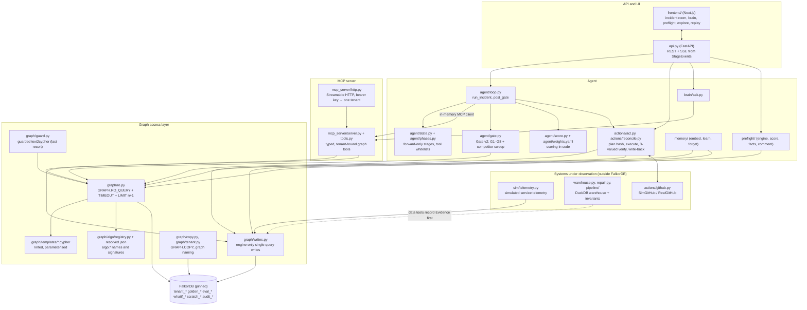

# Architecture

Faultline is an on-call agent whose only store is a per-tenant FalkorDB graph. The model may propose a cause. Deterministic code backed by read-only queries decides. This page maps the components to files and follows one incident from the alert to the write-back.

Related pages:
- [GRAPH_MODEL.md](GRAPH_MODEL.md): what is in the graph;
- [QUERY_CATALOGUE.md](QUERY_CATALOGUE.md): every template the product runs;
- [SAFETY.md](SAFETY.md): what the agent cannot do, and where that is enforced;
- [DESIGN_DECISIONS.md](DESIGN_DECISIONS.md): why it is built this way;
- [HONEST_LIMITS.md](HONEST_LIMITS.md): what it does not do.

Paths below are relative to `backend/faultline/` unless they start with a top-level folder.

## Component diagram

## Components

| Component | What it does | Files |
|---|---|---|
| Agent loop | Runs the stages in order: RECALL, LOCALIZE, BLAST, HYPOTHESIZE, INVESTIGATE, GATE, then CONTAIN, ROUTE and PLAN in `post_gate`. Graph tools are called through an in-memory MCP client. An investigator (deterministic `BaselineInvestigator`, or `LLMInvestigator` with a key) proposes causes. | `agent/loop.py` |
| Stages and whitelists | Forward-only stage machine with sticky terminals (RESOLVED, NO_INCIDENT, UNKNOWN_ESCALATED, FAILED). Each stage offers a fixed tool list; advisory tools only run after the verdict. | `agent/state.py`, `agent/phases.py` |
| Scoring | Suspect ranking from hops, time, pageRank and the memory prior. Every weight has a one-line justification. | `agent/score.py`, `agent/weights.py`, `agent/weights.yaml` |
| Evidence Gate v2 | G1–G8 as read-only queries, plus a deterministic competitor sweep over every change in the window and the three-valued no-incident proof. Writes one `GateRun` per verdict. | `agent/gate.py`, `graph/templates/gate_*.cypher`, `neg_proof*.cypher` |
| Report | Proven vs inferred is decided by the gate, not by the model's labels. | `agent/report.py` |
| MCP server | The agent's graph tools, also served to judges. Each tool returns rows, the Cypher, params, timing and an evidence id. Tools that build scratch graphs stay internal. | `mcp_server/server.py`, `mcp_server/tools.py`, `mcp_server/context.py`, `mcp_server/http.py`, `mcp_server/resources.py`; [MCP.md](MCP.md) |
| RO wrapper | The only read path: `GRAPH.RO_QUERY`, a clamped `TIMEOUT`, a literal `LIMIT` sent as n+1 to detect truncation, a digest of the rows, seen ids, and loud three-valued errors. The ablation switch is checked on every call. | `graph/ro.py`, `graph/client.py`, `graph/errors.py` |
| Templates | One `.cypher` file per query id, parameterised and linted (LIMIT, ORDER BY, bounded paths, CALL allowlist, no writes, engine-bug shapes). | `graph/templates/*.cypher`, `graph/templates/__init__.py`, `tests/graph/test_template_lint.py` |
| `algo.*` registry | Procedure names and signatures, resolved on the pinned engine by smoke. The min-cut is computed from `algo.maxFlow` edge flows. | `graph/algo/registry.py`, `graph/algo/resolved.json`, `graph/algo/maxflow.py` |
| Guarded text2cypher | Last-resort tier: guard on masked text, `GRAPH.EXPLAIN` plan check, then `RO_QUERY` with a short timeout. | `graph/guard.py` |
| Writes | Engine-only writes, each one query: evidence and tool calls, run state, gate runs, options, approval, verdicts, write-back, memory, claims, forget. | `graph/writes.py` |
| Tenancy and copies | Graph names per tenant, ownership checks, `GRAPH.COPY` for golden, eval, what-if and Re-arm. | `graph/tenant.py`, `graph/copy.py` |
| Actions | Options from a fixed enum, plan hash, exclusive two-step approval, execute with a drift guard, three-valued verification on two channels, write-back and re-read, reconciler. | `actions/act.py`, `actions/github.py`, `actions/reconcile.py` |
| Memory | Embeds incident text locally. Recall is a vector query confirmed by a shared `Symptom`. LEARN groups families with `algo.labelPropagation` and consolidates derived runbooks. Forget runs with a receipt. | `memory/embed.py`, `memory/learn.py`, `memory/forget.py`, `recall.cypher`, `families.cypher` |
| Company brain | Routes a question to seeds, then templates, then guarded text2cypher. A read-only citation check decides which ids may be cited. Sessions and turns are stored in the graph. | `brain/ask.py`, `cite_check.cypher`, `session_history.cypher` |
| Preflight | Ingests a PR as `PR`/`File`/`ChangeFact` nodes and scores it from BFS impact, betweenness, past incidents, contradicted decisions, bus factor and missing guardrails. | `preflight/engine.py`, `preflight/score.py`, `preflight/facts.py`, `preflight/comment.py`, `deploy/github-action/` |
| API | REST and SSE. The SSE stream is built from `StageEvent` reads. Public mode adds run tokens, rate limits and clean-room copies for visitors. | `api.py`, [API.md](API.md), `SECURITY.md` |
| UI | Incident room (graph view, gate checklist, Cypher panel with PROFILE and RO re-run, approval), brain, preflight, an Explore view on `@falkordb/canvas`, and a static replay. | `frontend/src/app/`, `frontend/src/components/incident/`, `frontend/src/components/cypher/CypherPanel.tsx`, `frontend/src/components/explore/FalkorCanvas.tsx` |
| Simulator | Generates service telemetry from the graph topology and the scenario's effects, and writes `MetricWindow` nodes. It reads flag state from simulated GitHub main, not from the graph. | `sim/telemetry.py`, `scenario.py` |
| Warehouse and pipeline | The existing DuckDB pipeline and invariant suite. It is the system under observation for data incidents and the verifier of data repairs. | `warehouse.py`, `repair.py`, `pipeline/`, `agent/datatools.py` |
| Ingest and seed | Builds topology, lineage, org, history, documents, obligations and embeddings as bundles, then seeds `golden_<t>` with batched `UNWIND … MERGE`. | `ingest/`, `scripts/seed.py` |

## One incident, end to end (S1, the hero)

The steps follow `api.py`, `scenario.py`, `agent/loop.py` and `actions/act.py`. Every arrow below is recorded in the graph as `StageEvent`, `ToolCall`, `Evidence` and `GateRun` nodes.

1. **Start.** `POST /api/scenarios/S1/run` (`api.py::run_scenario`) checks rate limits and the LLM key, then starts `_run_job`. It returns a run token; only its sha256 is stored, on the `Run` node (`writes.set_run_token`).
2. **Prepare a clean room.** `scenario.prepare` copies `golden_acme` to a fresh `eval_acme_…` graph (`graph/copy.py::copy_graph`). It then injects the scenario's deploys (`writes.inject_change`) and alerts (`writes.raise_alert`) and simulates telemetry into `MetricWindow` nodes (`sim/telemetry.py::simulate`).
3. **INTAKE.** The symptoms are the targets of the alerts that fired around onset (template `Q-ALERT-1`). The incident is opened (`writes.open_incident`), its text is embedded with `vecf32` (`scenario.embed_incident`), and the run is indexed in `audit_acme` (`writes.index_run`).
4. **RECALL.** `similar_incidents` runs a vector query on the incident's own embedding, then keeps only precedents that share a `Symptom` node (`recall.cypher`). `runbook_for` lists runbooks. The prior per target is computed in Cypher (`Q-MEM-8`, `family_prior.cypher`). Recall is written back as `RECALLED` edges (`writes.record_recall`).
5. **LOCALIZE.** `service_context` and `upstream_scope` per symptom (`context.cypher`, `upstream_scope.cypher`).
6. **BLAST.** `blast_radius` (`algo.BFS` over `PROPAGATES_TO`) and `chokepoints` (`algo.betweenness`).
7. **HYPOTHESIZE.** `upstream_suspects` and `window_changes` list the changes in the window. `rank_causes` runs `algo.pageRank` on a scratch projection. `agent/score.py` ranks the suspects, which are written as `Hypothesis` nodes.
8. **INVESTIGATE.** The investigator measures suspects with data and telemetry tools, which record `Evidence` first. It then calls `confirm_root_cause`. A tool outside the stage's whitelist is refused (`agent/phases.py`).
9. **GATE.** `agent/gate.py::Gate.sweep` and `Gate.confirm` run G1–G8 as read-only queries and write one `GateRun` each:
   - **G2** `algo.SPpaths` (`gate_path.cypher`): `D-rec-12` has no path to checkout and is rejected;
   - **G5** joint `algo.maxFlow` (`gate_flow.cypher`): `D-email-88` has a path, but its max flow cannot carry the observed share, so it is rejected;
   - `D-pay-417` passes, and G8 attaches the contradicted ADR-012 and ADR-013 (`decision_contradiction.cypher`).

   Advisory checks then run without changing the verdict: `alert_coverage` (`chain_monitors.cypher`) and `residue_check` (`residue.cypher`).
10. **CONTAIN** (`agent/loop.py::post_gate`). `connectivity_check` (`algo.WCC`) decides whether a cut is needed. `containment_cut` (`algo.maxFlow`, then `graph/algo/maxflow.py::min_cut`) finds the smallest cut between the failing component and the protected set (`protect_set.cypher`). `whatif` applies the cut on a `GRAPH.COPY` branch (`whatif_*.cypher`). `futures` then gives every candidate (each single cut edge, the whole cut, removing the origin, no change) its own branch and predicts each symptom's residual with `futures.cypher` (Q-FUTURE-1: measured excess × path transfer), judged by verification's band rule.
11. **ROUTE.** These run next:
    - `who_fixes`: `algo.HarmonicCentrality` on a scratch projection;
    - `bus_factor`;
    - `escalation_tree`: `algo.MSF`;
    - `obligation_clock`: SLO burn and customers reached;
    - `notify_set`;
    - `owner_at`: who owned the component when the change shipped.
12. **PLAN.** `remedy_stats` (`remedy_stats.cypher`) supplies past success rates. `actions/act.py::build_options` builds the options from the cut, the cause, the what-if verdict and each option's predicted future, orders them predicted-to-contain first, and lets that history reorder only within the same prediction. `Action.future` keeps the prediction; verification records whether it came true. The incident moves to `AWAITING_APPROVAL` only after every option exists in the graph.
13. **Choose, then approve.** `POST /api/incidents/{inc}/choose` renders the exact action and its plan hash (`act.choose`, `writes.W_CHOOSE`). `POST …/approve` must quote that hash; `writes.W_APPROVE` moves the incident to EXECUTE in the same query, so approval is exclusive. On the public demo both calls need the run token, and the approver must be an active person in the graph (`approver.cypher`).
14. **EXECUTE.** `api.py::_act_job` first runs the reconciler on older intents. Then `act.execute` re-checks the approval, the intent owner, the plan hash and drift at GitHub main, and opens and merges a `faultline/fix-*` PR on the (simulated) infra repo.
15. **VERIFY.** `act.verify` returns APPLIED, NOT_APPLIED or UNKNOWN from two channels: (1) a re-read of GitHub main, and (2) telemetry after the change for every symptom, plus collateral on the protected nodes. NOT_APPLIED returns to approval with that option disabled. UNKNOWN escalates to a human and writes no success.
16. **WRITEBACK.** `writes.W_WB_1` writes `CAUSED`, `RESOLVED_BY`, a `Postmortem`, a `Decision` and `PRECEDENT_FOR` in one query, and only when the verdict is APPLIED. `act.verify_writeback` re-reads it through a separate read-only connection (`writeback_check.cypher`) and reports `verified n/m`. An incomplete re-read escalates instead of resolving.
17. **LEARN.** `memory/learn.py::learn` finds the incident's family (`algo.labelPropagation`, `families.cypher`), consolidates a derived runbook with `DERIVED_FROM` provenance, and applies decay. The incident ends RESOLVED. The next incident with a shared symptom starts warm (S1b).

The UI follows along through `GET /api/incidents/{inc}/events` (SSE built from `StageEvent` reads, `run_events.cypher`). `scripts/export_run.py` and `scripts/record_demo.py` export runs to `examples/` as files generated from the graph.

## Where FalkorDB sits

FalkorDB is the only store. Topology, lineage, telemetry windows, alerts, evidence, hypotheses, gate runs, plans, approvals, intents, actions, memory vectors, documents, sessions and run state all live in the graph. `events.jsonl`, `report.md` and the replay files are exports of the graph. `scripts/lint_single_store.py` enforces this in CI (`tests/test_lint_single_store.py`).

**Outside FalkorDB, by design:**
- the systems under observation: the warehouse and pipeline, the simulated or real GitHub repos and their `flags.json`. Specialist tools reach them and record `Evidence` first;
- configuration (`agent/weights.yaml`, `data/scenarios/scenarios.yaml`, `data/topology/*.yaml`);
- the grader-only `data/scenarios/*.truth.json`, read only by `evals/` and `tests/` (`scripts/lint_no_leaks.py`).

**Graphs on one instance** (names built and checked in `graph/tenant.py`):

| Graph | Purpose | Written by |
|---|---|---|
| `tenant_<t>` | The live tenant graph the demo and the API serve | `graph/copy.py` (from golden), runs, actions |
| `golden_<t>` | The deterministic seeded state; the source of every copy | `scripts/seed.py` |
| `golden_<t>_nomem` | Golden without incident memory, for the memory-off eval arm (A2) | `scripts/seed.py --no-memory` |
| `eval_<t>_<run>_<arm>_<scn>_<trial>` | Clean rooms: one fresh `GRAPH.COPY` per scenario run | `scenario.py::prepare`, `evals/harness.py` |
| `whatif_<t>_<id>` | A branch where a containment cut is applied and checked with `algo.WCC`/`algo.BFS` | `mcp_server/tools.py::whatif` |
| `whatif_<t>_<run>_fut_<hash>` | One branch per containment candidate, its cut edges removed, read by Q-FUTURE-1 | `mcp_server/tools.py::futures` |
| `scratch_<t>_<inc>` | Temporary projections for pageRank, HarmonicCentrality and MSF; deleted after use | `mcp_server/tools.py::_scratch_run`, `writes.build_scratch*` |
| `audit_<t>` | Append-only records that survive Re-arm: run index, forget receipts, Re-arm events | `writes.index_run`, `writes.append_audit`, `memory/forget.py` |

**Access paths:**
- **Reads:** `graph/ro.py` as the per-tenant ACL user `ro_<t>` when ACL passwords are configured (`deploy/users.acl.template`, `scripts/render_acl.py`). That user may run only `GRAPH.RO_QUERY`, `GRAPH.EXPLAIN` and `PING` on its own keys.
- **Writes:** `graph/writes.py` through the engine connection (`graph/client.py::engine`). The model never holds it.
- **Engine housekeeping:** readiness flags, constraint and index checks in `graph/copy.py` and `graph/writes.py`. These are bounded, fixed-text and never decision reads.
- **Engine limits:** `GRAPH.CONFIG` limits are applied and verified at seed (`scripts/configure_falkordb.py`).
- **Pinning:** the engine image is pinned by digest in `deploy/docker-compose.yml` (see [FALKORDB_COMPAT.md](FALKORDB_COMPAT.md)).

**Ablation.** With `FAULTLINE_DISABLE_GRAPH=true`, `graph/client.py` and `graph/ro.py` raise `GraphUnavailable` before any socket. The run cannot start and confirms no cause (eval arm A4). The UI shows a banner instead of an invented answer.
