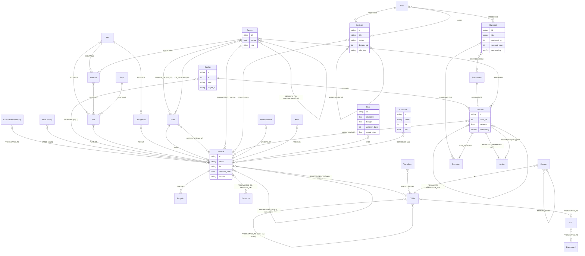
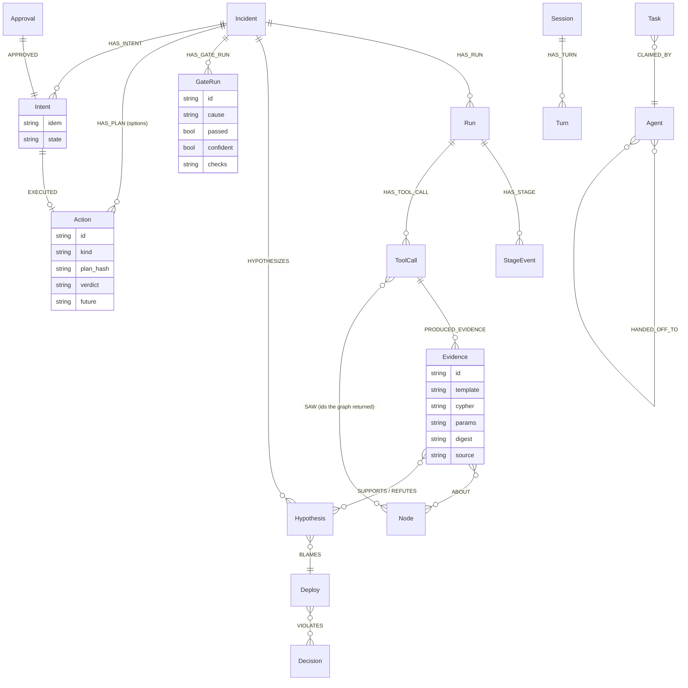

# Graph model

One FalkorDB graph per tenant (`tenant_<t>`) holds the world the agent reasons over and everything it does. Services, data lineage, changes, people, decisions, incidents, memory and run state all share one id space. Every node carries the base label `Node` (for cross-label id lookups) plus exactly one domain label.

Sources of truth:
- **Declared model:** [`backend/faultline/graph/schema_model.py`](../backend/faultline/graph/schema_model.py) (`NODE_LABELS`, `REL_TYPES`, `RUNTIME_RELS`, `RESERVED_RELS`). The seeder and the writes reject anything else.
- **Live schema:** [GRAPH_SCHEMA.md](GRAPH_SCHEMA.md), generated from the seeded graphs by `scripts/gen_graph_schema.py`. It gives counts per graph, endpoint pairs, property keys, indexes and the templates that read each relationship type. `scripts/check_schema_drift.py` compares it with the declared model.
- **DDL:** [`backend/faultline/graph/schema.cypher`](../backend/faultline/graph/schema.cypher), applied per graph by `scripts/seed.py` and re-applied after every `GRAPH.COPY`.
- **Queries:** [QUERY_CATALOGUE.md](QUERY_CATALOGUE.md), one row per template.

This page explains the model. It does not repeat the generated tables.

## World model

Edges drawn on `Service` also connect the other component labels (`Datastore`, `Transform`, `KPI`) where [GRAPH_SCHEMA.md](GRAPH_SCHEMA.md) lists the endpoint pair. For example, `OWNS` and `OWNED_AT` reach every owned component, and `CHANGED` reaches services, datastores and transforms.

## Run state (written by the agent, in the same graph)

`audit_<t>` is a separate graph for records that must survive Re-arm: `RunIndex`, `ForgetReceipt` and `Rearm` (`graph/writes.py::index_run`, `::append_audit`).

## M15 additions

- `PROPAGATES_TO` / `DEPENDS_ON`: `valid_from`, `introduced_by` on the calls a past PR introduced (versioned topology; absent = always there); `learned: true`, `from_incident`, `approved_by` on a learned failure link.
- `(:Override)-[:OVERRIDES]->(:Decision)`, `-[:FOR_CHANGE]->(change)`: a reviewer's answer to a contradiction for one change, bound to the asserted value (`actual`).
- `(:Incident)-[:HAS_PROPOSAL]->(:EdgeProposal {src, dst, cap, status, plan_hash})`: a link a verified fix showed was missing, until a human approves it.
- `(:PlaygroundRun {kind, result})` in `audit_<t>`: a recorded "break the graph" diff.

## Key properties

| Label | Properties that decisions read | Read by (examples) |
|---|---|---|
| `Service`, `Datastore`, `Table`, `KPI` | `tier`, `revenue_path`, `domain` | blast ranking, protect set (`Q-PROTECT-1`), preflight |
| `Deploy` | `at` (range-indexed), `kind`, `target_id` | window and time order (`Q-SUS-2`, `Q-GATE-2`) |
| `Incident` | `onset_at`, `salience`, `last_used`, `embedding` | recall (`Q-MEM-1`), decay, as-of answers |
| `Decision` | `status`, `decided_at`, `rule_key`, `rule_op`, `rule_value` | G8 and preflight contradictions (`Q-DEC-1`), heads (`Q-DEC-2`) |
| `Runbook` | `reviewed_at`, `valid_from`, `support_count`, `source` | knowledge health (`Q-KH-1`), derived runbooks (`Q-MEM-3`) |
| `Person` | `active`, `valid_to` | who fixes it, bus factor, approver check (`Q-APPROVER-1`) |
| `MetricWindow` | `target_id` (range-indexed), `metric`, `kind`, `value` | telemetry tools, alert coverage, obligation clock, G4 upstream (measured excess) |
| `SLO` | `objective`, `budget` (= 1 − objective), `window_days`, `metric`, `spent_prior` (synthetic share of the budget spent before the telemetry horizon) | obligation clock burn and budget left (`Q-OBL-SLO`) |
| `Customer` | `mrr`, `tier`, `name` (all synthetic); `CONSUMES {via}` to an entry service, API service or KPI | customers reached and MRR at risk, counted once per customer (`Q-OBL-CUST`) |
| `Evidence` | `cypher`, `params`, `digest`, `value`, `baseline`, `ratio`, `source` | G1, G4, G5 observed share, G7 (`gate_*.cypher`) |
| `Action` | `kind`, `target_id`, `verdict`, `plan_hash`, `idem` | approval, verify, write-back, fix history (`Q-REM-1`) |
| `Intent` | `idem` (unique constraint), `state` | idempotent execute, reconciler (`actions/reconcile.py`) |

## The derived failure-flow layer

The agent does not traverse `CALLS` or the raw lineage edges to decide anything. At ingest, each producer writes a derived edge pair:
- `PROPAGATES_TO` points in the direction failure flows (dependency → dependent);
- `DEPENDS_ON` is its reverse.

The pair is written by `ingest/otel_topology.py` and `ingest/lineage_to_graph.py::flow`, plus cross-domain links from `ingest/cross_domain.py`. Each edge carries:
- `cap`: capacity for `algo.maxFlow`;
- `cut_cost`: the cost of cutting this edge, for the min-cut;
- `w`: the SPpaths weight;
- `domain` (`service` or `data`) and `cap_why`, a one-line justification.

**`cap` semantics** (decision of record; full reasoning in [EXPLAINER.md](EXPLAINER.md) and `docs/design/scenario_numbers.md` §1):
- **Service edges:** `cap` = criticality, a property of the call type set per edge in `data/topology/*.yaml`. It is never a traffic share. <!-- noclaim: configured constants -->A synchronous, error-propagating call has `cap` 1.0; a best-effort or async call has a small criticality, such as 0.02 for the order-confirmation email.
- **Lineage edges:** `cap` = the end-to-end row share: the fraction of the symptom's contributing rows that are derived from that input. Only the edge into the join table carries a share below 1, and upstream lineage edges are 1.0, so the minimum along a path equals the end-to-end share. <!-- noclaim: configured constant --> For example, the FX feed touches only non-USD orders, so its max flow to the revenue KPI is <!-- claim:s2.D-fx-pause-7.max_flow -->0.0692<!-- /claim -->.
- **Control-plane edges:** `CHANGED` (Deploy → component) and `GATES` (FeatureFlag → component) carry `cap` 1.0, so a max-flow from the deploy equals one from the changed node. <!-- noclaim: configured constant -->

**Why G5 is sound.** Max flow over these capacities, multiplied by k, the number of distinct paths by which the change reaches the symptom (min(1, k × maxFlow); plain max flow when k = 1), is an upper bound on the share of the symptom that a single cause can explain: with k reconvergent paths a request meets the fault once per path, so plain max flow alone is not a bound. If even the bound is below the observed impact, the suspect is eliminated, but only when another suspect can carry the impact **alone** (its plain `algo.maxFlow`, over every component that change touched, excluding a component measured in band while another is anomalous). An elimination never rests on a group of suspects that are each insufficient alone: which one of them is the cause is contingent, and eliminating one "because the others can carry it" depended on the order they were looked at (review: three suspects that each fail alone while any two together suffice). Such suspects all stay, and if together they can carry the impact (one multi-source `algo.maxFlow`) every one is "unresolved: only jointly sufficient (multi-cause)", so nothing is confident. The rule runs per independent alert and is order-independent (`g5_eliminations`, `g5_jointly_sufficient`). Otherwise the result is an abstention. The "others" flow is the plain max flow, deliberately not inflated by path multiplicity, so an elimination never rests on an overestimate. Code: `agent/gate.py::Gate.sweep`, `::confirm`, `gate_flow.cypher`. Tests: `tests/ingest/test_cap_semantics.py`, `tests/live/test_gate_s2.py`.

**Who reads it:**
- G2 (`algo.SPpaths` over `CHANGED|GATES|PROPAGATES_TO`);
- G5 and the min-cut (`algo.maxFlow`);
- the blast radius (`algo.BFS`) and connectivity (`algo.WCC`);
- what-if, the negative proof (`algo.SSpaths`), the residue check and hidden coupling.

`PROPAGATES_TO` has the longest "read by" list in [GRAPH_SCHEMA.md](GRAPH_SCHEMA.md).

## Validity windows and time

The graph answers "as of" questions from edge properties. There is no second store and no snapshot.

| Edge or property | Meaning | Read by |
|---|---|---|
| `(:Team)-[:OWNED_AT {from, to}]->(component)` | Every ownership period. `to` is null for the current owner; `OWNS` mirrors the current owner. | `Q-OWN-AT` (`owner_at.cypher`), `Q-ASOF-1` (`beliefs_at.cypher`), `Q-KH-2`, `Q-PRE-2-ASOF` |
| `(:Person)-[:ON_CALL {from, to}]->(:Team)` | The weekly rota, contiguous per team | `Q-ASOF-1`, `Q-NOTIFY-1`, `Q-CTX-1` |
| `(:Person)-[:MEMBER_OF {from, to}]->(:Team)` | Team membership over time; "active" at a past instant | `Q-ORG-BUS-ASOF` (`bus_factor_asof.cypher`) |
| `(:Decision)-[:SUPERSEDES {at}]->(:Decision)` + `Decision.decided_at` | Decision chains. The head is the decision nothing supersedes; "in force at t" means decided by t and not yet superseded at t. | `Q-DEC-2` (`decision_head.cypher`), `Q-ASOF-1`, `Q-DEC-1` |
| `Runbook.valid_from`, `Runbook.valid_to`, `Runbook.reviewed_at` | When a runbook took effect, was retired and was last reviewed | `Q-ASOF-1`, `Q-KH-1` |
| `Deploy.at`, `Incident.onset_at`, `PR.merged_at` | Event times for windows, timelines and the as-of backtest | `Q-SUS-2`, `Q-TIMELINE-1`, `Q-PRE-HIST` |

Tools built on these: `owner_at`, `beliefs_at`, `component_timeline` and `knowledge_health` (`mcp_server/tools.py`). The preflight backtest uses the as-of templates, so no later incident or ownership leaks into a historical score (`evals/backtest.py`). Service calls are versioned (`PROPAGATES_TO.valid_from`, Q-TOPO-AT, Q-PRE-1-ASOF); revenue paths, betweenness and lineage are not (see [HONEST_LIMITS](HONEST_LIMITS.md)).

## Indexes and constraints

All in [`schema.cypher`](../backend/faultline/graph/schema.cypher), except the constraint, which is created by `graph/writes.py::ensure_constraints`.
- **Range indexes** on `id` for every label, on `:Node(id)`, and on `Deploy.at`, `MetricWindow.target_id` and `Intent.idem`.
- **Full-text, DDL form only** (the procedure form fails on the pinned engine):
  - `Service.name`, `Table.name`, `Runbook.title`, `Decision.title`, `Postmortem.summary`, `Doc.title`;
  - never on an attribute that also has a range index (engine issue noted in [FALKORDB_COMPAT.md](FALKORDB_COMPAT.md));
  - used as tier-1 seeds (`find_*.cypher`).
- **Vector indexes** (384-dimensional, cosine) on `Incident.embedding`, `Runbook.embedding` and `Postmortem.embedding`:
  - written only through `vecf32()` (`graph/writes.py::set_vectors`);
  - queried with `db.idx.vector.queryNodes`, which returns a distance that the template converts to a similarity;
  - used by recall (`recall.cypher`), `find_incident_vector.cypher` and the forget proof (`forget_vector_probe.cypher`).
- **Unique constraint** on `Intent.idem` (`GRAPH.CONSTRAINT CREATE … UNIQUE`). It is asynchronous, so seeding polls `db.constraints()` until OPERATIONAL. It makes execute idempotent across retries and crashes.

`graph/copy.py` re-applies the schema after every `GRAPH.COPY` and checks `db.indexes()`.

## Which templates read what

The full mapping (relationship type → every template that reads it) is the "read by templates" column of [GRAPH_SCHEMA.md](GRAPH_SCHEMA.md). That page also lists the write-only types (written as source provenance and read by no template). The purpose, algorithm and PROFILE time of each template are in [QUERY_CATALOGUE.md](QUERY_CATALOGUE.md). In summary:

| Relationship group | Main decisions it feeds | Representative templates |
|---|---|---|
| `PROPAGATES_TO` / `DEPENDS_ON` | G2, G5, G4 upstream, blast radius, min-cut, what-if, negative proof, residue | `Q-GATE-1`, `Q-GATE-3`, `Q-GATE-UPSTREAM`, `Q-BLAST-1`, `Q-CUT-1`, `Q-CUT-2`, `Q-WHATIF-1`, `Q-NEG-1`, `Q-RESIDUE-1` |
| `CHANGED`, `GATES` | suspects in the window, path sources, levers | `Q-SUS-1`, `Q-SUS-2`, `Q-CHANGE-1`, `Q-GATE-1` |
| `CALLS` | chokepoints (betweenness), the simulator's topology | `Q-CHOKE-1`, `Q-SIM-1` |
| `OWNS`, `OWNED_AT`, `MEMBER_OF`, `ON_CALL`, `COMMITTED`, `AUTHORED`, `TOUCHES`, `PART_OF`, `RESOLVED`, `COLLABORATES`, `REPORTS_TO` | who fixes it (scratch projection for HarmonicCentrality), bus factor, escalation (MSF), notify set, owner at the time | `Q-ORG-1`, `Q-ORG-BUS`, `Q-ORG-MSF`, `Q-NOTIFY-1`, `Q-OWN-AT` |
| `CONSTRAINS`, `SUPERSEDES`, `CITES`, `PRODUCED` | G8 contradictions, decision heads and sources, forget dry run | `Q-DEC-1`, `Q-DEC-2`, `Q-DEC-3`, `Q-FORGET-1` |
| `HAS_SYMPTOM`, `CAUSED`, `RESOLVED_BY`, `ATTEMPTED`, `DOCUMENTS`, `DERIVED_FROM`, `RUNBOOK_FOR` | recall, family prior, derived runbooks, learned remediation order | `Q-MEM-1`, `Q-MEM-3`, `Q-MEM-6`, `Q-MEM-8`, `Q-REM-1` |
| `HAS_TOOL_CALL`, `SAW`, `PRODUCED_EVIDENCE`, `ABOUT` | G1 grounding, G4, G7, origin test, brain citation guard | `Q-GATE-G1`, `Q-GATE-4`, `Q-GATE-7`, `Q-GATE-ORIGIN`, `Q-CITE-1` |
| `HAS_PLAN`, `HAS_INTENT`, `APPROVED`, `EXECUTED` | approval, execute, reconcile, write-back re-read | `Q-ACT-1`, `Q-INTENT-1`, `Q-WB-1` |
| `FOR`, `CONSUMES` | obligation clock (SLO burn, customers reached) | `Q-OBL-SLO`, `Q-OBL-CUST` |

Not every type is read. [GRAPH_SCHEMA.md](GRAPH_SCHEMA.md) lists each one no template reads: seeded provenance types such as `EXPOSES` and `EMITS`, and the runtime `PRECEDENT_FOR` and `HANDED_OFF_TO`. Each is a candidate for a template or for removal.
