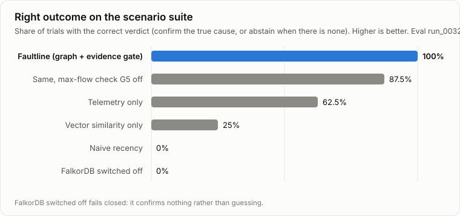
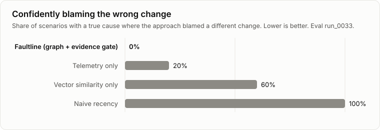

# Faultline by the numbers

Every number on this page is read from [`evals/results/latest.json`](../evals/results/latest.json) and checked by `make claims`; a number that drifts from the results file fails the build. The charts are drawn from the same file by `scripts/gen_charts.py`. The method behind each figure, its pre-registration and its limits are in [EVALS.md](EVALS.md), [evals/PREREGISTRATION.md](../evals/PREREGISTRATION.md) and [evals/RESULTS.md](../evals/RESULTS.md).

The headline numbers are keyless (the deterministic investigator, no API key). A small LLM comparison with `claude-opus-5-5` is reported separately below.

## Scorecard

How to read it: **k/n** counts independent cases (identical re-runs of a deterministic run count once); square brackets hold a 95 % Wilson interval. **Kind** says whether a number could have come out otherwise: *measured*, or *by design* (true by construction: a property check). Telemetry only (T) blames the most anomalous changed component; T+ is the same heuristic allowed to say "none" below one percentage point of error rate.

| What is measured | Faultline | Compared with | Kind |
|---|---|---|---|
| **Deep bench** (<!-- claim:deep.fresh.all.cases -->140<!-- /claim --> adversarial worlds: causes 1–4 hops upstream, look-alikes on the path and on the alerting service, five adversarial kinds) | right cause <!-- claim:deep.fresh.all.right_cause -->51<!-- /claim -->/<!-- claim:deep.fresh.all.cause_cases -->100<!-- /claim --> [<!-- claim:deep.fresh.all.right_cause.ci_lo -->41%<!-- /claim -->–<!-- claim:deep.fresh.all.right_cause.ci_hi -->61%<!-- /claim -->]; confident wrong blames <!-- claim:deep.fresh.all.wrong_confident -->0<!-- /claim -->/<!-- claim:deep.fresh.all.cases -->140<!-- /claim --> [0–<!-- claim:deep.fresh.all.wrong_confident.ci_hi -->2.7%<!-- /claim -->]; abstained <!-- claim:deep.fresh.all.abstained -->89<!-- /claim -->, of which <!-- claim:deep.fresh.accepted_nc.bystander -->9<!-- /claim --> named an innocent change as a "not confident" suspect | T: right <!-- claim:deep.fresh.all.T.right_strict -->85<!-- /claim -->, wrong <!-- claim:deep.fresh.all.T.wrong_any -->55<!-- /claim -->; T+: right <!-- claim:deep.fresh.all.Tplus.right_strict -->85<!-- /claim -->, wrong <!-- claim:deep.fresh.all.Tplus.wrong_any -->55<!-- /claim --> (here every look-alike is anomalous, so T+ never says "none") | measured |
| The same bench on <!-- claim:seeds.deep.seeds -->3<!-- /claim --> seeds generated for this audit | right cause <!-- claim:seeds.deep.right_cause -->136<!-- /claim -->/<!-- claim:seeds.deep.cause_cases -->300<!-- /claim --> [<!-- claim:seeds.deep.right_cause.ci_lo -->40%<!-- /claim -->–<!-- claim:seeds.deep.right_cause.ci_hi -->51%<!-- /claim -->]; confident wrong <!-- claim:seeds.deep.wrong_confident -->0<!-- /claim -->/<!-- claim:seeds.deep.cases -->420<!-- /claim --> [0–<!-- claim:seeds.deep.wrong_confident.ci_hi -->0.9%<!-- /claim -->]; abstained <!-- claim:seeds.deep.abstained -->284<!-- /claim -->, of which <!-- claim:seeds.deep.accepted_nc.bystander -->24<!-- /claim --> named an innocent change as a "not confident" suspect | T: right <!-- claim:seeds.deep.T.right_strict -->249<!-- /claim -->, wrong <!-- claim:seeds.deep.T.wrong_any -->171<!-- /claim -->; T+: right <!-- claim:seeds.deep.Tplus.right_strict -->249<!-- /claim -->, wrong <!-- claim:seeds.deep.Tplus.wrong_any -->171<!-- /claim --> | measured |
| The same bench on <!-- claim:seeds2.deep.seeds -->8<!-- /claim --> more seeds, pre-registered 2026-10-16 (<!-- claim:seeds2.deep.cases -->1120<!-- /claim --> worlds) | right cause <!-- claim:seeds2.deep.right_cause -->382<!-- /claim -->/<!-- claim:seeds2.deep.cause_cases -->800<!-- /claim --> [<!-- claim:seeds2.deep.right_cause.ci_lo -->44%<!-- /claim -->–<!-- claim:seeds2.deep.right_cause.ci_hi -->51%<!-- /claim -->]; confident wrong <!-- claim:seeds2.deep.wrong_confident -->0<!-- /claim -->/<!-- claim:seeds2.deep.cases -->1120<!-- /claim --> [0–<!-- claim:seeds2.deep.wrong_confident.ci_hi -->0.3%<!-- /claim -->]; abstained <!-- claim:seeds2.deep.abstained -->738<!-- /claim -->, of which <!-- claim:seeds2.deep.accepted_nc.bystander -->48<!-- /claim --> named an innocent change as a "not confident" suspect. All <!-- claim:seedsall.deep.seeds -->11<!-- /claim --> non-headline seeds pooled: right <!-- claim:seedsall.deep.right_cause -->518<!-- /claim -->/<!-- claim:seedsall.deep.cause_cases -->1100<!-- /claim -->, confident wrong <!-- claim:seedsall.deep.wrong_confident -->0<!-- /claim -->/<!-- claim:seedsall.deep.cases -->1540<!-- /claim --> [0–<!-- claim:seedsall.deep.wrong_confident.ci_hi -->0.25%<!-- /claim -->] | T: right <!-- claim:seeds2.deep.T.right_strict -->671<!-- /claim -->, wrong <!-- claim:seeds2.deep.T.wrong_any -->449<!-- /claim --> [<!-- claim:seeds2.deep.T.wrong_any.ci_lo -->37%<!-- /claim -->–<!-- claim:seeds2.deep.T.wrong_any.ci_hi -->43%<!-- /claim -->]; T+: right <!-- claim:seeds2.deep.Tplus.right_strict -->671<!-- /claim -->, wrong <!-- claim:seeds2.deep.Tplus.wrong_any -->449<!-- /claim -->; pooled, T wrong <!-- claim:seedsall.deep.T.wrong_any -->620<!-- /claim -->/<!-- claim:seedsall.deep.cases -->1540<!-- /claim --> | measured |
| **Decisive bench** (the look-alike has its own fault, so only the graph can reject it) | right cause <!-- claim:decisive.full.g5_only.right_cause -->20<!-- /claim -->/<!-- claim:decisive.full.g5_only.cases -->20<!-- /claim --> (best-effort path only) and <!-- claim:decisive.full.anomalous_no_path.right_cause -->20<!-- /claim -->/<!-- claim:decisive.full.anomalous_no_path.cases -->20<!-- /claim --> (no path), 0 wrong | T: <!-- claim:decisive.T.g5_only.right_strict -->13<!-- /claim -->/20 and <!-- claim:decisive.T.anomalous_no_path.right_strict -->15<!-- /claim -->/20 right, <!-- claim:decisive.T.g5_only.wrong_frac -->7<!-- /claim --> + <!-- claim:decisive.T.anomalous_no_path.wrong_frac -->5<!-- /claim --> wrong; without `algo.maxFlow`: <!-- claim:decisive.no_maxflow.g5_only.right_cause -->0<!-- /claim -->/20 on the best-effort worlds | measured |
| **Independent-parameter worlds** (<!-- claim:world.cases -->100<!-- /claim --> worlds drawn by a world rule: uniform look-alikes, weaker faults; not blind) | right cause <!-- claim:world.right_cause -->43<!-- /claim -->/<!-- claim:world.cause_cases -->64<!-- /claim --> [<!-- claim:world.right_cause.ci_lo -->55%<!-- /claim -->–<!-- claim:world.right_cause.ci_hi -->77%<!-- /claim -->]; confident wrong <!-- claim:world.wrong_confident -->0<!-- /claim -->/<!-- claim:world.cases -->100<!-- /claim --> [0–<!-- claim:world.wrong_confident.ci_hi -->4%<!-- /claim -->]; <!-- claim:world.accepted_nc.bystander -->12<!-- /claim --> innocent changes named "not confident" | T: right <!-- claim:world.T.right_strict -->56<!-- /claim -->, wrong <!-- claim:world.T.wrong_any -->44<!-- /claim -->; T+: right <!-- claim:world.Tplus.right_strict -->56<!-- /claim -->, wrong <!-- claim:world.Tplus.wrong_any -->10<!-- /claim --> | measured |
| **Independent-parameter worlds on the second tenant** (globex, 200 services; <!-- claim:world_globex.cases -->200<!-- /claim --> worlds, same world rule; not blind) | right cause <!-- claim:world_globex.right_cause -->106<!-- /claim -->/<!-- claim:world_globex.cause_cases -->117<!-- /claim --> [<!-- claim:world_globex.right_cause.ci_lo -->84%<!-- /claim -->–<!-- claim:world_globex.right_cause.ci_hi -->95%<!-- /claim -->]; confident wrong <!-- claim:world_globex.wrong_confident -->0<!-- /claim -->/<!-- claim:world_globex.cases -->200<!-- /claim --> [0–<!-- claim:world_globex.wrong_confident.ci_hi -->1.9%<!-- /claim -->]; <!-- claim:world_globex.accepted_nc.bystander -->5<!-- /claim --> innocent changes named "not confident" | T: right <!-- claim:world_globex.T.right_strict -->107<!-- /claim -->, wrong <!-- claim:world_globex.T.wrong_any -->93<!-- /claim -->; T+: right <!-- claim:world_globex.Tplus.right_strict -->107<!-- /claim -->, wrong <!-- claim:world_globex.Tplus.wrong_any -->1<!-- /claim --> (with uniform look-alikes a thresholded heuristic is as good here) | measured |
| Scenario suite (8 hand-written scenarios, the gate's development set) | <!-- claim:arm.A3.scen.outcome_correct_strict.k -->8<!-- /claim -->/<!-- claim:arm.A3.scen.outcome_correct_strict.n -->8<!-- /claim --> [<!-- claim:arm.A3.scen.outcome_correct_strict.ci_lo -->68%<!-- /claim -->–100 %]; across <!-- claim:seeds.scen.seeds -->5<!-- /claim --> telemetry seeds <!-- claim:seeds.scen.A3.outcome_correct.k -->32<!-- /claim -->/<!-- claim:seeds.scen.A3.outcome_correct.n -->32<!-- /claim --> worlds | T+ <!-- claim:seeds.scen.Tplus.outcome_correct.k -->26<!-- /claim -->/<!-- claim:seeds.scen.Tplus.outcome_correct.n -->32<!-- /claim -->, T <!-- claim:seeds.scen.T.outcome_correct.k -->20<!-- /claim -->/<!-- claim:seeds.scen.T.outcome_correct.n -->32<!-- /claim -->; per scenario: T <!-- claim:arm.T.scen.outcome_correct_strict.k -->4<!-- /claim -->/8, vector <!-- claim:arm.V.scen.outcome_correct_strict.k -->2<!-- /claim -->/8, naive recency <!-- claim:arm.N.scen.outcome_correct_strict.k -->0<!-- /claim -->/8 (by design: every look-alike is as recent as the cause or more) | measured |
| Blaming a wrong change, any of the 8 scenarios | <!-- claim:arm.A3.scen.wrong_blame.k -->0<!-- /claim -->/<!-- claim:arm.A3.scen.wrong_blame.n -->8<!-- /claim --> | T <!-- claim:arm.T.scen.wrong_blame.k -->3<!-- /claim -->/8, vector <!-- claim:arm.V.scen.wrong_blame.k -->5<!-- /claim -->/8, naive <!-- claim:arm.N.scen.wrong_blame.k -->7<!-- /claim -->/8 (N, V, T cannot abstain by design) | measured |
| Gate bench (generated; a conformance test: its expected verdicts follow the gate's rules and every look-alike is healthy) | <!-- claim:gate_bench.correct -->100<!-- /claim -->/<!-- claim:gate_bench.cases -->100<!-- /claim --> and <!-- claim:gate_bench_heldout.correct -->100<!-- /claim -->/<!-- claim:gate_bench_heldout.cases -->100<!-- /claim --> by outcome on two seeds; <!-- claim:seeds.gate.correct -->300<!-- /claim -->/<!-- claim:seeds.gate.cases -->300<!-- /claim --> on <!-- claim:seeds.gate.seeds -->3<!-- /claim --> new seeds, 0 wrong. Strict (a bystander named "not confident" counts wrong): <!-- claim:gate_bench.correct_strict -->96<!-- /claim -->, <!-- claim:gate_bench_heldout.correct_strict -->98<!-- /claim -->, <!-- claim:seeds.gate.correct_strict -->296<!-- /claim --> | T+ on the new seeds: right <!-- claim:seeds.gate.Tplus.right_strict -->194<!-- /claim -->/<!-- claim:seeds.gate.cause_cases -->195<!-- /claim -->, wrong <!-- claim:seeds.gate.Tplus.wrong_any -->1<!-- /claim -->/<!-- claim:seeds.gate.cases -->300<!-- /claim --> | measured; near-structural |
| The graph's two algorithms (capability ladder, <!-- claim:ladder.full.b.confirm_cases -->65<!-- /claim --> gate-bench worlds with a cause) | right cause <!-- claim:ladder.full.b.right_cause -->65<!-- /claim --> with both; <!-- claim:ladder.no_maxflow.b.right_cause -->65<!-- /claim --> without `algo.maxFlow`, <!-- claim:ladder.no_sppaths.b.right_cause -->65<!-- /claim --> with `algo.SPpaths` → connectivity; <!-- claim:ladder.neither.b.right_cause -->43<!-- /claim --> without both [<!-- claim:ladder.neither.b.right_cause.ci_lo -->54%<!-- /claim -->–<!-- claim:ladder.neither.b.right_cause.ci_hi -->76%<!-- /claim -->] | | measured |
| **On-call night** (scripted, pre-registered: page → no ack → escalate → ack → approve → APPLIED → contract → the same fault again; `evals/oncall_night.py`) | <!-- claim:oncall.night.steps_passed -->14<!-- /claim -->/<!-- claim:oncall.night.steps -->14<!-- /claim --> steps; the repeat woke <!-- claim:oncall.night.inc2.people_woken -->0<!-- /claim --> people and was verified <!-- claim:oncall.night.inc2.verdict -->APPLIED<!-- /claim --> under the contract | the first incident: <!-- claim:oncall.night.inc1.people_woken -->5<!-- /claim --> people paged, <!-- claim:oncall.night.escalations -->1<!-- /claim --> escalation, stopped by the ack | by design, run <!-- claim:oncall.night.runs -->5<!-- /claim --> of a deterministic eval (the first passed <!-- claim:oncall.night.first_run.steps_passed -->13<!-- /claim -->/<!-- claim:oncall.night.steps -->14<!-- /claim --> on a harness set-up check; every run is kept; amendments in the pre-registration) |
| A standing contract outside its conditions | fired in <!-- claim:oncall.night.negatives_fired -->0<!-- /claim --> of <!-- claim:oncall.night.negatives -->5<!-- /claim --> negative cases (exhausted, revoked, expired, other parameters, gate abstaining) | | by design (one guarded write); held in every run (<!-- claim:oncall.night.runs_all_negatives_held -->True<!-- /claim -->) |
| **Learning from operators, cold vs warm** (choices on <!-- claim:learn.choices.scenarios -->S1,S1b<!-- /claim -->, three runs each; `evals/learning_night.py`, pre-registered) | the flag flip first in <!-- claim:learn.choices.warm_top_flag -->6<!-- /claim -->/<!-- claim:learn.choices.warm_trials -->6<!-- /claim --> warm runs [<!-- claim:learn.choices.warm_top_flag.ci_lo -->0.6097<!-- /claim -->, <!-- claim:learn.choices.warm_top_flag.ci_hi -->1.0<!-- /claim -->] after the on-call chose it on <!-- claim:learn.choices.learning_plans -->5<!-- /claim --> incidents | cold: the rollback first in <!-- claim:learn.choices.cold_top_rollback -->6<!-- /claim -->/<!-- claim:learn.choices.cold_trials -->6<!-- /claim --> (verified outcomes alone) | measured; gate verdicts identical cold and warm |
| **Learned responder** (the person who answers is paged first; scripted clock) | time to acknowledge <!-- claim:learn.routing.mtta_after_min -->1.0<!-- /claim --> min from incident <!-- claim:learn.routing.first_wave_from -->3<!-- /claim --> on | <!-- claim:learn.routing.mtta_before_min -->16.0<!-- /claim --> min before (reached only by escalation) | by design (a mechanism check, not a response-time claim); the rota on-call was still paged every time |
| **Forget a person's influence** (receipt, then re-read) | <!-- claim:learn.forget.events -->14<!-- /claim --> events deleted, <!-- claim:learn.forget.events_left -->0<!-- /claim --> left; the plan reverted to <!-- claim:learn.forget.top_after -->rollback_deploy<!-- /claim --> | | by design |
| **T2 go/no-go** (cold vs warm, S13, S7, S10, sessions; `evals/t2_gonogo.py`) | <!-- claim:t2.green -->5<!-- /claim --> of <!-- claim:t2.items -->5<!-- /claim --> green | | S10 on the live URL is the read-only dry run (<!-- claim:t2.s10.live_dry_run_status -->200<!-- /claim -->); the executed forget ran locally |
| FalkorDB switched off (arm A4) | confirms <!-- claim:arm.A4.confirmed_causes -->0<!-- /claim --> causes: it fails closed | | by design |
| Safety invariants under mutation | <!-- claim:mutation.killed -->41<!-- /claim --> of <!-- claim:mutation.mutants -->41<!-- /claim --> hand-written mutants caught (each written with the test meant to catch it) | | measured; self-selected |
| Context for any agent: rank of the true cause, 30 unrelated deploys (MRR) | <!-- claim:ctx.busy30.b1000.GA.mrr -->0.6598<!-- /claim --> [<!-- claim:ctx.busy30.b1000.GA.mrr_ci_lo -->0.6025<!-- /claim -->–<!-- claim:ctx.busy30.b1000.GA.mrr_ci_hi -->0.7224<!-- /claim -->] over <!-- claim:ctx.busy30.worlds -->110<!-- /claim --> worlds | telemetry ranking without the graph <!-- claim:ctx.busy30.b1000.TR.mrr -->0.5606<!-- /claim --> (paired gap <!-- claim:ctx.busy30.b1000.GA_minus_TR.mrr_diff -->0.0991<!-- /claim --> [<!-- claim:ctx.busy30.b1000.GA_minus_TR.ci_lo -->0.06<!-- /claim -->–<!-- claim:ctx.busy30.b1000.GA_minus_TR.ci_hi -->0.1424<!-- /claim -->]), vector RAG <!-- claim:ctx.busy30.b1000.V.mrr -->0.4226<!-- /claim -->, recency <!-- claim:ctx.busy30.b1000.R.mrr -->0.0768<!-- /claim -->, graph distance alone <!-- claim:ctx.busy30.b1000.G.mrr -->0.385<!-- /claim --> | measured |
| Company brain | <!-- claim:brain.correct -->33<!-- /claim -->/<!-- claim:brain.questions -->33<!-- /claim --> on our questions; a paraphrase of each question: <!-- claim:brain_para.correct -->30<!-- /claim -->/<!-- claim:brain_para.questions -->33<!-- /claim --> (keyword routing first, FalkorDB routing when no keyword matches; the paraphrases are its development set, not blind); on a blind set written by an agent that never saw the router: <!-- claim:brain_blind.s2.hybrid.correct -->24<!-- /claim -->/<!-- claim:brain_blind.s2.hybrid.questions -->40<!-- /claim --> [<!-- claim:brain_blind.s2.hybrid.correct.ci_lo -->45%<!-- /claim -->–<!-- claim:brain_blind.s2.hybrid.correct.ci_hi -->74%<!-- /claim -->], keyword routing alone <!-- claim:brain_blind.s2.keyword_router.correct -->19<!-- /claim -->/<!-- claim:brain_blind.s2.keyword_router.questions -->40<!-- /claim -->; p50 <!-- claim:brain.ms_p50 -->11.8<!-- /claim --> ms | | measured; self-authored |
| Many responders, one incident: <!-- claim:contention.responders -->24<!-- /claim --> approvals of one plan at once | <!-- claim:contention.same.accepted -->1<!-- /claim --> accepted, <!-- claim:contention.same.refused -->23<!-- /claim --> refused, <!-- claim:contention.same.prs -->1<!-- /claim --> PR | | by design (one atomic query), 1 run |
| Crash between execute and verify (SIGKILL, restart, reconcile) | exactly once = <!-- claim:chaos.exactly_once -->True<!-- /claim -->, <!-- claim:chaos.prs_after_reconcile -->1<!-- /claim --> PR | a naive retry without the idempotency key merged <!-- claim:chaos.control_merged_prs -->2<!-- /claim --> PRs | measured, 1 run |
| Work claims under contention (<!-- claim:s13.workers -->16<!-- /claim --> workers, <!-- claim:s13.rounds -->100<!-- /claim --> rounds) | <!-- claim:s13.rounds_one_owner -->100<!-- /claim --> rounds with exactly one owner, <!-- claim:s13.lost_updates -->0<!-- /claim --> lost updates | | measured |
| Scale: <!-- claim:scale.10k.services -->10000<!-- /claim --> services (<!-- claim:scale.10k.nodes -->296261<!-- /claim --> nodes, <!-- claim:scale.10k.edges -->1097675<!-- /claim --> edges), one world per size | right cause = <!-- claim:scale.10k.correct -->True<!-- /claim -->, whole run <!-- claim:scale.10k.run_s -->24.81<!-- /claim --> s, `Q-GATE-1` engine p50 <!-- claim:scale.10k.Q-GATE-1.engine_ms_p50 -->6.447<!-- /claim --> ms; measured <!-- claim:scale.started -->2026-10-16T09:17:55+00:00<!-- /claim --> | at 1k services `Q-GATE-1` <!-- claim:scale.1k.Q-GATE-1.engine_ms_p50 -->0.92<!-- /claim --> ms | measured, 1 run, idle machine. Most of the run is the futures stage: one `GRAPH.COPY` branch per containment option, <!-- claim:scale.10k.copy_ms -->3656.0<!-- /claim --> ms each at this size; the gate sweep is <!-- claim:scale.10k.sweep_ms_p50 -->720.897<!-- /claim --> ms (p50) |
| Investigation time, scenario suite (local) | p50 <!-- claim:arm.A3.seconds_p50 -->0.84<!-- /claim --> s, p95 <!-- claim:arm.A3.seconds_p95 -->1.63<!-- /claim --> s | | measured |

## The live deployment, measured from outside

[`evals/live_bench.py`](../evals/live_bench.py) drives the public site at [13-203-185-119.sslip.io](https://13-203-185-119.sslip.io) over HTTPS the way a visitor does (network latency included) and writes its results into the same checked results file. Measured <!-- claim:live.at -->2026-10-15T19:56:12Z<!-- /claim --> on release <!-- claim:live.version -->1.0.0<!-- /claim -->:

| What | Result |
|---|---|
| Hero incident, run end to end <!-- claim:live.hero.n -->5<!-- /claim --> times | right cause <!-- claim:live.hero.cause_correct -->5<!-- /claim -->, resolved <!-- claim:live.hero.resolved -->5<!-- /claim -->, verified APPLIED <!-- claim:live.hero.applied -->5<!-- /claim --> |
| Alert to a gate verdict | p50 <!-- claim:live.hero.verdict_ms_p50 -->1584.4<!-- /claim --> ms |
| Approve to verified write-back | p50 <!-- claim:live.hero.act_ms_p50 -->797.5<!-- /claim --> ms |
| Alert to RESOLVED, end to end | p50 <!-- claim:live.hero.total_ms_p50 -->2718.9<!-- /claim --> ms |
| Data incident (S2) to its verdict, warehouse rebuild included | <!-- claim:live.s2.verdict_ms -->5771.9<!-- /claim --> ms, right cause = <!-- claim:live.s2.cause_correct -->True<!-- /claim --> |
| Company brain | <!-- claim:live.brain.ok -->3<!-- /claim -->/<!-- claim:live.brain.n -->3<!-- /claim --> answered, p50 <!-- claim:live.brain.ms_p50 -->155.5<!-- /claim --> ms |
| Preflight on a PR that must block | `<!-- claim:live.preflight.decision -->block<!-- /claim -->` |
| Hosted MCP without a key | HTTP <!-- claim:live.mcp_unauthenticated -->401<!-- /claim --> |


Real GitHub, once, on the hero scenario: [faultline-demo-infra PR #1](https://github.com/Prashant-thakur77/faultline-demo-infra/pull/1) was opened, merged after the two-step approval and verified APPLIED. The public site itself uses the simulated GitHub, so visitors never touch a real repository.

## Against other approaches






The arms share one engine, one seed and one grader; only the decision rule changes:
- **Naive recency** blames the latest change in the window. On our scenarios it loses by design: every look-alike was placed in the same minute as the cause or later.
- **Vector similarity** blames the change whose text is closest to the alert (FalkorDB's vector index; the graph is not walked).
- **Telemetry only (T)** blames the change on the component with the largest error rise. It cannot say "none".
- **Thresholded telemetry (T+)** is T allowed to say "no incident" or "no change explains it" below one percentage point of error rate. It is the fairest heuristic we found: on the hand-written scenarios it gets <!-- claim:seeds.scen.Tplus.outcome_correct.k -->26<!-- /claim --> of <!-- claim:seeds.scen.Tplus.outcome_correct.n -->32<!-- /claim --> seeded worlds right with <!-- claim:seeds.scen.Tplus.wrong_blame.k -->0<!-- /claim --> wrong blames.
- **Faultline** confirms a change only when `algo.SPpaths` returns a path from it to the symptom, `algo.maxFlow` shows the path can carry the observed impact, and the rest of the gate (timing, origin, rivals, agreement) holds. Otherwise it abstains.

The heuristics fail where a look-alike is itself anomalous: a deploy downstream of the real break, or a component with its own fault. There, "most anomalous" picks it, and T and T+ blame an innocent change in <!-- claim:deep.fresh.all.T.wrong_any -->55<!-- /claim --> of <!-- claim:deep.fresh.all.cases -->140<!-- /claim --> deep-bench worlds. Faultline's price is recall: it abstains where the heuristic would have guessed right (<!-- claim:deep.fresh.all.right_cause -->51<!-- /claim --> right causes against <!-- claim:deep.fresh.all.T.right_strict -->85<!-- /claim -->).

## Why FalkorDB: what the graph engine itself contributes

**Healthy look-alikes: each algorithm covers for the other.** On the second-seed gate-bench worlds (every look-alike healthy), one capability is removed at a time and everything else runs as shipped ([evals/ladder.py](../evals/ladder.py)). Right cause, of the <!-- claim:ladder.full.b.confirm_cases -->65<!-- /claim --> worlds that have one:

| Capability | Right cause | Confident wrong blames |
|---|---|---|
| Full product: `algo.SPpaths` + `algo.maxFlow` | <!-- claim:ladder.full.b.right_cause -->65<!-- /claim --> | <!-- claim:ladder.full.wrong_confident -->0<!-- /claim --> |
| `algo.maxFlow` removed (no capacity bound) | <!-- claim:ladder.no_maxflow.b.right_cause -->65<!-- /claim --> | <!-- claim:ladder.no_maxflow.wrong_confident -->0<!-- /claim --> |
| `algo.SPpaths` replaced by mere connectivity (`algo.WCC`) | <!-- claim:ladder.no_sppaths.b.right_cause -->65<!-- /claim --> | <!-- claim:ladder.no_sppaths.wrong_confident -->0<!-- /claim --> |
| Both removed | <!-- claim:ladder.neither.b.right_cause -->43<!-- /claim --> [<!-- claim:ladder.neither.b.right_cause.ci_lo -->54%<!-- /claim -->–<!-- claim:ladder.neither.b.right_cause.ci_hi -->76%<!-- /claim -->], <!-- claim:ladder.neither.abstained -->42<!-- /claim --> of <!-- claim:ladder.neither.cases -->100<!-- /claim --> worlds abstain | <!-- claim:ladder.neither.wrong_confident -->0<!-- /claim --> |


The earlier version of this table counted "strict" verdicts (100, 80, 76, 56), which also require the bench's expected gate to be the one that rejects each look-alike. That read as lost answers when one algorithm was removed; it was not: another check rejected the same healthy look-alike. <!-- noclaim: strict counts quoted from ladder.*.correct, tagged in EVALS.md -->

**Faulty look-alikes: `algo.maxFlow` decides alone.** In the decisive bench ([evals/decisive_bench.py](../evals/decisive_bench.py)), the look-alike's own component has a genuine fault, so the origin check passes it and only the graph can reject it:

| Rung | Look-alike reaches the alert only through best-effort calls (<!-- claim:decisive.full.g5_only.cases -->20<!-- /claim --> worlds) | Look-alike has no path to the alert (<!-- claim:decisive.full.anomalous_no_path.cases -->20<!-- /claim --> worlds) |
|---|---|---|
| Full product | <!-- claim:decisive.full.g5_only.right_cause -->20<!-- /claim --> right | <!-- claim:decisive.full.anomalous_no_path.right_cause -->20<!-- /claim --> right |
| `algo.maxFlow` removed | <!-- claim:decisive.no_maxflow.g5_only.right_cause -->0<!-- /claim --> right (<!-- claim:decisive.no_maxflow.g5_only.abstained -->20<!-- /claim --> abstain) | <!-- claim:decisive.no_maxflow.anomalous_no_path.right_cause -->20<!-- /claim --> right |
| `algo.SPpaths` → connectivity | <!-- claim:decisive.no_sppaths.g5_only.right_cause -->20<!-- /claim --> right | <!-- claim:decisive.no_sppaths.anomalous_no_path.right_cause -->20<!-- /claim --> right (the directional max flow still rejects it) |
| Both removed | <!-- claim:decisive.neither.g5_only.right_cause -->0<!-- /claim --> right | <!-- claim:decisive.neither.anomalous_no_path.right_cause -->7<!-- /claim --> right |
| Telemetry only (T) | <!-- claim:decisive.T.g5_only.right_strict -->13<!-- /claim --> right, <!-- claim:decisive.T.g5_only.wrong_frac -->7<!-- /claim --> wrong | <!-- claim:decisive.T.anomalous_no_path.right_strict -->15<!-- /claim --> right, <!-- claim:decisive.T.anomalous_no_path.wrong_frac -->5<!-- /claim --> wrong |

No rung ever blames a wrong change confidently: removing an algorithm costs the ability to decide, never safety.

**The same graph questions, with identical answers to recursive SQL.** On a 1,000-service graph ([evals/perf_vs_flat.py](../evals/perf_vs_flat.py)), each lookup was run as the product runs it and as DuckDB recursive SQL over the same edge table; the answers were checked equal on every instance:

| Lookup (1k services, p50) | FalkorDB, product round trip | FalkorDB engine time | DuckDB recursive SQL (in-process) |
|---|---|---|---|
| Shortest causal path (`algo.SPpaths`) | <!-- claim:perf.1k.shortest_causal_path.falkordb_rt_p50 -->0.265<!-- /claim --> ms | <!-- claim:perf.1k.shortest_causal_path.falkordb_engine_p50 -->0.034<!-- /claim --> ms | <!-- claim:perf.1k.shortest_causal_path.sql_p50 -->1.216<!-- /claim --> ms |
| Blast radius (`algo.BFS` reach set) | <!-- claim:perf.1k.reach_set.falkordb_rt_p50 -->0.491<!-- /claim --> ms | <!-- claim:perf.1k.reach_set.falkordb_engine_p50 -->0.159<!-- /claim --> ms | <!-- claim:perf.1k.reach_set.sql_p50 -->1.788<!-- /claim --> ms |
| Hop distances | <!-- claim:perf.1k.hop_distance.falkordb_rt_p50 -->0.387<!-- /claim --> ms | <!-- claim:perf.1k.hop_distance.falkordb_engine_p50 -->0.054<!-- /claim --> ms | <!-- claim:perf.1k.hop_distance.sql_p50 -->2.105<!-- /claim --> ms |


Both answer in milliseconds at this size, so this is not a speed claim: the point is that the graph engine gives the same answers natively, with the product's own round trip lower even though DuckDB runs in-process and computes only the path length (`Q-GATE-1` also returns the paths). What SQL cannot do at all is the capacity bound: max flow, behind G5, has no SQL equivalent.

**Fresh enough to act on.** An alert written by the engine user is seen by the read-only decision query that consumes it in p50 <!-- claim:perf.fresh.alert.p50_ms -->0.727<!-- /claim --> ms; <!-- claim:perf.fresh.alert.first_read_saw_it -->50<!-- /claim --> of <!-- claim:perf.fresh.alert.writes -->50<!-- /claim --> writes were visible on the first read.

**One engine for everything the agent knows.** Topology, telemetry windows, evidence, gate runs, plans, approvals, write-back, memory vectors (`vecf32` + vector index) and documents (full-text index) all live in FalkorDB, one graph per tenant with its own read-only ACL user; clean rooms are `GRAPH.COPY`s. `scripts/lint_single_store.py` fails CI if any other store creeps in.

**Giving back.** Building on the engine surfaced engine issues, each reduced to a minimal reproduction with a workaround and a lint rule so the product never depends on the broken shape: [docs/upstream/](upstream/). Each was re-run and checked against FalkorDB's tracker: some are new, and where a bug was already known (the most serious, a read-only query that crashes the server, is FalkorDB#3150) the new evidence goes into the existing thread. Filed so far: [FalkorDB#3349](https://github.com/FalkorDB/FalkorDB/issues/3349) (a new `algo.WCC`/`algo.pageRank` failure), [new evidence on #3150](https://github.com/FalkorDB/FalkorDB/issues/3150#issuecomment-6201125566) (the server panic), [FalkorDB#3376](https://github.com/FalkorDB/FalkorDB/issues/3376) (an edge index that slows a query down), [FalkorDB#3377](https://github.com/FalkorDB/FalkorDB/issues/3377) (the Docker image's `LOAD CSV` import folder), [a new shape of #2502](https://github.com/FalkorDB/FalkorDB/issues/2502#issuecomment-6237945777) (a pattern comprehension in `WHERE` that silently drops the row), and a fix as a pull request, [GraphRAG-SDK#345](https://github.com/FalkorDB/GraphRAG-SDK/pull/345) (full-text indexes through the DDL form, so the SDK runs on 6.0.x). <!-- noclaim: engine version --> One finding about read-only queries went to FalkorDB as a private security report, so it is not linked here; the deployment closes it with an engine network that has no internet egress (`scripts/egress_check.py`).

## With a language model in the loop

The same model (`claude-opus-5-5`), three ways ([evals/llm_arms.py](../evals/llm_arms.py), prompt v2; A0 and A1 three trials per scenario, A3L one; graded by the same grader as every other arm):

| Approach | Trials | Right verdict (95 % interval) | Right where there is no cause to blame | Median tokens per decision |
|---|---|---|---|---|
| LLM reads the alert, per-minute telemetry, the change list and (data incidents) the warehouse evidence (A0) | <!-- claim:arm.A0.trials -->24<!-- /claim --> | <!-- claim:arm.A0.outcome_correct.k -->23<!-- /claim -->/<!-- claim:arm.A0.outcome_correct.n -->24<!-- /claim --> (<!-- claim:arm.A0.outcome_correct.ci_lo -->80%<!-- /claim -->–<!-- claim:arm.A0.outcome_correct.ci_hi -->99%<!-- /claim -->) | <!-- claim:arm.A0.scen.abstention.k -->3<!-- /claim --> of <!-- claim:arm.A0.scen.abstention.n -->3<!-- /claim --> | <!-- claim:arm.A0.tokens_median -->2522<!-- /claim --> |
| Same, plus vector-RAG over runbooks, postmortems and ADRs (A1) | <!-- claim:arm.A1.trials -->24<!-- /claim --> | <!-- claim:arm.A1.outcome_correct.k -->23<!-- /claim -->/<!-- claim:arm.A1.outcome_correct.n -->24<!-- /claim --> | <!-- claim:arm.A1.scen.abstention.k -->3<!-- /claim --> of <!-- claim:arm.A1.scen.abstention.n -->3<!-- /claim --> | <!-- claim:arm.A1.tokens_median -->3809<!-- /claim --> |
| Faultline with the model as investigator; the graph gate decides (A3L) | <!-- claim:arm.A3L.trials -->8<!-- /claim --> | <!-- claim:arm.A3L.outcome_correct.k -->8<!-- /claim -->/<!-- claim:arm.A3L.outcome_correct.n -->8<!-- /claim --> (<!-- claim:arm.A3L.outcome_correct.ci_lo -->68%<!-- /claim -->–<!-- claim:arm.A3L.outcome_correct.ci_hi -->100%<!-- /claim -->) | <!-- claim:arm.A3L.scen.abstention.k -->3<!-- /claim --> of <!-- claim:arm.A3L.scen.abstention.n -->3<!-- /claim --> | <!-- claim:arm.A3L.tokens_median -->38353<!-- /claim --> |

**Read this plainly: on our 8 hand-written scenarios, a strong model given good evidence is as accurate as the gate.** It named the cause in all <!-- claim:arm.A0.scen.false_blame.n -->5<!-- /claim --> scenarios that have one and blamed no innocent change (<!-- claim:arm.A0.scen.wrong_blame.k -->0<!-- /claim --> wrong blames); its one miss in each arm was a single "not confident" on S3b. What the graph contributes on these scenarios is everything around the verdict:
- **A proof, not an opinion.** The verdict is a causal path (`algo.SPpaths`) and a flow bound (`algo.maxFlow`) anyone can re-run read-only; the model's "why" is a sentence.
- **Cost and speed.** A no-path proof takes <!-- claim:perf.acme.shortest_causal_path.falkordb_engine_p50 -->0.053<!-- /claim --> ms of engine time and no tokens.
- **Determinism.** The gate gives the same answer on every run; the model changed its verdict on S3b across trials.
- **The action loop.** Only the product proposes a bounded containment, binds approval to a plan hash, acts and verifies.

**On the adversarial worlds the model is not safe** ([evals/llm_deep.py](../evals/llm_deep.py), pre-registered 2026-10-16; the same evidence as A0, one trial per world, graded by each bench's own rules):

| Same worlds | Right cause | Confident wrong blames | Abstained |
|---|---|---|---|
| Deep bench, <!-- claim:llm_deep.deep.all.cases -->140<!-- /claim --> worlds: Faultline | <!-- claim:deep.fresh.all.right_cause -->51<!-- /claim -->/100 | <!-- claim:deep.fresh.all.wrong_confident -->0<!-- /claim --> | <!-- claim:deep.fresh.all.abstained -->89<!-- /claim --> |
| Deep bench: the LLM alone | <!-- claim:llm_deep.deep.all.right_cause -->66<!-- /claim -->/100 [<!-- claim:llm_deep.deep.all.right_cause.ci_lo -->56%<!-- /claim -->–<!-- claim:llm_deep.deep.all.right_cause.ci_hi -->75%<!-- /claim -->] | <!-- claim:llm_deep.deep.all.wrong_confident -->37<!-- /claim --> [<!-- claim:llm_deep.deep.all.wrong_confident.ci_lo -->20%<!-- /claim -->–<!-- claim:llm_deep.deep.all.wrong_confident.ci_hi -->34%<!-- /claim -->] | <!-- claim:llm_deep.deep.all.abstained -->37<!-- /claim --> |
| Deep bench: telemetry only (T) | <!-- claim:deep.fresh.all.T.right_strict -->85<!-- /claim -->/100 | <!-- claim:deep.fresh.all.T.wrong_any -->55<!-- /claim --> | 0 |
| Decisive bench, <!-- claim:llm_deep.decisive.all.cases -->40<!-- /claim --> worlds: Faultline | <!-- claim:decisive.full.g5_only.right_cause -->20<!-- /claim --> + <!-- claim:decisive.full.anomalous_no_path.right_cause -->20<!-- /claim --> of 40 | 0 | 0 |
| Decisive bench: the LLM alone | <!-- claim:llm_deep.decisive.all.right_cause -->27<!-- /claim -->/40 [<!-- claim:llm_deep.decisive.all.right_cause.ci_lo -->52%<!-- /claim -->–<!-- claim:llm_deep.decisive.all.right_cause.ci_hi -->80%<!-- /claim -->] | <!-- claim:llm_deep.decisive.all.wrong_confident -->7<!-- /claim --> | <!-- claim:llm_deep.decisive.all.abstained -->6<!-- /claim --> |

The model finds more causes than the gate and fewer than plain telemetry, and it confidently blames an innocent change in about a quarter of the adversarial worlds: a look-alike deploy on the path, or on the alerting service itself, reads like the cause in the telemetry, and nothing in its reasoning checks whether the change can reach the symptom or carry the impact. That check is the graph's job. The two runs cost US$<!-- claim:llm_deep.deep.cost_usd -->2.45<!-- /claim --> and US$<!-- claim:llm_deep.decisive.cost_usd -->0.74<!-- /claim --> at list price. <!-- noclaim: 100 and 40 are the bench sizes tagged above -->

**An earlier version of this test was unfair to the model**, and the numbers above are from the fixed rerun. Version 1 offered only "a change id or none", so S12's right answer (an incident no listed change explains) could not be given; and on the data control (S4D) the model saw none of the warehouse evidence the product reads. Version 2 fixes both.


## Context for agents


`context_pack` (MCP tool and `POST /api/context_pack`) gives any agent a token-budgeted briefing: the changes upstream of the alert in the graph, ranked by the error-rate excess the graph holds for each changed component, then their causal paths, owners and decisions. With 30 unrelated deploys in the window, the true cause's mean reciprocal rank is <!-- claim:ctx.busy30.b1000.GA.mrr -->0.6598<!-- /claim --> [<!-- claim:ctx.busy30.b1000.GA.mrr_ci_lo -->0.6025<!-- /claim -->–<!-- claim:ctx.busy30.b1000.GA.mrr_ci_hi -->0.7224<!-- /claim -->]. Ranking every change in the window by the same telemetry without the graph gives <!-- claim:ctx.busy30.b1000.TR.mrr -->0.5606<!-- /claim -->; vector RAG <!-- claim:ctx.busy30.b1000.V.mrr -->0.4226<!-- /claim -->; recency <!-- claim:ctx.busy30.b1000.R.mrr -->0.0768<!-- /claim -->.

Read honestly, most of the lead over vector RAG comes from the telemetry signal. The graph's scoping (only changes upstream of the alert) adds <!-- claim:ctx.busy30.b1000.GA_minus_TR.mrr_diff -->0.0991<!-- /claim --> [<!-- claim:ctx.busy30.b1000.GA_minus_TR.ci_lo -->0.06<!-- /claim -->–<!-- claim:ctx.busy30.b1000.GA_minus_TR.ci_hi -->0.1424<!-- /claim -->] on the same worlds (paired), <!-- claim:ctx.busy100.b1000.GA_minus_TR.mrr_diff -->0.1236<!-- /claim --> with 100 unrelated deploys, and only <!-- claim:ctx.busy0.b1000.GA_minus_TR.mrr_diff -->0.0136<!-- /claim --> in a quiet window. Graph distance without telemetry scores <!-- claim:ctx.busy30.b1000.G.mrr -->0.385<!-- /claim -->, no better than vector. Vector RAG and recency also never surface the decisions a change would contradict; the graph pack does, though only one scenario's truth names such decisions.

## What makes these numbers hard to fake

- **Pre-registered.** Arms, metrics and stopping rules were written down before the runs ([PREREGISTRATION.md](../evals/PREREGISTRATION.md)); later changes are dated amendments, and failed runs are kept.
- **New seeds.** Besides the development seeds, the gate bench and the deep bench were run on seeds generated for the first time in this audit, after the gate was frozen (below). The earlier "held-out" gate-bench seed has since been reused to develop other evals, so it is reported as a second seed, not as held out.
- **Adversarial.** The deep bench was built to break the gate (look-alikes downstream of an unchanged break, two-path worlds). Its first version found a real hole in the shipped gate; the fix is in the code and the numbers above are from the fixed gate on a fresh seed.
- **Mutation-tested.** Each safety invariant is broken on purpose in a scratch copy, and a test must fail.
- **Checked in CI.** `make claims` fails on any number on this page, the README or the docs that drifts from the results file.

## Reproduce

```bash
make setup && make judge-check      # keyless; prints PASS
make eval && make results           # every arm and bench → evals/results/run_NNNN.json, latest.json, RESULTS.md
uv run python scripts/gen_charts.py # the charts on this page
make claims                         # every number on this page against latest.json
```

## What these numbers do not show

- **Synthetic worlds.** The topology is shaped like the OpenTelemetry Demo and the incidents are generated; real production incidents are untested.
- **Our own benches.** "Zero confident wrong blames" is bounded by what the benches generate; the deep bench widened that, and it still is not the open world.
- **A small LLM comparison, with two flaws.** One model, one trial per scenario, A3L on four scenarios; the prompt could not express S12's answer and the data control lacked the warehouse evidence. A direction, not a benchmark.
- **Our own grader and generator.** The gate bench is a conformance test (its expected verdicts follow the gate's own rules); the deep bench, the decisive bench and the independent-parameter worlds are harder, but every world comes from our simulator, written by us.

The full list is in [HONEST_LIMITS.md](HONEST_LIMITS.md).

How current products approach the same problem, with sources: [LANDSCAPE.md](LANDSCAPE.md).
