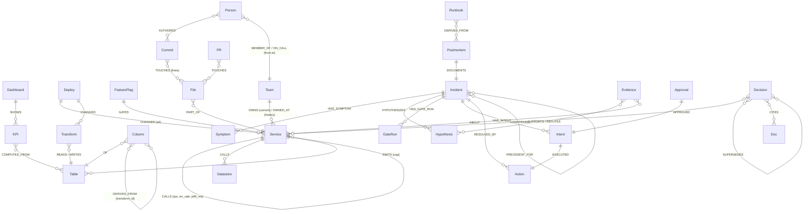

# Graph model sketch (pre-event; becomes docs/GRAPH_MODEL.md in M1)

One graph per tenant (`tenant_acme`, `tenant_globex`). All nodes carry `id` and `tenant`. Time fields: `at`, `valid_from`/`valid_to`, `updated_at`. Full label and property list: [GRAPH_MODEL.md](../GRAPH_MODEL.md). Changes from research are marked ★.

**Derived failure-flow layer** (materialised at seed time; the gate and algorithms run over it):
- `PROPAGATES_TO`: the direction failure flows (reverse of CALLS; EMITS; table → table through transforms; table → KPI; KPI → Dashboard). Properties:
  - ★ `cap` = criticality (service: 1.0 sync / 0.02 best-effort) or end-to-end row share (lineage); see `scenario_numbers.md` §1
  - `cut_cost`, `w = 1`, `domain ∈ {service, data, cross}`
- `DEPENDS_ON`: the exact reverse, for upstream walks (`algo.BFS` from the symptom).

**Why a graph and not a table or vectors** (README contrast frame, draft): two deploys in the same minute both mention "payment checkout". Text similarity ranks them equally. Only the graph can say that one of them sits on a path that can explain up to 100% of checkout's failures and the other on a path that can explain at most 2%. That answer is a path plus a flow, which a vector search cannot return.

**Indexes** (★ = changed by research):
- Range index on every `id`, plus `Deploy.at` and `Intent.idem`.
- Full-text DDL on `Service.name`, ★ `Table.name` (not `id`, because of 6.0 bug #3248), `Runbook.title`, `Decision.title`, `Postmortem.summary`.
- Vector (384, cosine) on `Incident.embedding`, `Runbook.embedding`, `Postmortem.embedding`, written only via `vecf32()`.
- ★ Unique constraint on `Intent.idem`: async, so seed polls `db.constraints()` until it is OPERATIONAL.

**Run state lives in the graph** (single-store rule): `(:Run)`, `(:StageEvent)`, `(:ToolCall)`, `(:Evidence)`, `(:Hypothesis)`, `(:GateRun)`, `(:Approval)`, `(:Intent)`, `(:Action)`. `events.jsonl`, `report.md` and `gate_runs.json` are exports.

**Graphs per instance:** `tenant_<t>`, `golden_<t>` (+`_nomem`), `audit_<t>`, `scratch_<t>_<inc>`, `whatif_<t>_<id>`, `eval_<t>_<run>_<arm>_<scn>_<trial>`, `evals`.
